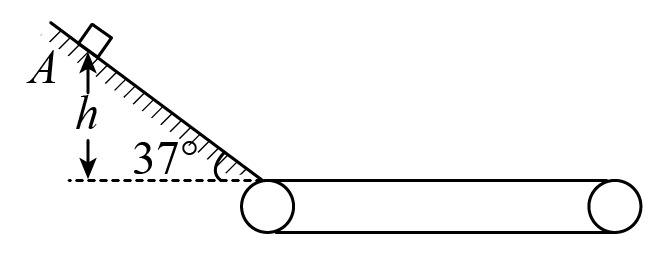

# Physics - 题目 1468

**ID**: 12980d274a3f4c8a9b5a88a281c95bf2
**年级**: Grade 10
**难度**: Medium-Hard
**题型**: Calculation

## 题目
如图所示，倾角为37°的斜面底端与水平传送带平滑对接，水平传送带足够长且在电动机的带动下保持以 $v{{}_{0}}=5{\rm{m}}/{\rm{s}}$ 的恒定速度匀速向左运动。​​​​​​​‌质量 $m=1.5{\rm{k}}{\rm{g}}$ 的小滑块从斜面上A点静止释放，在斜面和水平传送带上多次往复运动后停在斜面底端，A点距离斜面底端的高 $h=2.4{\rm{m}}$ 。小滑块与斜面间动摩擦因数 $μ{{}_{1}}=0.5$ ，与水平传送带之间动摩擦因数 $μ{{}_{2}}=0.2$ ，小滑块可视为质点，重力加速度g取 $10{\rm{m}}/{\rm{s}}{^{2}}$ ，小滑块通过斜面底端与传送带的对接点时速率不变。求：（1）小滑块第一次在传送带上运动的过程中，电动机由于传送小滑块多消耗的电能；（2）小滑块停止运动前，第2n次经过斜面最低点时的动能 $E{{}_{2n}}$ 与 $2n+1$ 次经过斜面最低点时的动能 $E{{}_{2n+1}}$ 之比 $\frac {E{{}_{2n}}}{E{{}_{2n+1}}}\left ({n\geqslant 1}\right )$ ；（3）小滑块在斜面上运动的总路程s。

## 解答

1. （1）小滑块第一次沿斜面下滑的位移大小为
2. $x{{}_{1}}=\frac {h}{{\sin}37{}^\circ }=4{\rm{m}}$
3. 小滑块第一次沿斜面下滑，有
4. $mg\left ({{\sin}37{}^\circ -μ{{}_{1}}{\cos}37{}^\circ }\right )x{{}_{1}}=\frac {1}{2}mv{{}_{1}^{2}}-0$
5. 解得
6. $v{{}_{1}}=4{\rm{m}}/{\rm{s}}$
7. 小滑块第一次在传送带上运动时间
8. $t{{}_{1}}=2\cdot \frac {v{{}_{1}}}{μ{{}_{2}}g}=4{\rm{s}}$
9. 电动机由于传送滑块多消耗的电能等于传送带克服摩擦力做功
10. $\Delta E=W{{}_{克f}}=μ{{}_{2}}mg\cdot v{{}_{0}}t{{}_{1}}=60{\rm{J}}$
11. （2）小滑块第2n次过斜面最低点后沿斜面上滑，由动能定理有
12. $-mg\left ({{\sin}37{}^\circ +μ{{}_{1}}{\cos}37{}^\circ }\right )x{{}_{2n}}=0-E{{}_{2n}}$
13. 然后小滑块沿斜面下滑第 $2n+1$ 次过斜面最低点，由动能定理有
14. $mg\left ({{\sin}37{}^\circ -μ{{}_{1}}{\cos}37{}^\circ }\right )x{{}_{2n}}=E{{}_{2n+1}}-0$
15. 解得
16. $\frac {E{{}_{2n}}}{E{{}_{2n+1}}}=5$
17. （3）分析知，滑块每次滑上传送带与离开传送带的速度大小相等，设滑块在斜面上运动的总路程为s，由能量守恒定律有
18. $mgh=μ{{}_{1}}mg{\cos}37{}^\circ \cdot s$
19. 解得滑块在斜面上运动的总路程为
20. $s=\frac {h}{μ{{}_{1}}{\cos}37{}^\circ }=6{\rm{m}}$

## 知识点

**中文**:
  - 单一物体机械能守恒定律的应用

**English**:
  - Applications for Single Body

---
