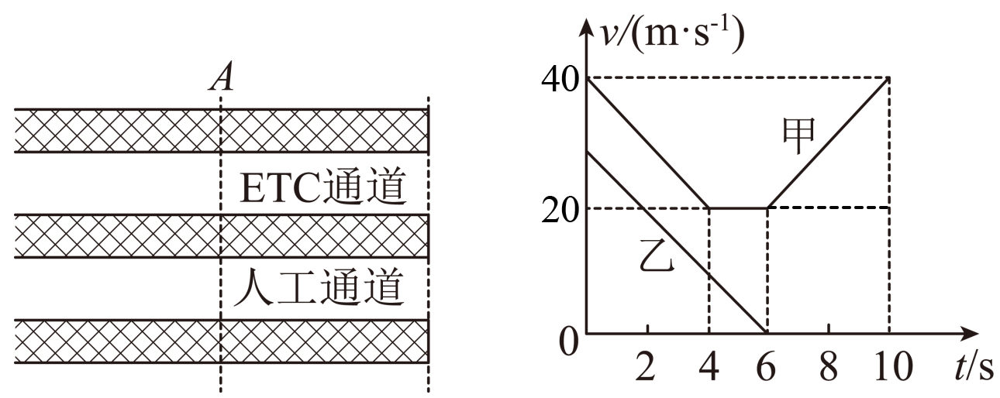

# Physics - 题目 2729

**ID**: 13e2e75fa6a64b609b35aab7e451ef9e
**年级**: Grade 10
**难度**: Medium-Hard
**题型**: Calculation

## 题目
ETC是电子不停车收费系统的简称，可以加快高速公路的通行。​​​​​​​‌甲、乙两车同向分别走ETC通道和人工通道，初速度和加速度均相同，通过后又加速到原来的速度，从甲车减速开始计时，v-t图像如图所示（10s后的图像未画出），两车在 $t=6{\rm{s}}$ 时恰好在A线（收费处）相遇，若乙车停车人工缴费耗时12s，求：（1） $t=0$ 时，甲乙两车相距多少米？（2）乙车从减速到恢复原来速度共历时多少秒？（3）走ETC通道比走人工通道节约时间为多少秒？

## 解答

1. （1）两车减速时的加速度大小： $a=\frac {Δv}{Δt}=\frac {40-20}{4}{\rm{m}}/{\rm{s}}{^{2}}=5{\rm{m}}{\rm{/}}{\rm{s}}{^{{{2}}}}$
2. 在0~6s内，甲车位移 $x{{}_{甲}}=\frac {1}{2}\times (20+40)\times 4{\rm{m}}+20\times 2{\rm{m}}=160{\rm{m}}$
3. 乙车位移 $x{{}_{乙}}=\frac {1}{2}at{^{2}}=\frac {1}{2}\times 5\times 6{^{2}}{\rm{m}}=90{\rm{m}}$
4. 则 $t=0$ 时，甲乙两车的距离为 $Δx=x{{}_{甲}}-x{{}_{乙}}=160{\rm{m}}-90{\rm{m}}=70{\rm{m}}$
5. （2）乙车减速到零用时 $t{{}_{0}}=\frac {Δv}{a}=\frac {40-0}{5}{\rm{s}}=8{\rm{s}}$
6. 从减速到恢复原来速度所用的总时间为： $t{{}_{乙}}=2t{{}_{0}}+{\rm{Δ}}t=2\times 8{\rm{s}}+12{\rm{s}}=28{\rm{s}}$
7. （3）由图知甲从减速到恢复原来速度用时 $t{{}_{甲}}=10{\rm{s}}$ ，总位移 $S{{}_{甲}}=2\times \frac {1}{2}\times (20+40)\times 4{\rm{m}}+20\times 2{\rm{m}}=280{\rm{m}}$
8. 乙车从减速到恢复原来速度用时28s，总位移 $S{{}_{乙}}=2\times \frac {1}{2}at{{}_{0}^{2}}=2\times \frac {1}{2}\times 5\times 8{^{2}}{\rm{m}}=320{\rm{m}}$
9. ${\rm{Δ}}S=S{{}_{乙}}-S{{}_{甲}}=320{\rm{m}}-280{\rm{m}}=40{\rm{m}}$
10. 甲车需用时 ${\rm{Δ}}t^{′}=\frac {{\rm{Δ}}S}{v{{}_{0}}}=\frac {40}{40}{\rm{s}}=1{\rm{s}}$
11. 走ETC通道比走人工通道节约时间 ${\rm{Δ}}t=t{{}_{乙}}-t{{}_{甲}}-{\rm{Δ}}t^{′}=\left ({28-10-1}\right ){\rm{s}}=17{\rm{s}}$

## 知识点

**中文**:
  - 刹车问题

**English**:
  - Braking Problems

---
