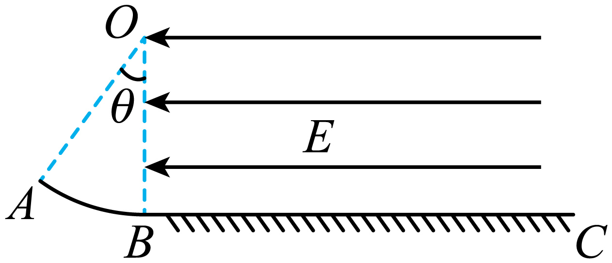

# Physics - 题目 932

**ID**: 1420c1f0a73a4b72a5308d4f9249dfdb
**年级**: Grade 10
**难度**: Medium-Hard
**题型**: Calculation

## 题目
如图所示，竖直平面内有一段绝缘光滑的圆弧轨道 $AB$ 和绝缘粗糙的水平轨道 $BC$ 相切于 $B$ ，圆弧轨道 $AB$ 的圆心为 $O$ ，半径 $R=\frac {25}{24}{\rm{m}}$ ，圆心角 $θ=37{^{\circ }}$ ，水平轨道 $BC$ 足够长，在 $OB$ 右侧存在水平向左的匀强电场，电场强度 $E=3\times 10{^{3}}{\rm{N}}/{\rm{C}}$ 。​​​​​​​‌一个质量为 $m=0.48{\rm{k}}{\rm{g}}$ ，带电量 $q=+1.0\times 10{^{-3}}{\rm{C}}$ 的小滑块（可视为质点）从A点左侧不同位置以不同的初速度水平向右抛出，均恰好从A点沿切线滑入轨道 $AB$ ，设小滑块的抛出点与A点的水平距离为 $x{\rm{m}}$ （ ${\rm{m}}$ 为单位），取重力加速度 $g=10{\rm{m}}/{\rm{s}}{^{2}}$ ， ${\rm{s}}{\rm{i}}{\rm{n}}37{^{\circ }}=0.6$ ， ${\rm{c}}{\rm{o}}{\rm{s}}37{^{\circ }}=0.8$ 。（1）若小滑块运动到A点时的速度大小为 $v{{}_{A}}$ ，求小滑块在抛出时的速度大小（用 $v{{}_{A}}$ 表示）；（2）求小滑块运动到A点时的动能 $E{{}_{{\rm{k}}A}}$ ；（3）已知小滑块与 $BC$ 轨道间的动摩擦因数 $μ=\frac {5}{12}$ ，设最大静摩擦力等于滑动摩擦力，求小滑块在 $BC$ 轨道上运动过程中，摩擦产生的总热量 $Q$ 随 $x$ 变化的关系式。

## 解答

1. （1）设小滑块水平抛出时速度为v，小球做平抛运动，在A点由速度的分解有 $v=v{{}_{A}}{\cos}θ$ ，解得 $v=0.8v{{}_{A}}$
2. （2）设小滑块在A点竖直分速度为 $v{{}_{y}}$ ，则有 $v{{}_{y}}=v{{}_{A}}\sin θ$ ，设小滑块从抛出到A点运动时间为t，则竖直方向上有 $v{{}_{y}}=gt$ ，水平方向上有 $x=vt$ ， $v=v{{}_{A}}{\cos}θ$ ，小滑块动能为 $E{{}_{{\rm{k}}A}}=\frac {1}{2}mv{{}_{A}^{2}}$ ，解得 $E{{}_{{\rm{k}}A}}=5x\left ({{\rm{J}}}\right )$
3. （3）设小滑块在水平轨道最远滑行距离为s，则从A点运动到最远点过程，由动能定理有 $mgR\left ({1-{\cos}37{^{\circ }}}\right )-\left ({qE+{\rm μm}g}\right )s=0-E{{}_{{\rm{k}}A}}$ ，解得 $s=x+0.2$ ，设返回A点的动能为 $E{{}_{{\rm{k}}A}^{^{′}}}$ ，则由最远点返回A点过程中，由动能定理有 $E{{}_{{\rm{k}}A}^{^{′}}}=\left ({qE-{\rm μm}g}\right )s-mgR\left ({1-{\cos}37{^{\circ }}}\right )$ ，解得 $E{{}_{{\rm{k}}A}^{^{′}}}=x-0.8$ ，当 $0\leqslant x\leqslant 0.8{\rm{m}}$ 时有 $E{{}_{{\rm{k}}A}^{^{′}}}\leqslant 0$ ，表明小滑块最终停在B点，从A到停止运动过程，由能量守恒有 $Q=E{{}_{{\rm{k}}A}}+mgR\left ({1-{\cos}37{^{\circ }}}\right )$ ，结合上述解得 $Q=5x+1\left ({{\rm{J}}}\right )$ ，当 $x>0.8{\rm{m}}$ 时有 $E{{}_{{\rm{k}}A}^{^{′}}}>0$ ，则小滑块会从A点离开轨道不再返回，从A到再次返回A过程，由能量守恒有 $Q=E{{}_{{\rm{k}}A}}-E{{}_{{\rm{k}}A}^{^{′}}}$ ，解得 $Q=4x+0.8\left ({{\rm{J}}}\right )$

## 知识点

**中文**:
  - 带电粒子（物体）在重力场和电场组成的复合场中的运动

**English**:
  - Motion in Gravity and Electric Composite Fields

---
