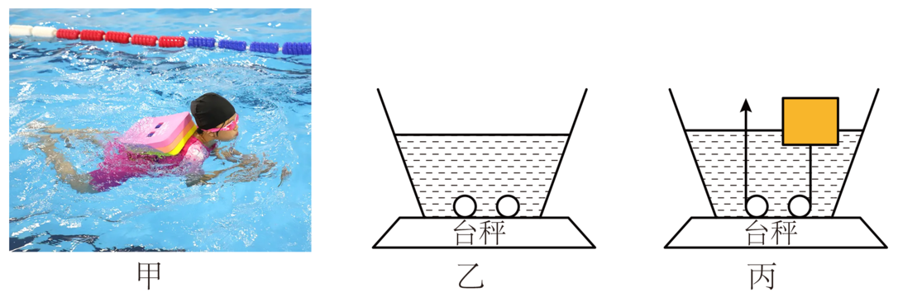

# Physics - 题目 1691

**ID**: 16db50e7d113483c82c2bf9f434c3740
**年级**: Grade 10
**难度**: Medium-Hard
**题型**: Calculation

## 题目
“背漂”是儿童练习游泳时常佩戴的一种救生装置（如图甲）．小宇和小亮为测量背漂浸没在水中时的浮力，进行了如下实验：在底部装有定滑轮的底面积为 ${{1}}{{0}}{{0}}{{0}}{\rm{c}}{\rm{m}}{^{{{2}}}}$ 的圆台形容器中加入适量的水后，再静放在水平台秤上，此时台秤的示数 $m{{}_{1}}$ 为 ${{6}}{\rm{k}}{\rm{g}}$ （如图乙）。​​​​​​​‌然后把质地均匀的长方体背漂浸入水中，用一轻质的细线通过定滑轮缓慢地将背漂拉入水中，拉力F的方向始终竖直向上，当背漂的一半体积浸入水中时，此时台秤的示数 $m{{}_{2}}$ 为 ${{5}}{\rm{k}}{\rm{g}}$ （如图丙）；当背漂浸没在水中时，台秤的示数 $m{{}_{3}}$ 为 ${{3}}{\rm{k}}{\rm{g}}$ ．不考虑滑轮的摩擦，在整个过程中水始终没有溢出，背漂不吸水、不变形，且未与容器接触， $g=10{\rm{N}}{\rm{/}}{\rm{k}}{\rm{g}}$ 。求：(1)从图乙到图丙，容器对台秤的压强变化了多少 ${\rm{P}}{\rm{a}}$ ；(2)该背漂浸没时受到的浮力是多少N；(3)若用台秤测得该背漂的质量为 ${{0}}{{.}}{{5}}{\rm{k}}{\rm{g}}$ ，穿上该背漂的儿童需把头部露出水面，才能确保儿童安全，若儿童头部的体积占人体总体积的十分之一，儿童的密度取 $1.04\times 10{^{3}}{\rm{k}}{\rm{g}}{\rm{/}}{\rm{m}}{^{{{3}}}}$ ,为确保儿童游泳时的安全，则穿着此背漂游泳的儿童的质量不能超过多少 ${\rm{k}}{\rm{g}}$ 。

## 解答

1. （1）从图乙到图丙，容器对台秤的压力的变化量 $ΔF=ΔG=(m{{}_{1}}-m{{}_{2}})g=(6-5)\times 10{\rm{N}}=10{\rm{N}}$ ，容器对台秤的压强变化了 $\Delta p=\frac {\Delta F}{S}=\frac {10}{1000\times 10{^{-4}}}{\rm{P}}{\rm{a}}=100{\rm{P}}{\rm{a}}$
2. （2）由图乙可知，整个装置的总重力 $G{{}_{1}}$ ，把整个装置和背漂看做一个整体，受到受竖直向下的总重力 $G{{}_{背漂}}+G{{}_{1}}$ 、竖直向上的拉力F和支持力 $F{{}_{支}}$ 的作用处于平衡状态，由整体受到的合力为零可得 $G{{}_{背漂}}+G{{}_{1}}=F+F{{}_{支}}$ ，则背漂的一半体积浸入水中时有 $G{{}_{背漂}}+G{{}_{1}}=F{{}_{1}}+F{{}_{支1}}$ ，背漂浸没时有 $G{{}_{背漂}}+G{{}_{1}}=F{{}_{2}}+F{{}_{支2}}$ ，因台秤对装置的支持力和装置对台秤的压力是一对相互作用力，联立两式可得 $F{{}_{2}}-F{{}_{1}}=F{{}_{支1}}-F{{}_{支2}}=(m{{}_{2}}-m{{}_{3}})g=20{\rm{N}}$ ，以背漂为研究对象可得，受到竖直向下的重力 $G{{}_{背漂}}$ 和拉力F、竖直向上浮力作用处于平衡状态，由背漂受到的合力为零可得 $G{{}_{背漂}}+F=F{{}_{浮}}$ ，则背漂的一半体积浸入水中时有 $G{{}_{背漂}}+F{{}_{1}}=\frac {1}{2}F{{}_{浮}}$ ，背漂浸没时有 $G{{}_{背漂}}+F{{}_{2}}=F{{}_{浮}}$ ，联立可得 $F{{}_{浮}}=40{\rm{N}}$
3. （3）设儿童的最大质量为 $m{{}_{人}}$ ，由于儿童和背漂整体漂浮，则 $F{{}_{浮总}}=G{{}_{总}}$ ，即 $F{{}_{浮人}}+F{{}_{浮}}=G{{}_{人}}+G{{}_{背漂}}$ ，则 $ρ{{}_{水}}g(1-\frac {1}{10})\frac {m{{}_{人}}}{ρ{{}_{人}}}+F{{}_{浮}}=m{{}_{人}}g+m{{}_{背漂}}g$ ，解得 $m{{}_{人}}=26{\rm{k}}{\rm{g}}$

## 知识点

**中文**:
  - 力学

**English**:
  - Mechanics

---
