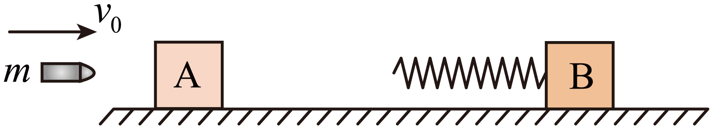

# Physics - 题目 2030

**ID**: 18c3f6903c1c4726a3fdf96b6f68aaa8
**年级**: Grade 10
**难度**: Medium-Hard
**题型**: Calculation

## 题目
如图所示，两滑块A、B位于光滑水平面上，已知A的质量 $M{{}_{{\rm{A}}}}=4.8{\rm{k}}{\rm{g}}{\rm ，B}$ 的质量 $M{{}_{{\rm{B}}}}=5{\rm{k}}{\rm{g}}$ ，滑块B的左端连有轻质弹簧，弹簧开始处于自然伸长状态。​​​​​​​‌一质量为 $m=200{\rm{g}}$ 的子弹以初速度 $v{{}_{0}}=100{\rm{m}}/{\rm{s}}$ 水平射入滑块A并留在其中，一起向右运动，通过弹簧与静止的滑块B相互作用直至分开，整个过程弹簧没有超过弹性限度，求：（1）相互作用过程中弹簧的最大弹性势能 $E{{}_{{\rm{P}}}}$ ；（2）滑块A（含子弹）与B分开时，二者的速度 $v{{}_{1}}$ 和 $v{{}_{2}}$ 。

## 解答

1. （1）在子弹射入滑块 $\mathrm{A}$ 的过程中动量守恒，有 $mv{{}_{0}}=\left ({M{{}_{{\rm{A}}}}+m}\right )v$
2. 代入数据解得 $v=4{\rm{m}}/{\rm{s}}$
3. 当滑块A（含子弹）、B速度相同时，弹簧被压缩至最短，由动量守恒定律得 $\left ({M{{}_{{\rm{A}}}}+m}\right )v=\left ({M{{}_{{\rm{A}}}}+M{{}_{{\rm{B}}}}+m}\right )v^{′}$
4. 代入数据解得 $v^{′}=2{\rm{m}}/{\rm{s}}$
5. 根据能量守恒有 $E{{}_{{\rm{p}}}}=\frac {1}{2}\left ({M{{}_{{\rm{A}}}}+m}\right )v{^{2}}-\frac {1}{2}\left ({M{{}_{{\rm{A}}}}+M{{}_{{\rm{B}}}}+m}\right )v^{′}{{^{2}}}$
6. 代入数据解得 $E{{}_{{\rm{p}}}}=20{\rm{J}}$
7. （2）当A、B分离时，设滑块A、B的速度分别为 $v{{}_{1}}、v{{}_{2}}$ ，根据动量守恒定律有 $\left ({M{{}_{{\rm{A}}}}+m}\right )v=\left ({M{{}_{{\rm{A}}}}+m}\right )v{{}_{1}}+M{{}_{{\rm{B}}}}v{{}_{2}}$
8. 能量也守恒，有 $\frac {1}{2}\left ({M{{}_{{\rm{A}}}}+m}\right )v{^{2}}=\frac {1}{2}\left ({M{{}_{{\rm{A}}}}+m}\right )v{{}_{1}^{2}}+\frac {1}{2}M{{}_{{\rm{B}}}}v{{}_{2}^{2}}$
9. 代入数据解得 $v{{}_{1}}=0,v{{}_{2}}=4{\rm{m}}/{\rm{s}}$ ，或 $v{{}_{1}}=4{\rm{m}}/{\rm{s}},v{{}_{2}}=0$ （舍去）
10. 所以当A、B分离时，滑块A的速度为0，B的速度为 $4{\rm{m}}/{\rm{s}}$ 。

## 知识点

**中文**:
  - 子弹-木块模型

**English**:
  - Bullet-Block Model

---
