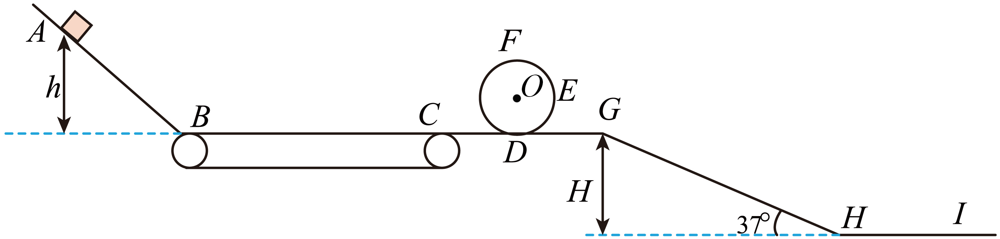

# Physics - 题目 2968

**ID**: 1dc13fc221fe4195a8405e0d3b6d95fc
**年级**: Grade 10
**难度**: Medium-Hard
**题型**: Calculation

## 题目
如图所示，一游戏装置由倾斜角为 $α$ 的光滑轨道 $AB$ 、水平传送带 $BC$ 、半径为 $R=0.2{\rm{m}}$ 的光滑竖直圆形轨道 $DEF$ 、倾角为 $37{^{\circ }}$ 斜面 $GH$ 组成， $O$ 为圆弧轨道的圆心， $B、C、D、G$ 四点在同一水平面上。​​​​​​​‌游戏时，小滑块从倾斜轨道不同高度处静止释放，经过传送带后沿圆形轨道运动，最后由 $G$ 点平抛后落在不同的区间可获不同的奖次。已知小滑块与传送带的动摩擦因数 $μ=0.6$ ， $BC$ 长为 $L=1{\rm{m}}$ ， $E$ 是圆轨道上与圆心等高的点， $G$ 距水平地面 $H$ 的高度 $H=1.8{\rm{m}}$ ，小滑块经 $B$ 处时速度大小不变，小滑块可视为质点，其余阻力均不计， ${\rm{s}}{\rm{i}}{\rm{n}}37{^{\circ }}=0.6$ ， $g$ 取 $10{\rm{m}}/{\rm{s}}{^{2}}$ ，传送带开始处于静止状态。（1）若小滑块质量为 $0.1{\rm{k}}{\rm{g}}$ ，释放的高度 $h=1.2{\rm{m}}$ ，求小滑块通过 $E$ 点时对轨道的压力；（2）为了使小滑块进入圆轨道且不脱离圆轨道 $DEF$ ，求小滑块释放高度的范围。

## 解答

1. （1）根据题意，小滑块从 $\mathrm{A}$ 到 $E$ 过程中，由动能定理有 $mg\left ({h-R}\right )-{\rm μm}gL=\frac {1}{2}mv{{}_{E}^{2}}-0$
2. 在 $E$ 点，由牛顿第二定律得 $F{{}_{{\rm{N}}}}=\frac {mv{{}_{E}^{2}}}{R}$
3. 联立得 $F{{}_{{\rm{N}}}}=4{\rm{N}}$
4. 由牛顿第三定律得 $F{{}_{压{{ }}}}=F{{}_{{\rm{N}}}}=4{\rm{N}}$ ，方向水平向右。
5. （2）滑块恰好进入到圆轨道，由动能定理得 $mgh-{\rm μm}gL=0-0$
6. 解得 $h=0.6{\rm{m}}$
7. 使小滑块进入圆轨道，则 $h⩾0.6{\rm{m}}$
8. ①滑块恰好到 $E$ 点，由动能定理得 $mg\left ({h-R}\right )-{\rm μm}gL=0-0$
9. 解得 $h=0.8{\rm{m}}$
10. 使小滑块进入圆轨道且不脱离圆轨道，则 $0.6{\rm{m}}⩽h⩽0.8{\rm{m}}$
11. ②滑块恰好到 $F$ 点，由动能定理得 $mg\left ({h-2R}\right )-{\rm μm}gL=\frac {1}{2}mv{{}_{F}^{2}}-0$
12. 在 $F$ 点，由牛顿第二定律得 $mg=\frac {mv{{}_{F}^{2}}}{R}$
13. 解得 $h=1.1{\rm{m}}$
14. 要使小滑块进入圆轨道且不脱离圆轨道，则 $h⩾1.1{\rm{m}}$

## 知识点

**中文**:
  - 应用动能定理求解多阶段、多过程问题

**English**:
  - Multi-stage/Multi-process Problems

---
