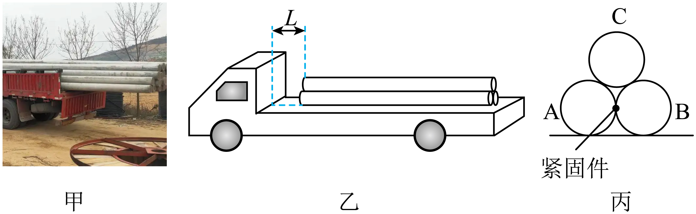

# Physics - 题目 909

**ID**: 22d7d15e72524c718f58f8aea223bf6f
**年级**: Grade 10
**难度**: Medium-Hard
**题型**: Calculation

## 题目
如图甲所示为一运输电线杆的货车，由于惯性，电线杆极易在货车急刹车时撞击驾驶室，造成人员伤亡和财产损失；运输过程可简化为如图乙所示，车厢内叠放有三根完全相同的圆柱体电线杆A、B、C，其横截面如图丙所示，其中A、B用紧固件连接在一起后放置在水平车厢上，C叠放在AB正上方且三个电线杆两两相切。​​​​​​​‌已知电线杆前端与驾驶室间的距离为L，每根电线杆的质量均为m，电线杆与车厢底部的动摩擦因数为 $μ$ ，电线杆间的动摩擦因数为 $\frac {\sqrt {3}}{3}μ$ ，最大静摩擦力等于滑动摩擦力，重力加速度为g，初始时货车以大小 $v{{}_{0}}=\sqrt {3μgL}$ 的速度在平直道路上匀速行驶，司机发现前方有限速标识后立即以大小为 $\frac {4}{3}μg$ 的加速度做匀减速运动，求：(1)货车匀速行驶时，C与A之间相互作用的弹力大小；(2)货车匀减速运动时，C和AB的加速度大小；(3)若要避免电线杆撞上驾驶室，货车匀减速运动时间t后，立即以大小为 $\frac {4}{3}μg$ 的加速度做匀加速运动，求时间t的最大值。

## 解答

1. （1）对C受力分析如图所示，由平衡条件
2. $2N{\cos}30{}\degree =mg$
3. 解得
4. $N=\frac {\sqrt {3}}{3}mg$
5. 
6. （2）货车匀减速运动时，假设货车与AB之间、AB与C之间均有相对滑动，设C所受摩擦力大小为 $f{{}_{{\rm{C}}}}{\rm ，C}$ 的加速度大小为 $a{{}_{1}}{\rm ，AB}$ 的加速度大小为 $a{{}_{2}}$ ，已知货车加速度 $a{{}_{3}}=\frac {4}{3}μg$ ，则
7. 对C
8. $f{{}_{{\rm{C}}}}=2\frac {μ}{\sqrt {3}}N$
9. $f{{}_{{\rm{C}}}}=ma{{}_{1}}$
10. 对AB
11. $3{\rm μm}g-f{{}_{{\rm{C}}}}=2ma{{}_{2}}$
12. 解得
13. $a{{}_{1}}=\frac {2}{3}μg$
14. $a{{}_{2}}=\frac {7}{6}μg$
15. 分析得
16. $a{{}_{1}}<a{{}_{2}}<a{{}_{3}}$
17. 假设成立。
18. （3）若时间为最大值 $t{{}_{0}}$ 时，恰好没有相撞．
19. 货车以 $a{{}_{3}}=\frac {4}{3}μg$ 的加速度匀减速运动 $t{{}_{0}}$ 时间后
20. 对C
21. $v{{}_{1}}=v{{}_{0}}-a{{}_{1}}t{{}_{0}}$
22. 对车
23. $v{{}_{3}}=v{{}_{0}}-a{{}_{3}}t{{}_{0}}$
24. 前t时间内C与车的相对位移
25. $Δx{{}_{1}}=\frac {v{{}_{0}}+v{{}_{1}}}{2}t{{}_{0}}-\frac {v{{}_{0}}+v{{}_{3}}}{2}t{{}_{0}}=\frac {a{{}_{3}}-a{{}_{1}}}{2}t{{}_{0}^{2}}$
26. 解得
27. $Δx{{}_{1}}=\frac {1}{3}μgt{{}_{0}^{2}}$
28. 车加速过程中先与AB达到共速，假设货车与AB保持相对静止一起匀加速，则
29. $f{{}_{{\rm{A}}{\rm{B}}}}+f{{}_{{\rm{C}}}}=2ma{{}_{3}}$
30. 解得
31. $f{{}_{{\rm{A}}{\rm{B}}}}=2{\rm μm}g<f{{}_{{\rm \max }}}=3{\rm μm}g$
32. 假设成立．
33. 所以AB会与车一起匀加速，此时C仍然减速，加速度为 $a{{}_{1}}$ ，设从货车匀减速运动 $t{{}_{0}}$ 时到货车与C共速用时为 $t{{}_{1}}$ ，则有
34. $v{{}_{3}}+a{{}_{3}}t{{}_{1}}=v{{}_{1}}-a{{}_{1}}t{{}_{1}}=v{{}_{共}}$
35. 解得
36. $t{{}_{1}}=\frac {1}{3}t{{}_{0}}$
37. 在此过程中
38. ${\rm{Δ}}x{{}_{2}}=\frac {v{{}_{共}}+v{{}_{1}}}{2}t{{}_{1}}-\frac {v{{}_{共}}+v{{}_{3}}}{2}t{{}_{1}}=\frac {\left ({a{{}_{3}}-a{{}_{1}}}\right )}{2}t{{}_{0}}t{{}_{1}}$
39. 解得
40. $Δx{{}_{2}}=\frac {1}{9}μgt{{}_{0}^{2}}$
41. 则前 $t{{}_{0}}+t{{}_{1}}$ 时间内C与车的相对位移
42. $Δx{{}_{总}}=Δx{{}_{1}}+Δx{{}_{2}}=\frac {4}{9}μgt{{}_{0}^{2}}=L$
43. 解得
44. $t{{}_{0}}=\frac {3}{2}\sqrt {\frac {L}{μg}}$
45. 注： $v-t$ 图像如图所示
46. 

## 知识点

**中文**:
  - 牛顿运动定律与图像结合问题
  - 用正交分解法分析问题

**English**:
  - Newton's Laws and Graphs
  - Problem Analysis using Orthogonal Decomposition

---
