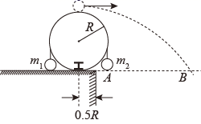

# Physics - 题目 2649

**ID**: 25914cd83adf42bdaae3d9e265c21085
**年级**: Grade 10
**难度**: Medium-Hard
**题型**: Calculation

## 题目
如图所示，半径为 $R$ 的光滑圆柱体被固定在水平台上，圆柱体中心离台边的水平距离为 $0.5R$ ，用轻绳跨过圆柱体将质量为 $m{{}_{1}}$ 的小球与质量为 $m{{}_{2}}$ 的小球相连，开始时将质量为 $m{{}_{1}}$ 的小球控制住放在平台上，两边轻绳竖直。​​​​​​​‌现在释放质量为 $m{{}_{1}}$ 的小球，使质量为 $m{{}_{1}}$ 的小球和质量为 $m{{}_{2}}$ 的小球分别由静止开始运动，当质量为 $m{{}_{1}}$ 的小球上升到圆柱体的最高点时，绳子突然断了，质量为 $m{{}_{1}}$ 的小球恰能做平抛运动，不计空气阻力，重力加速度为 $g$ 。（1）质量为 $m{{}_{1}}$ 的小球做平抛运动的初速度 $v$ 多大？（2） $m{{}_{2}}$ 应为 $m{{}_{1}}$ 的多少倍？（3）质量为 $m{{}_{1}}$ 的小球在做平抛运动的过程中，恰能经过与台面等高的 $B$ 点，求 $B$ 点离台边的距离 $s{{}_{{\rm{A}}{\rm{B}}}}$ 。

## 解答

1. （1）若质量为 $m{{}_{1}}$ 的小球恰能做平拋运动，说明在绳子断的时刻圆柱体对小球无弹力，则由牛顿第二定律有
2. $m{{}_{1}}g=\frac {m{{}_{1}}v{^{2}}}{R}$
3. 解得
4. $v=\sqrt {gR}$
5. （2）当质量为 $m{{}_{1}}$ 的小球上升 $2R$ 到达圆柱体最高点时，质量为 $m{{}_{2}}$ 的小球下降了 $\left ({R+\frac {π}{2}R}\right )$ ，由质量为 $m{{}_{1}}、m{{}_{2}}$ 的小球和细绳组成的系统机械能守恒，根据机械能守恒定律有
6. $m{{}_{2}}gR\left ({1+\frac {π}{2}}\right )-m{{}_{1}}g\cdot 2R=\frac {1}{2}\left ({m{{}_{1}}+m{{}_{2}}}\right )v{^{2}}$
7. 解得
8. $\frac {m{{}_{2}}}{m{{}_{1}}}=\frac {5}{1+π}$
9. （3）根据平拋运动的规律，质量为 $m{{}_{1}}$ 的小球从圆柱体最高点到 $B$ 点的运动时间
10. $t=\sqrt {\frac {2\times 2R}{g}}=2\sqrt {\frac {R}{g}}$
11. 则水平位移
12. $x=vt=2R$
13. 故 $B$ 点离台边的距离
14. $s{{}_{{\rm{A}}{\rm{B}}}}=x-0.5R=1.5R$

## 知识点

**中文**:
  - 绳球模型圆周运动中机械能守恒定律的应用

**English**:
  - String-Ball Circular Motion Models

---
