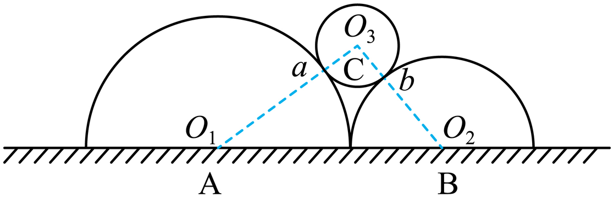

# Physics - 题目 1462

**ID**: 2858334425e4441890c9bb08a05c3115
**年级**: Grade 10
**难度**: Medium-Hard
**题型**: Calculation

## 题目
如图所示，通过插销分别固定的半圆柱体A、B并排放在粗糙水平面上，光滑圆柱体C静置其上，a、b为切点。​​​​​​​‌已知A、B、C密度相同且等长，半径之比为 $3:2:1$ ，圆柱体C的质量为m，地面与半圆柱体A、B接触面之间的动摩擦因数均为0.25，重力加速度为g，最大静摩擦力等于滑动摩擦力， $\sin 37\degree =0.6$ ， ${\cos}37\degree =0.8$ 。(1)求圆柱体C受到半圆柱体A、B的支持力 $F{{}_{a}}$ 、 $F{{}_{b}}$ 的大小；(2)若解除对半圆柱体B的固定，求解除瞬间半圆柱体B受到的摩擦力大小：(3)若解除对半圆柱体A、B的固定，同时在圆柱体C上施加一个竖直向下、且缓慢增大的外力F，试判断，半圆柱体A、B谁先滑动，求滑动瞬间外力F的大小。

## 解答

1. （1）根据题目半径之比为3:2:1，由几何关系可知O_{1}和O_{3}连线与水平方向的夹角为37°，O_{2}和O_{3}连线与水平方向的夹角为53°，对圆柱体C受力分析，由正交分解可知 $F{{}_{a}}=mg\sin 37{}\degree $ ， $F{{}_{b}}=mg{\cos}37{}\degree $ ，解得 $F{{}_{a}}=\frac {3}{5}mg$ ， $F{{}_{b}}=\frac {4}{5}mg$
2. （2）根据题意，半圆柱体与圆柱体密度相同，且ABC等长，半径之比3:2:1，则 $m{{}_{{\rm{A}}}}=\frac {9}{2}m{{}_{{\rm{C}}}}=\frac {9}{2}m，m{{}_{{\rm{B}}}}=2m{{}_{{\rm{C}}}}=2m$ ，若解除对半圆柱体B的固定，对圆柱体B受力分析，竖直方向满足 $F{{}_{{\rm{N}}{\rm{B}}}}=F{{}_{b}}\sin 53{}\degree +m{{}_{{\rm{B}}}}g$ ，解得 $F{{}_{{\rm{N}}{\rm{B}}}}=\frac {66}{25}mg$ ，最大静摩擦力等于滑动摩擦力，则B与地面之间的最大静摩擦力为 $F{{}_{{\rm{f}}{\rm{B}}{\rm{m}}{\rm{a}}{\rm{x}}}}=μF{{}_{{\rm{N}}{\rm{B}}}}$ ，解得 $F{{}_{{\rm{f}}{\rm{B}}{\rm{m}}{\rm{a}}{\rm{x}}}}=0.66mg$ ，水平方向满足 $F{{}_{{\rm{B}}x}}=F{{}_{b}}{\cos}53{}\degree $ ，解得 $F{{}_{{\rm{B}}x}}=0.48mg<F{{}_{{\rm{f}}{\rm{B}}{\rm{m}}{\rm{a}}{\rm{x}}}}=0.66mg$ ，则B物体与地面未发生相对滑动，摩擦力为静摩擦力，大小为 $f{{}_{{\rm{B}}}}=F{{}_{{\rm{B}}x}}=0.48mg$
3. （3）设施加一个外力 $F{{}_{1}}$ 后，A与地面之间先达到最大静摩后，发生相对滑动，则根据受力分析可知 $μ\left [\left ({F{{}_{1}}+m{{}_{{\rm{C}}}}g}\right )\sin 37{}\degree \cdot \sin 37{}\degree +m{{}_{{\rm{A}}}}g\right ]=\left ({F{{}_{1}}+m{{}_{{\rm{C}}}}g}\right )\sin 37{}\degree \cdot {\cos}37{}\degree $ ，解得 $F{{}_{1}}=\frac {49}{26}mg$ ，设施加一个外力 $F{{}_{2}}$ 后，B与地面之间先达到最大静摩后，发生相对滑动，则根据受力分析可知 $μ\left [\left ({F{{}_{2}}+m{{}_{{\rm{C}}}}g}\right ){\cos}37{}\degree \cdot {\cos}37{}\degree +m{{}_{{\rm{B}}}}g\right ]=\left ({F{{}_{2}}+m{{}_{{\rm{C}}}}g}\right ){\cos}37{}\degree \cdot \sin 37{}\degree $ ，解得 $F{{}_{2}}=\frac {9}{16}mg$ ，因为 $F{{}_{1}}=\frac {49}{26}mg>F{{}_{2}}=\frac {9}{16}mg$ ，则外力大小为 $F{{}_{2}}$ 时，B相对地面发生滑动，则半圆柱B先滑动，此时外力F的大小为 $\frac {9}{16}mg$ 。

## 知识点

**中文**:
  - 在共点力平衡中整体法与隔离法的应用

**English**:
  - Whole and Isolation Methods in Equilibrium

---
