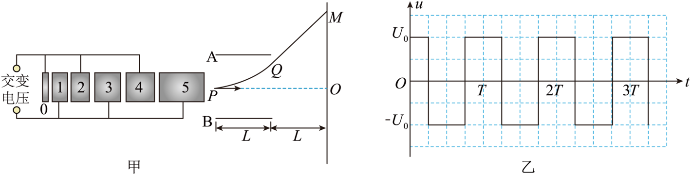

# Physics - 题目 1201

**ID**: 2f2fb65d39f34cfa884c72a60b39c1b0
**年级**: Grade 10
**难度**: Medium-Hard
**题型**: Calculation

## 题目
如图甲所示，某装置由直线加速器、偏转电场和荧光屏三部分组成。​​​​​​​‌直线加速器由5个横截面积相同的金属圆筒依次排列，其中心轴线在同一直线上，圆筒的长度依照一定的规律依次增加。序号为奇数的圆筒和交变电源的一个极相连，序号为偶数的圆筒和该电源的另一个极相连。交变电源两极间电势差的变化规律如图乙所示，在t=0时，奇数圆筒相对偶数圆筒的电势差为正值，此时位于序号为0的金属圆板中央的一个电子，在圆板和圆筒1之间的电场中由静止开始加速，沿中心轴线冲进圆筒1，电子运动到圆筒与圆筒之间各个间隙中时，都能恰好使所受静电力的方向与运动方向相同而不断加速，且已知电子的质量为m、电荷量为e、交变电压的绝对值为U_{0}，周期为T，电子通过圆筒间隙的时间可以忽略不计。偏转电场由两块相同的平行金属极板A与B组成，板长和板间距均为L，两极板间的电压U_{AB}=8U_{0}，两板间的电场可视为匀强电场，忽略边缘效应，距两极板右侧L处竖直放置一足够大的荧光屏。电子自直线加速器射出后，沿两板的中心线PO射入偏转电场，并从另一侧的Q点射出，最后打到荧光屏上。试求：（1）第4个金属圆筒的长度s；（2）电子打在荧光屏上的M点到O点的距离l_{OM}；（3）若两极板间的电压U_{AB}可调节，要使电子能打在荧光屏上距O点0.5L ~2L的范围内，求U_{AB}的取值范围。

## 解答

1. （1）设电子进入第4个圆筒后的速度为v_{1}，根据动能定理有 $4U{{}_{0}}e=\frac {1}{2}mv{{}_{1}^{2}}$ ，
2. 得 $v{{}_{1}}=2\sqrt {\frac {2U{{}_{0}}e}{m}}$ ，
3. 第4个圆筒的长度为 $s=v{{}_{1}}t=v{{}_{1}}\frac {T}{2}=T\sqrt {\frac {2U{{}_{0}}e}{m}}$ 。
4. （2）设电子从第5个圆筒射出后的速度为v_{2}，根据动能定理有 $5U{{}_{0}}e=\frac {1}{2}mv{{}_{2}^{2}}$  ，
5. 得 $v{{}_{2}}=\sqrt {\frac {10U{{}_{0}}e}{m}}$ ，
6. 电子在偏转电场中运动的加速度是 $a=\frac {F}{m}=\frac {eE}{m}=\frac {eU{{}_{AB}}}{{\rm mL}}$  ，
7. 电子射出偏转电场时，在垂直于板面方向偏移的距离为 $y=\frac {1}{2}at{^{2}}$ ，
8. 其中t为飞行时间。由于电子在平行于板面的方向不受力，所以在这个方向做匀速直线运动，由L=v_{2}t可求得 $t=\frac {L}{v{{}_{2}}}{\rm ，}$ ，
9. 且有题意得U_{AB}=8U_{0}，
10. 代入得到 $y=\frac {2L}{5}$  $y=\frac {2}{5}L$ ，
11. 由类平抛运动的结论，结合几何关系可知： $\frac {y}{l{{}_{OM}}}=\frac {\frac {L}{2}}{\frac {L}{2}+L}$  $\frac {y}{l{{}_{OM}}}=\frac {\frac {L}{2}}{\frac {L}{2}+L}$ ，
12. 解得 $l{{}_{OM}}=\frac {6}{5}L$ 。
13. （3）由 $\frac {y^{′}}{l{{}_{OM}}^{′}}=\frac {\frac {L}{2}}{\frac {L}{2}+L}$  $\frac {y^{′}}{l{{}_{OM}^{^{′}}}}=\frac {\frac {L}{2}}{\frac {L}{2}+L}{\rm （0.5\mathit{L}≤l_{OM}≤2\mathit{L}）}$ ，
14. 得 $\frac {1}{6}L⩽y^{′}⩽\frac {2}{3}L$  ，
15. 且要使电子不打板，电子在垂直于板面方向偏移的距离： $0⩽y^{′}⩽\frac {1}{2}L$ ，
16. 综上得 $\frac {1}{6}L⩽y^{′}⩽\frac {1}{2}L$  ，
17. 又因为 $y{^{\prime }}=\frac {1}{2}\frac {eU{{}_{AB}}}{{\rm mL}}(\frac {L}{v{{}_{2}}}){^{2}}$ ，
18. 得 $\frac {10}{3}U{{}_{0}}⩽U{{}_{AB}}⩽10U{{}_{0}}$ ，
19. 或 $-10U{{}_{0}}⩽U{{}_{AB}}⩽-\frac {10}{3}U{{}_{0}}$ 。

## 知识点

**中文**:
  - 带电粒子在交变电场中的运动
  - 应用动能定理求解多阶段、多过程问题

**English**:
  - Motion in Alternating Electric Field
  - Multi-stage/Multi-process Problems

---
