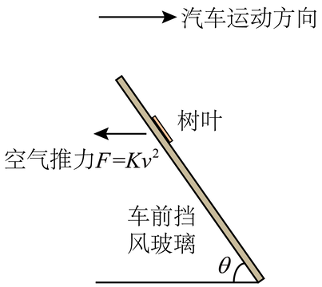

# Physics - 题目 1127

**ID**: 31e323469f8f4b00948e891eb85279dc
**年级**: Grade 10
**难度**: Medium-Hard
**题型**: Calculation

## 题目
在水平道路上行驶的汽车，挡风玻璃与水平面成角θ=37°，如图所示，无风的天气里，车辆行驶时，静止在挡风玻璃上的树叶受到水平方向空气的推力，推力方向与车前进方向相反，大小由车速v决定，且满足F=Kv^{2}。​​​​​​​‌现只讨论树叶沿挡风玻璃向下或向上的运动，横向可视为静止无运动，已知树叶质量m=0.01kg，K=0.75×10^{-3}kg/m，取g=10m/s^{2}，cos37°=0.8，sin37°=0.6。(1)若忽略树叶与玻璃间的摩擦力，求树叶静止在挡风玻璃上时车匀速运动的速度大小v_{0}；(2)若树叶与玻璃间有摩擦，且最大静摩擦力等于滑动摩擦力，某次经精密测量发现当匀速运动的车速为 $\frac {2}{3}v{{}_{0}}$ 时，原来静止在挡风玻璃上的树叶恰好要开始沿挡风玻璃向下运动，求树叶与玻璃间的动摩擦因数μ；(3)在（2）中的动摩擦因数μ条件下，当车以 $2\sqrt {3}v{{}_{0}}$ 的速度匀速运动时，原本被雨刷夹在挡风玻璃底部的树叶突然失去雨刷的夹持。树叶的运动看做是相对挡风玻璃向上的匀加速直线运动（忽略树叶在挡风玻璃上运动时速度的变化对空气推力的影响），树叶由玻璃底部开始运动到离开挡风玻璃所用时间为0.2s，求挡风玻璃斜面长度（结果保留两位有效数字）。

## 解答

1. （1）树叶静止时受力平衡，沿玻璃斜面方向有F_{1}cosθ-mgsinθ=0，又因为 $F{{}_{1}}=Kv{{}_{0}^{2}}$ ，解得v_{0}=10m/s
2. （2）当车速为 $\frac {2}{3}v{{}_{0}}$ 时，发现树叶恰好向下运动，此时为临界状态，树叶加速度为0，则 $F{{}_{2}}{\cos}θ+μF{{}_{N}}-mg\sin θ=0$ ， $F{{}_{N}}=F{{}_{2}}\sin θ+mg{\cos}θ$ ，联立解得 $μ=\frac {1}{3}$
3. （3）失去夹持时树叶相对挡风玻璃的初速度为零，树叶相对挡风玻璃做初速度为零的匀加速直线运动，设加速度为a，有 $F{\cos}θ-mg\sin θ-f=ma$ ， $F{{}_{N}}=F\sin θ+mg{\cos}θ$ ， $f=μF{{}_{N}}$ ，解得 $a=\frac {136}{3}{\rm{m}}{\rm{/}}{\rm{s}}{^{{{2}}}}\approx 45{\rm{m}}{\rm{/}}{\rm{s}}{^{{{2}}}}$ ，设玻璃的长度为L，则 $L=\frac {1}{2}at{^{2}}$ ，解得L=0.90m（或0.91m）

## 知识点

**中文**:
  - 用正交分解法分析问题

**English**:
  - Problem Analysis using Orthogonal Decomposition

---
