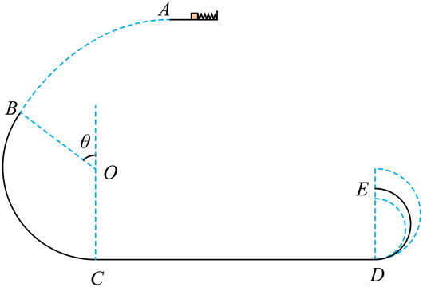

# Physics - 题目 2371

**ID**: 34d6a6fcd35f4327a230ed88a27bc3e5
**年级**: Grade 10
**难度**: Medium-Hard
**题型**: Calculation

## 题目
如图所示，水平地面CD与圆心为O、半径R=3m的光滑圆弧轨道 $\overset{\frown}{{BC}}$ 在C点处相切，与半径可调整的光滑半圆轨道 $\overset{\frown}{{DE}}$ 在D点处相切，BO与竖直方向的夹角θ=53°。​​​​​​​‌水平地面上方的光滑水平平台右侧竖直挡板连接着水平轻弹簧。将可视为质点、质量m=0.3kg的物块压缩弹簧至某位置，由静止释放物块，物块离开弹簧后从A点飞离平台，恰好能从B点沿切线方向进入圆弧轨道 $\overset{\frown}{{BC}}$ 。一段时间后物块从E点飞出后落至水平地面上的F点（图中未画出）。已知物块与水平地面间的动摩擦因数μ=0.48，C、D两点间的距离L=10m，A、B两点间的高度差h=3.2m，不计空气阻力，取重力加速度大小g=10m/s^{2}，sin53°=0.8，cos53°=0.6。求：（1）释放物块前瞬间弹簧的弹性势能；（2）物块经过圆弧轨道 $\overset{\frown}{{BC}}$ 上C点时对轨道的压力大小；（3）F、D两点间的最大距离d_{max}。

## 解答

1. （1）设物块经过A点时的速度大小为v_{0}，运动至B点时竖直方向的分速度大小为v_{y}，物块从A点到B点做平抛运动，竖直方向上有 $v{{}_{y}^{2}}=2gh$
2. 物块运动到B点时速度方向与轨道相切，有 ${\rm{t}}{\rm{a}}{\rm{n}}θ=\frac {v{{}_{y}}}{v{{}_{0}}}$
3. 物块从被释放至运动到A点有 $E{{}_{弹}}=\frac {1}{2}mv{{}_{0}^{2}}$
4. 代入相关已知数据，解得 $v{{}_{y}}=8{\rm{m}}/{\rm{s}}$ ， $v{{}_{0}}=6{\rm{m}}/{\rm{s}}$ ， $E{{}_{弹}}=5.4{\rm{J}}$
5. （2）物块经过B点时的速度大小 $v{{}_{1}}=\sqrt {v{{}_{0}^{2}}+v{{}_{y}^{2}}}=10{\rm{m}}/{\rm{s}}$
6. 设物块经过圆弧轨道 $\overset{\frown}{{BC}}$ 上的C点时的速度大小为v_{2}，则物块从B点运动到C点有 $mgR\left ({1+{\rm{c}}{\rm{o}}{\rm{s}}θ}\right )=\frac {1}{2}mv{{}_{2}^{2}}-\frac {1}{2}mv{{}_{1}^{2}}$
7. 物块经过圆弧轨道 $\overset{\frown}{{BC}}$ 上的C点时有 $F{{}_{{\rm{N}}}}-mg=\frac {mv{{}_{2}^{2}}}{R}$
8. 由牛顿第三定律知，物块经过C点时对轨道的压力大小为 $F=F{{}_{{\rm{N}}}}$
9. 解得 $v{{}_{2}}=14{\rm{m}}/{\rm{s}}$ ， $F=22.6{\rm{N}}$
10. （3）物块从C点运动到D点有 $-{\rm μm}gL=\frac {1}{2}mv{{}_{3}^{2}}-\frac {1}{2}mv{{}_{2}^{2}}$
11. 解得 $v{{}_{3}}=10{\rm{m}}/{\rm{s}}$
12. 设 $\overset{\frown}{{DE}}$ 半径为r，物块从D点运动到E点有 $-2mgr=\frac {1}{2}mv{{}_{4}^{2}}-\frac {1}{2}mv{{}_{3}^{2}}$
13. 物块从E点飞出做平抛运动有 $2r=\frac {1}{2}gt{^{2}}$
14. F、D两点间的距离 $d=v{{}_{4}}t$
15. 联立可得 $d=\sqrt {-16r{^{2}}+\frac {4v{{}_{3}^{2}}}{g}r}=\sqrt {-{\left({4r-\frac {v{{}_{3}^{2}}}{2g}}\right)^{2}}+\frac {v{{}_{3}^{4}}}{4g{^{2}}}}$
16. 可知当 $r=\frac {v{{}_{3}^{2}}}{8g}$ 时有 $d{{}_{{\rm{m}}{\rm{a}}{\rm{x}}}}=\frac {v{{}_{3}^{2}}}{2g}$
17. 因此F、D两点间的最大距离 $d{{}_{{\rm{m}}{\rm{a}}{\rm{x}}}}=5{\rm{m}}$ 。

## 知识点

**中文**:
  - 平抛运动与斜面、圆轨道相结合问题
  - 应用动能定理求解多阶段、多过程问题

**English**:
  - Horizontal Projectile on Inclined Planes and Circular Tracks
  - Multi-stage/Multi-process Problems

---
