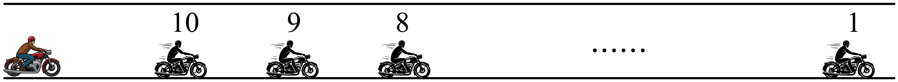

# Physics - 题目 1443

**ID**: 3800947dee7d48febed8c0788238bec9
**年级**: Grade 10
**难度**: Medium-Hard
**题型**: Calculation

## 题目
2024环广西公路自行车世界巡回赛于10月15日在防城港开赛，赛事持续六天，共设六个赛段，赛道形式包含平路绕圈，环山丘陵和终点爬坡。​​​​​​​‌竞赛总距离为1021.8公里。为让观众更清晰的观看赛事，常有跟拍摩托车跟随记录精彩过程。在某直线路段，由10辆自行车构成的车队正以 $v=8{\rm{m}}{\rm{/}}{\rm{s}}$ 的速度匀速直线行驶，相邻两自行车间距10m，在车队后面跟拍摩托车以 $v{{}_{0}}=18{\rm{m}}{\rm{/}}{\rm{s}}$ 的速度在另一条平行车道上同向行驶（忽略两平行车道之间的距离），所有车均视为质点。当摩托车与10号车距离为19m时，摩托车开始以加速度 $a=0.5{\rm{m}}{\rm{/}}{\rm{s}}{^{{{2}}}}$ 刹车做匀减速运动， 求：（1）摩托车的速度和自行车队速度相等时，摩托车和自行车队前进的位移各是多少？（2）摩托车与车队交汇的相遇时间（即两次遇到10号车的时间间隔）；（3）摩托车与10号车距离为19m时记为零时刻，10号自行车突然爆胎并立即做匀减速直线运动，经2s时间停下，摩托车驾驶员在10号车爆胎瞬间，经0.5s反应时间， 以大小为6.0m/s²的加速度作匀减速运动，试写出摩托车在停车前与10号车的距离x和时间t的关系（取 $\sqrt {10}\approx 3.2$ ）。

## 解答

1. （1）当摩托车的速度和自行车队速度相等时，由 $v{{}_{2}}-at=v{{}_{1}}$
2. 得 $t=20{\rm{s}}$
3. 此时摩托车前进的位移 $x{{}_{2}}=\frac {v{{}_{0}}+v}{2}\cdot t=260{\rm{m}}$
4. 自行车队前进的位移 $x{{}_{1}}=v\cdot t=160{\rm{m}}$
5. （2）摩托车与10号车相遇，则有 $x^{′}{{{}_{2}}}-x^{′}{{{}_{1}}}=x{{}_{0}}$
6. 则 $v{{}_{0}}t-\frac {1}{2}at{^{2}}-v\cdot t=19$
7. 解得 $t{{}_{1}}=2{\rm{s}}$
8. （ $t{{}_{2}}=38s>\frac {18}{0.5}=36{\rm{s}}$ 舍去）
9. 则当摩托车停车时 $x^{′}{{{}_{2}}}=\frac {v{{}_{0}^{2}}}{2a}=324{\rm{m}}$ ， $x^{′}{{{}_{1}}}=v\cdot t=8\times 36=288{\rm{m}}$
10. 此时两者相距 $324-288-19=17{\rm{m}}$ ， ${\rm{Δ}}t=\frac {17}{8}=2.125{\rm{s}}$
11. 故第二次相遇是在38.125s，两次相遇的时间间隔为 $38.125-2=36.125{\rm{s}}$
12. （3）自行车爆胎后在2s内停下：有 $a{{}_{1}}=\frac {{\rm{Δ}}v}{{\rm{Δ}}t}=\frac {0-8}{2}=-4{\rm{m}}/{\rm{s}}{^{2}}$
13. 若以摩托车所在处为原点建立一维坐标系，则自行车的位置 $x{{}_{自}}=x{{}_{0}}+\left ({vt-\frac {1}{2}a{{}_{1}}t{^{2}}}\right )\left ({0⩽t⩽2{\rm{s}}}\right )$
14. 得 $x{{}_{自}}=19+\left ({8t-2t{^{2}}}\right )\left ({0⩽t⩽2{\rm{s}}}\right )$ ， $x{{}_{自}}=27\left ({t⩾2{\rm{s}}}\right )$
15. 摩托车的位置 $x{{}_{摩}}=v{{}_{0}}t-\frac {1}{2}at{^{2}}\left ({0⩽t⩽0.5{\rm{s}}}\right )$
16. 得
17. $x{{}_{摩}}=18t-0.25t{^{2}}\left ({0⩽t⩽0.5s}\right )$  $t{{}_{3}}=0.5{\rm{s}}$ 时， $x{{}_{摩0.5}}=8.9375{\rm{m}}$ ，此时 $v{{}_{0.5}}=v{{}_{0}}-at{{}_{3}}=17.75{{\rm{m}}}/{{\rm{s}}}$
18. 摩托车完全停下的时间 $t{{}_{总}}=t{{}_{3}}+\frac {v{{}_{0.5}}}{a{{}_{2}}}=\frac {83}{24}s$
19. 则 $x{{}_{摩}}=x{{}_{摩0.5}}+v{{}_{0.5}}\left ({t-t{{}_{3}}}\right )-\frac {1}{2}a{{}_{2}}{\left({t-t{{}_{3}}}\right)^{2}}\left ({0.5s⩽t⩽\frac {83}{24}{\rm{s}}}\right )$
20. 得 $x{{}_{摩}}=20.75t-3t{^{2}}-0.6875\left ({0.5s⩽t⩽\frac {83}{24}{\rm{s}}}\right )$
21. 综上
22. ①在 $0<t⩽0.5{\rm{s}}$ 内，由于 $x{{}_{自}}>x{{}_{摩}}$ ，所以摩托车与10号车的距离表示为 $\vartriangle x=x{{}_{自}}-x{{}_{摩}}=19-10t-1.75t{^{2}}\left ({0⩽t⩽0.5{\rm{s}}}\right )$
23. ②在 $0.5<t⩽2{\rm{s}}$ 内，2s时 $x{{}_{自}}<x{{}_{摩}}$ ，说明摩托车在此期间追上了自行车，追上时 $x{{}_{自}}=x{{}_{摩}}$
24. 解得 $t\approx 1.8{\rm{s}}$
25. 在 $0.5{\rm{s}}<t<1.8{\rm{s}}$ 内 $\Delta x=x{{}_{自}}-x{{}_{摩}}=19.6875-12.75t+t{^{2}}(0.5{\rm{s}}<t<1.8{\rm{s}})$
26. 在 $1.8{\rm{s}}<t<2{\rm{s}}$ 内 $\Delta x=x{{}_{摩}}-x{{}_{自}}=-19.6875+12.75t-t{^{2}}\left ({1.8{\rm{s}}⩽t⩽2{\rm{s}}}\right )$
27. ③在 $2{\rm{s}}⩽t⩽\frac {83}{24}{\rm{s}}$ 内 $\Delta x=x{{}_{摩}}-x{{}_{自}}=-27.6875+20.75t-3t{^{2}}\left ({2{\rm{s}}⩽t⩽\frac {83}{24}{\rm{s}}}\right )$

## 知识点

**中文**:
  - 追及与相遇问题

**English**:
  - Chase and Encounter Problems

---
