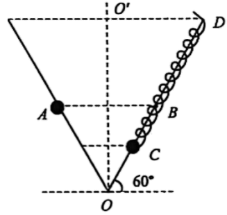

# Physics - 题目 154

**ID**: 39ed995d8bb04a0cab063a3d8ffc70a8
**年级**: Grade 10
**难度**: Medium-Hard
**题型**: Calculation

## 题目
如图所示，由两轻杆连接成的“V”形光滑支架可以绕竖直轴线OO'匀速转动，两轻杆与水平面间夹角均为60°，A、B两点等高。​​​​​​​‌A点固定一带电小球，绝缘轻质弹簧一端固定于轻杆OD顶端，另一端与套在杆上质量为m的带电小球相连。初始时，小球静止于OB中点C且对杆无压力，此时弹簧的形变量为2L。现驱动该装置绕OO'转动，使小球缓慢移动至B点。已知 $OA=OB=2L$ ，重力加速度为g，不计空气阻力，求（1）弹簧的劲度系数；（2）小球在B点的库仑力大小；（3）小球在B点时的角速度（结果保留根式）。

## 解答

1. （1）小球在C点处于平衡状态，弹簧的拉力
2. $F{{}_{1}}=mg\sin 60{}\degree =k2L$
3. 可得弹簧的劲度系数为 $k=\frac {\sqrt {3}mg}{4L}$
4. （2）小球在C点处于平衡状态，所受的库仑力
5. $F{{}_{电}}=mg{\cos}60{}\degree =\frac {kq{{}_{1}}q{{}_{2}}}{{\left({\sqrt {3}L}\right)^{2}}}$
6. 小球在B点所受的库仑力
7. $F{{}_{电}}{^{\prime }}=\frac {kq{{}_{1}}q{{}_{2}}}{(2L){^{2}}}$
8. 解得 $F{{}_{电}}{^{\prime }}=\frac {3mg}{8}$
9. （3）小球在B点时，弹簧的弹力
10. $F{{}_{2}}=kL=\frac {\sqrt {3}mg}{4}$
11. 设轻杆的支持力为F_{N}
12. 竖直方向上： $F{{}_{2}}\sin 60{}\degree +F{{}_{{\rm{N}}}}{\cos}60{}\degree =mg$
13. 解得 $F{{}_{{\rm{N}}}}=\frac {5mg}{4}$
14. 水平方向上： $F{{}_{电}}{^{\prime }}+F{{}_{{\rm{N}}}}\sin 60{}\degree -F{{}_{2}}{\cos}60{}\degree =mω{^{2}}L$
15. 解得 $ω=\sqrt {\frac {\left ({3+4\sqrt {3}}\right )g}{8L}}$

## 知识点

**中文**:
  - 带电体在库仑力作用下的平衡问题
  - 水平面内匀速圆周问题

**English**:
  - Equilibrium under Coulomb Force
  - Uniform Circular Motion in Horizontal Plane

---
