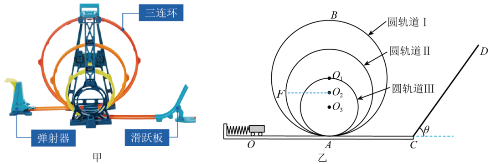

# Physics - 题目 1992

**ID**: 3c7c1ba028354af99b99660b98281b01
**年级**: Grade 10
**难度**: Medium-Hard
**题型**: Calculation

## 题目
如图甲是组合玩具实物图，该玩具主要配件有小车、弹射器、三连环、滑跃板及部分直线轨道等。​​​​​​​‌如图乙为该玩具的轨道结构示意图，其中三连环是由三个半径不同的光滑圆轨道I、II、III组成，且三个光滑的圆轨道平滑连接但不重叠。其圆心分别为（ $O{{}_{1}}$ 、 $O{{}_{2}}$ 、 $O{{}_{3}}$ ，半径分别为 $R{{}_{1}}=20{\rm{c}}{\rm{m}}$ 、 $R{{}_{2}}=15{\rm{c}}{\rm{m}}$ 、 $R{{}_{3}}=10{\rm{c}}{\rm{m}}$ 。OA、AC为光滑水平轨道，滑跃板CD为足够长的粗糙倾斜轨道，轨道倾角 $θ$ 可调（ $0⩽θ<90{}\degree $ ）。某次游戏中弹射器将小车自O点以一定初速度弹出，小车先后通过圆轨道I、II、III后冲上滑跃板。小车可视为质点，其质量 $m=0.1{\rm{k}}{\rm{g}}$ ，与滑跃板CD间动摩擦因数 $μ=\frac {\sqrt {3}}{3}$ ，轨道各部分平滑连接，g取 $10{\rm{m}}{\rm{/}}{\rm{s}}{^{2}}$ 。求：（1）若小车恰好能够通过圆轨道I的最高点B，初始时弹射器弹性势能为多少；（2）若小车恰好能够通过三连环，调整滑跃板CD的倾角 $θ$ ，求小车第一次滑上CD轨道的最小距离；（3）若小车恰好能够通过三连环，为确保小车整个运动过程均不脱离轨道，分析滑跃板CD与水平面间夹角 $θ$ 的取值范围（可用三角函数表示）。

## 解答

1. （1）依题意，小车恰好能够通过圆轨道I的最高点B，则有 $mg=m\frac {v{{}_{B}^{2}}}{R{{}_{1}}}$ ，根据能量守恒定律，可得初始时弹射器弹性势能 $E{{}_{{\rm{p}}}}=\frac {1}{2}mv{{}_{B}^{2}}+2mgR{{}_{1}}$ ，联立，解得 $E{{}_{{\rm{p}}}}=0.5{\rm{J}}$ 。
2. （2）若小车恰好能够通过三连环，则初始时弹射器弹性势能为0.5J，设小车第一次滑上CD轨道的距离为L，由能量守恒定律，可得 $E{{}_{{\rm{p}}}}={\rm μm}gL{\cos}θ+mgL\sin θ$ ，整理可得 $L=\frac {\sqrt {3}}{4\sin \left ({θ+30{}\degree }\right )}$ ，当 $θ=60{}\degree $ 时，有 $L{{}_{{\rm{m}}{\rm{i}}{\rm{n}}}}=\frac {\sqrt {3}}{4}{\rm{m}}$ 。
3. （3）由（1）可得小车恰好通过三连环则有 $v{{}_{B}}=\sqrt {2}{\rm{m}}/{\rm{s}}$ ，①当 $0⩽θ⩽30{}\degree $ 时，满足 ${\rm }{\rm μm}g{\cos}θ>mg\sin θ$ ，小车冲上滑越板轨道CD后不再下滑，符合题目要求；②假设小车自B点冲上滑跃板轨道CD最大距离为x，根据动能定理有 $2mgR{{}_{1}}-{\rm μm}gx{\cos}θ-mgx\sin θ=0-\frac {1}{2}mv{{}_{B}^{2}}{\rm }$ ，解得 $x=\frac {0.5}{μ{\cos}θ+\sin θ}$ ，在滑跃板轨道CD上往返克服摩擦力做功 $W{{}_{f}}=2{\rm μm}gx{\cos}θ=\frac {1}{\sqrt {3}{\tan}θ+1}$ ，可知 $θ$ 增大， $W{{}_{f}}$ 减小，若要不脱离轨道，返回三连环时不能超过圆轨道O_{3}圆心等高位置，根据动能定理有 $mg\left ({2R{{}_{1}}-R{{}_{3}}}\right )-W{{}_{f}}=0-\frac {1}{2}mv{{}_{B}^{2}}$ ，解得 ${\tan}θ{{}_{1}}=\frac {\sqrt {3}}{2}$ ，当 $30{}\degree ⩽θ⩽{\rm{a}}{\rm{r}}{\rm{c}}{\tan}\frac {\sqrt {3}}{2}$ 时，小车往返运动最终静止于C点，综上所述当 $0⩽θ⩽{\rm{a}}{\rm{r}}{\rm{c}}{\tan}\frac {\sqrt {3}}{2}$ 时小车不脱离轨道。

## 知识点

**中文**:
  - 应用动能定理求解变力做功问题

**English**:
  - Solving Work Done by Variable Force

---
