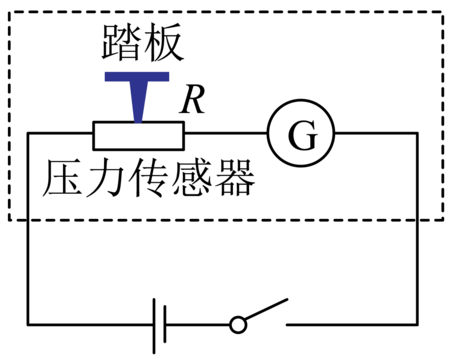

# Physics - 题目 1661

**ID**: 404f4aed5e1f41c2ae1f80c5f41973b3
**年级**: Grade 10
**难度**: Medium-Hard
**题型**: Calculation

## 题目
有一种测量物体重量的电子秤，其电路主要由三部分构成：踏板、压力传感器R(实际上是一个阻值可随压力变化的电阻器)、显示体重的仪表G(实质上是电流表)，原理图如图中的虚线所示，不计踏板的质量．已知电流表的量程为2 A，内阻为1 Ω，电源电动势为12 V，内阻为1Ω，电阻R随压力F变化的函数式为R＝30－0.​​​​​​​‌01F(F和R的单位分别为N和Ω)．(1)求该秤能测量的最大体重．(2)通过计算，得出该秤零刻度线(即踏板空载时的刻度线)应标在电流表G刻度盘的哪个刻度处？(3)写出该秤测量的重力与电流表中电流的函数关系．

## 解答

1. (1)由电流表量程可知电路中最大电流为2 A
2. 由闭合电路欧姆定律E＝I(R＋r＋r_{g})
3. 可解得压力传感器R的最小值为4 Ω
4. 由电阻R随压力F的变化的函数式为R＝30－0.01F
5. 可得压力最大值F＝2 600 N，
6. 即该秤能测量的最大体重为2 600 N.
7. (2)踏板空载时，F＝0，R＝30 Ω
8. 由闭合电路欧姆定律，E＝I(R＋r＋r_{g})
9. 可解得I＝0.375 A
10. 即该秤零刻度线应标在电流表G刻度盘的0.375 A刻度处．
11. (3)由E＝I(R＋r＋r_{g})和R＝30－0.01F可得
12. E＝I(30－0.01F＋r＋r_{g})
13. 将电动势E＝12 V、内阻r＝1 Ω、电流表内阻r_{g}＝1 Ω代入化简，
14. 得F＝3 200－ $\frac {1200}{I}$ .
15. 点睛：本题结合传感器考查闭合电路的欧姆定律的应用，要注意理解所设计仪器的原理，分析物理规律的正确应用即可顺利求解．

## 知识点

**中文**:
  - 闭合电路的欧姆定律及其应用

**English**:
  - Ohm's Law for Closed Circuits and Applications

---
