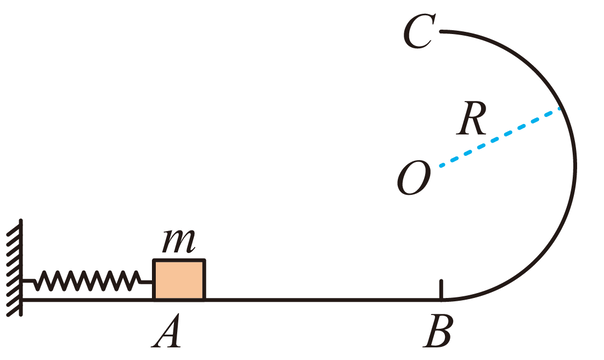

# Physics - 题目 2013

**ID**: 409ded807a4243a0bc174fc7d1e1d83f
**年级**: Grade 10
**难度**: Medium-Hard
**题型**: Calculation

## 题目
如图所示，光滑水平面AB与竖直面内的半圆形粗糙导轨在B点相接，半圆形导轨半径为R，一个质量为m的物体将弹簧压缩至A点后由静止释放，在弹力作用下物体获得某一向右速度后脱离弹簧，当它经过B点时的速度为 $v{{}_{1}}$ ，之后沿着半圆形导轨运动到C点时的速度为 $v{{}_{2}}$ ，重力加速度为g，试求：（1）物体在A点时弹簧的弹性势能；（2）物体在C点时对轨道压力的大小；（3）物体从B点运动至C点的过程中克服阻力做的功。​​​​​​​‌

## 解答

1. （1）由机械能守恒定律，物体在A点时弹簧的弹性势能 $E{{}_{{\rm{p}}A}}=\frac {1}{2}mv{{}_{1}^{2}}$
2. （2）物体在C点时，设轨道对物体的弹力为 $F{{}_{{\rm{N}}}}$ ，由牛顿第二定律得 $F{{}_{{\rm{N}}}}+mg=m\frac {v{{}_{2}^{2}}}{R}$
3. 解得 $F{{}_{{\rm{N}}}}=m\frac {v{{}_{2}^{2}}}{R}-mg$
4. 由牛顿第三定律得，物体在C点时对轨道压力的大小 $F^{′}{{{}_{{\rm{N}}}}}=F{{}_{{\rm{N}}}}=m\frac {v{{}_{2}^{2}}}{R}-mg$
5. （3）设物体从B点运动至C点的过程中克服阻力做的功为 $W$ ，由动能定理 $-2mgR-W=\frac {1}{2}mv{{}_{2}^{2}}-\frac {1}{2}mv{{}_{1}^{2}}$
6. 解得 $W=\frac {1}{2}mv{{}_{1}^{2}}-2mgR-\frac {1}{2}mv{{}_{2}^{2}}$

## 知识点

**中文**:
  - 应用动能定理求解变力做功问题

**English**:
  - Solving Work Done by Variable Force

---
