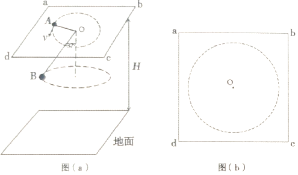

# Physics - 题目 814

**ID**: 4237b4933bb54d7193001572f3826bb2
**年级**: Grade 10
**难度**: Medium-Hard
**题型**: Calculation

## 题目
如图（a）所示，水平放置的正方形光滑桌面abcd，距地面的高度为 $H=\frac {31}{15}{\rm{m}}$ ，桌面正中间有一个光滑的小孔O，一根长为x=2m的细线穿过小孔，两端分别系着小球A和B，A的质量是B的2倍，小球 $\mathrm{A}$ 在桌面上绕O点沿逆时针做匀速圆周运动时，B在桌面下方水平面内做匀速圆周运动，绳子与竖直方向夹角为37°，A与B线速度比为 $\sqrt {5}:\sqrt {6}{\rm ，\mathit{g}}$ 取10m/s^{2}，sin37°=0.6，cos37°=0.8，不计一切阻力。​​​​​​​‌求：（1）小球A做圆周运动的半径；（2）某时刻剪断细线，当小球B落地时A恰好运动到桌角c点，请在图（b）中画出绳断后小球A在桌面上的运动轨迹（标清主要角度），并计算 $O$ 到桌角c点的距离。

## 解答

1. （1）设绳子拉力为T，小球A、B的线速度分别为v_{A}、v_{B}，做圆周运动的半径分别为r_{A}、r_{B}，小球B的质量为m，则小球A的质量为2m，对小球A，有 $T=2m\frac {v{{}_{{\rm{A}}}^{{{2}}}}}{r{{}_{{\rm{A}}}}}$ ，
2. 对小球B，有 $r{{}_{{\rm{B}}}}=(x-r{{}_{{\rm{A}}}}){\rm{s}}{\rm{i}}{\rm{n}}37{}\degree $ ， $T{\rm{c}}{\rm{o}}{\rm{s}}37{}\degree =mg$ ， $T{\rm{s}}{\rm{i}}{\rm{n}}37{}\degree =m\frac {v{{}_{{\rm{B}}}^{{{2}}}}}{r{{}_{{\rm{B}}}}}$ ，
3. 由题意得 $\frac {v{{}_{{\rm{A}}}}}{v{{}_{{\rm{B}}}}}=\frac {\sqrt {5}}{\sqrt {6}}$ ，
4. 联立解得 $r{{}_{{\rm{A}}}}=\frac {3}{4}{\rm{m}}$ 。
5. （2）绳断后小球A在桌面上的运动轨迹，如图所示
6. 
7. 下落高度 $h=H-{\rm{(}}x-r{{}_{{\rm{A}}}}{\rm{)}}{\rm{c}}{\rm{o}}{\rm{s}}37{}\degree $ ，
8. 由运动学关系知 $h=\frac {1}{2}gt{^{2}}$ ，
9. 设绳断时小球位置为e点，则 $x{{}_{ce}}=v{{}_{{\rm{A}}}}t$ ，
10. 由勾股定理知 $r{{}_{{\rm{A}}}^{2}}+x{{}_{ce}^{2}}=x{{}_{Oc}^{2}}$ ，
11. 联立解得 $x{{}_{Oc}}=\frac {5}{4}{\rm{m}}$ 。

## 知识点

**中文**:
  - 绳、杆类圆周运动问题

**English**:
  - String and Rod Circular Motion Problems

---
