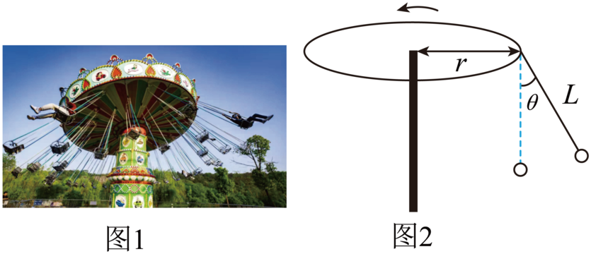

# Physics - 题目 1239

**ID**: 44abd5e114624716ba53b967f5230420
**年级**: Grade 10
**难度**: Medium-Hard
**题型**: Calculation

## 题目
图1所示是一种叫“旋转飞椅”的游乐项目，将其结构简化为图2所示的模型。​​​​​​​‌长 $L=3{\rm{m}}$ 的钢绳一端系着座椅，另一端固定在半径 $r=3{\rm{m}}$ 的水平转盘边缘。转盘可绕穿过其中心的竖直轴转动。转盘静止时，钢绳沿竖直方向自由下垂；转盘匀速转动时，钢绳与转轴在同一竖直平面内，与竖直方向的夹角 $θ=37{}\degree $ 。将游客和座椅看作一个质点，质量 $m\mathrm{=}50{\rm{k}}{\rm{g}}$ 。不计钢绳重力和空气阻力，重力加速度 $g=10{\rm{m}}{\rm{/}}{\rm{s}}{^{2}}$ 。（ $\sin 37{^{\circ }}=0.6$ ， ${\cos}37{^{\circ }}=0.8$ ）（1）当转盘匀速转动时，求游客和座椅做圆周运动a．向心力的大小 $F{{}_{{\rm{n}}}}$ ；b．线速度的大小v。（2）求游客由静止到随转盘匀速转动的过程中，钢绳对游客和座椅做的功W。

## 解答

1. （1）对游客和座椅一起受力分析如下图所示
2. a．根据受力分子可知游客和座椅做圆周运动所需要的向心力为 $F{{}_{{\rm{n}}}}=mg{\tan}θ=50\times 10\times \frac {3}{4}{\rm{N}}=375{\rm{N}}{\rm \mathit{b}}$ ．根据几何关系可知游客和座椅zuo2圆周运动的半径为 $R=r+L\sin θ=3\times 0.6{\rm{m}}=4.8{\rm{m}}$ ，
3. 由 $F{{}_{{\rm{n}}}}=m\frac {v{^{2}}}{r}$ ，
4. 代入数据得 $v=6{\rm{m}}{\rm{/}}{\rm{s}}$ 。
5. （2）游客和座椅由静止到随转盘匀速转动得过程，根据功能关系有 $W-mgL(1-{\cos}θ)=\frac {1}{2}mv{^{2}}$ ，
6. 代入数据解得 $W=1200{\rm{J}}$ 。

## 知识点

**中文**:
  - 圆锥摆问题
  - 水平面内匀速圆周问题

**English**:
  - Conical Pendulum Problems
  - Uniform Circular Motion in Horizontal Plane

---
