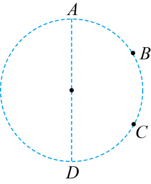

# Physics - 题目 1742

**ID**: 45161eb3f1dd4f20b57c661b4ea07ffa
**年级**: Grade 10
**难度**: Medium-Hard
**题型**: Calculation

## 题目
如图所示，在匀强电场中（电场线未画出）有一半径为R的圆，AD为圆的直径，B、C分别为圆弧AD的三等分点，将质量为m、电荷量为 $+q$ 的带电粒子，以大小为v的速度从A点沿某一方向射入电场，粒子经过圆上B点时，速度大小为 $3v$ ；若以大小为2v的速度从A点射入电场，粒子经过圆上D点时，速度大小为 $2\sqrt {3}v$ ，圆、电场强度以及粒子的速度均在同一平面内，粒子只受电场力。​​​​​​​‌求：（1）A、B间的电势差 $U{{}_{AB}}$ ；（2）电场强度的大小和方向；（3）若将该粒子以速度 $v{{}_{0}}$ 从A点垂直于AB射入圆内，恰好经过C点，求 $v{{}_{0}}$ 的大小。

## 解答

1. （1）从A到B由动能定理有 $qU{{}_{AB}}=\frac {1}{2}m(3v){^{2}}-\frac {1}{2}mv{^{2}}$
2. 解得 $U{{}_{AB}}=\frac {4mv{^{2}}}{q}$
3. （2）从A到D由动能定理有 $qU{{}_{AD}}=\frac {1}{2}m(2\sqrt {3}v){^{2}}-\frac {1}{2}m(2v){^{2}}$
4. 解得 $U{{}_{AD}}=\frac {4mv{^{2}}}{q}$
5. 可知 $U{{}_{AB}}=U{{}_{AD}}$ ， $φ\,{{}_{B}}=φ\,{{}_{D}}{\rm _{，}}$ 又 $E=\frac {U{{}_{AB}}}{AB}$
6. 解得 $E=\frac {4mv{^{2}}}{qR}$ ，方向沿AB方向。
7. （3）沿AB和垂直于AB方向建立直角坐标系如图
8. 
9. 沿x轴方向，有 $x=\frac {\sqrt {3}}{2}R=v{{}_{0}}t$
10. 沿y轴方向，有 $y=\frac {3}{2}R=\frac {1}{2}at{^{2}}$
11. 又 $a=\frac {qE}{m}$
12. 联立，解得 $v{{}_{0}}=v$

## 知识点

**中文**:
  - 匀强电场中电势差与电场强度的关系

**English**:
  - U=Ed in Uniform Electric Field

---
