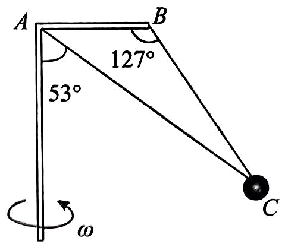

# Physics - 题目 552

**ID**: 4811c2ef31e64acfa64fe717cd6a72a1
**年级**: Grade 10
**难度**: Medium-Hard
**题型**: Calculation

## 题目
如图所示，一轻杆制成的竖直直角支架，水平杆上A、B两端点用两根不可伸长的轻细绳BC、AC分别与质量为m=0.1kg的小球连接，小球可视为质点，A、B两端点的间距为  $R=0.525{\rm{m}}$ ，轻细绳BC长为  $l=1.125{\rm{m}}$ ，整个装置可绕竖直杆做匀速圆周运动，三角形ABC始终在竖直平面内。​​​​​​​‌当两轻细绳都拉直时，轻细绳AC与竖直方向夹角为  $53{^{\circ }},$ ，水平杆AB与轻细绳BC的夹角为  $127{^{\circ }},g=10{\rm{m}}/{\rm{s}}{^{2}}。$（1）若两轻细绳始终伸直，求小球角速度的取值范围；（2）当小球角速度ω=3rad/s时，求两轻细绳张力的大小。(结果均保留两位有效数字)

## 解答

1. （1）两轻细绳始终伸直时，小球做圆周运动的半径为  $r=R+l{\rm{s}}{\rm{i}}{\rm{n}}\left ({127{^{\circ }}-90{^{\circ }}}\right )$
2. 由几何关系得 $R+\frac {3}{5}l=\frac {4}{3}\times \frac {4}{5}l$
3. 解得r=1.2m。
4. AC间绳的拉力恰为零时，小球的角速度为 $ω{{}_{1}}$ ，由牛顿第二定律得
5. $mg{\rm{t}}{\rm{a}}{\rm{n}}37{^{\circ }}=mrω{{}_{1}^{2}}$
6. 解得 $ω{{}_{1}}=2.5{\rm{r}}{\rm{a}}{\rm{d}}/{\rm{s}}$
7. BC间绳的拉力恰为零时，小球的角速度为 $ω{{}_{2}}$ ，由牛顿第二定律得
8. $mg{\rm{t}}{\rm{a}}{\rm{n}}53{^{\circ }}=mrω{{}_{2}^{2}}$
9. 解得 $ω{{}_{2}}=\frac {10}{3}{\rm{r}}{\rm{a}}{\rm{d}}/{\rm{s}}\approx 3.3{\rm{r}}{\rm{a}}{\rm{d}}/{\rm{s}}$
10. 要使两绳都伸直，小球角速度的范围为2.5 rad/s≤ω≤3.3 rad/s。
11. （2）当ω=3 rad/s时，两绳都张紧,设轻细绳BC的拉力为 $F{{}_{1}}$ ，轻细绳AC的拉力为 $F{{}_{2}}$ 。
12. 在竖直方向，有  $F{{}_{1}}{\rm{c}}{\rm{o}}{\rm{s}}37{^{\circ }}+F{{}_{2}}{\rm{s}}{\rm{i}}{\rm{n}}37{^{\circ }}=mg$
13. 在水平方向，有 $F{{}_{2}}{\rm{c}}{\rm{o}}{\rm{s}}37{^{\circ }}+F{{}_{1}}{\rm{s}}{\rm{i}}{\rm{n}}37{^{\circ }}=mrω{^{2}}$
14. 联立得  $F{{}_{1}}=0.54{\rm{N}},F{{}_{2}}=0.94{\rm{N}}$

## 知识点

**中文**:
  - 绳、杆类圆周运动问题

**English**:
  - String and Rod Circular Motion Problems

---
