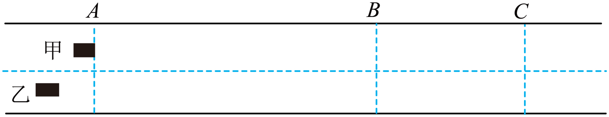

# Physics - 题目 1446

**ID**: 4a346bf1dc5d4eb1b776a19fb9900f58
**年级**: Grade 10
**难度**: Medium-Hard
**题型**: Calculation

## 题目
如图所示，两辆新能源汽车甲、乙沿同一条平直的公路行驶，汽车甲的速度为 $v{{}_{0}}=30{\rm{m}}/{\rm{s}}$ ，当汽车甲运动到虚线 $A$ 时立即以 $a{{}_{1}}=3{\rm{m}}/{\rm{s}}{^{2}}$ 的加速度减速， $4{\rm{s}}$ 后汽车甲的加速度大小变为 $a{{}_{2}}=4.​​​​​​​‌5{\rm{m}}/{\rm{s}}{^{2}}$ ，最终汽车甲刚好停在虚线 $B$ 位置，汽车甲在虚线 $B$ 处停留 $t{{}_{0}}=8{\rm{s}}$ 后立即以 $a{{}_{3}}=5{\rm{m}}/{\rm{s}}{^{2}}$ 的加速度启动，汽车甲到达虚线 $C$ 位置时的速度恢复到 $v{{}_{0}}=30{\rm{m}}/{\rm{s}}$ ，此后汽车甲保持该速度不变；汽车乙沿平直的公路以 $v=25{\rm{m}}/{\rm{s}}$ 的速度做匀速直线运动，当汽车乙运动到虚线 $B$ 位置时汽车甲刚好启动.忽略汽车的长度.求：（1）虚线 $A$ 、 $C$ 之间的距离是多少？（2）汽车甲从 $A$ 到 $C$ 的时间比汽车乙从 $A$ 到 $C$ 的时间多多少？（3）汽车乙越过虚线 $B$ 后，两汽车之间的最大距离以及两汽车再次相遇点到虚线 $B$ 的距离是多少？

## 解答

1. （1）汽车甲以 $a{{}_{1}}=3{\rm{m}}/{\rm{s}}{^{2}}$ 的加速度减速的位移为 $x{{}_{1}}=v{{}_{0}}t{{}_{1}}-\frac {1}{2}a{{}_{1}}t{{}_{1}}{^{2}}=96{\rm{m}}$
2. 汽车甲 $4{\rm{s}}$ 末的速度大小为 $v{{}_{1}}=v{{}_{0}}-a{{}_{1}}t{{}_{1}}=18{\rm{m}}/{\rm{s}}$
3. 汽车甲以 $a{{}_{2}}=4.5{\rm{m}}/{\rm{s}}{^{2}}$ 的加速度减速的位移为 $x{{}_{2}}=\frac {v{{}_{1}}{^{2}}}{2a{{}_{2}}}=36{\rm{m}}$
4. 汽车甲以 $a{{}_{3}}=5{\rm{m}}/{\rm{s}}{^{2}}$ 的加速度加速的位移为 $x{{}_{3}}=\frac {v{{}_{0}}{^{2}}}{2a{{}_{3}}}=90{\rm{m}}$
5. 虚线 $A$ 、 $C$ 之间的距离为 $x=x{{}_{1}}+x{{}_{2}}+x{{}_{3}}=222{\rm{m}}$
6. （2）汽车甲以 $a{{}_{2}}=4.5{\rm{m}}/{\rm{s}}{^{2}}$ 的加速度减速的时间为 $t{{}_{2}}=\frac {v{{}_{1}}}{a{{}_{2}}}=4{\rm{s}}$
7. 汽车甲从 $B$ 到 $C$ 的时间为 $t{{}_{3}}=\frac {v{{}_{0}}}{a{{}_{3}}}=6{\rm{s}}$
8. 汽车乙从 $A$ 到 $C$ 的时间为 $t{{}_{4}}=\frac {x}{v}=8.88{\rm{s}}$
9. 汽车甲从 $A$ 到 $C$ 的时间比汽车乙从 $A$ 到 $C$ 多运动的时间为 ${\rm{Δ}}t=t{{}_{1}}+t{{}_{2}}+t{{}_{0}}+t{{}_{3}}-t{{}_{4}}$
10. 解得 ${\rm{Δ}}t=13.12{\rm{s}}$
11. （3）汽车乙越过虚线 $B$ 后，当两汽车的速度相等时两车之间的距离最大，设经时间 $t{{}_{5}}$ 两汽车的速度相等，则有 $v=a{{}_{3}}t{{}_{5}}$
12. 解得 $t{{}_{5}}=5{\rm{s}}$
13. 该过程中汽车甲的位移为 $x{{}_{4}}=\frac {v}{2}t{{}_{5}}=62.5{\rm{m}}$
14. 汽车乙的位移为 $x{{}_{5}}=vt{{}_{5}}=125{\rm{m}}$
15. 两汽车之间的最大距离为 ${\rm{Δ}}x=x{{}_{5}}-x{{}_{4}}=62.5{\rm{m}}$
16. 根据速度-时间公式 $v{{}_{0}}=a{{}_{3}}t{{}_{6}}$
17. 可得 $t{{}_{6}}=6{\rm{s}}$
18. 设汽车乙越过虚线 $B$ 后经时间 $t{{}_{7}}$ 两汽车相遇，则有 $\frac {1}{2}a{{}_{3}}t{{}_{6}}{^{2}}+v{{}_{0}}\left ({t{{}_{7}}-t{{}_{6}}}\right )=vt{{}_{7}}$
19. 解得 $t{{}_{7}}=18{\rm{s}}$
20. 则有 $x{{}_{6}}=vt{{}_{7}}=450{\rm{m}}$

## 知识点

**中文**:
  - 追及与相遇问题

**English**:
  - Chase and Encounter Problems

---
