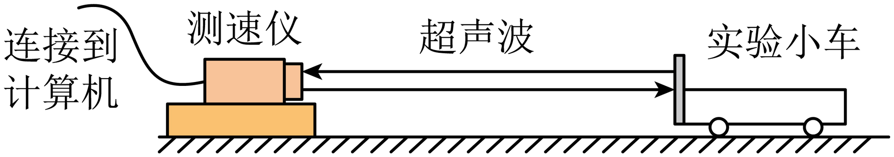

# Physics - 题目 2519

**ID**: 4d4002c3e4e04b0799e1fd6a3fa19569
**年级**: Grade 10
**难度**: Medium-Hard
**题型**: Calculation

## 题目
如图所示为一种运动传感器工作原理的示意图．固定在地面上的测速仪可以向被测物体发出短暂的超声波脉冲，脉冲被运动物体反射后被测速仪接收，计算机根据发射与接收脉冲的时间差可得到运动物体的加速度。​​​​​​​‌某次测试中，测速仪在 $t{{}_{1}}=0{\rm{s}}$ 发射第一个脉冲，到达做匀加速直线运动的实验汽车上，经过 $Δt{{}_{1}}=2{\rm{s}}$ 接收到反射波； $t{{}_{2}}=7.5{\rm{s}}$ 发射第二个脉冲，经过 $Δt{{}_{2}}=1{\rm{s}}$ 接收到反射波； $t{{}_{3}}=9.7{\rm{s}}$ 发射第三个脉冲，经过 $Δt{{}_{3}}=0.6{\rm{s}}$ 接收到反射波，已知超声波在空气中传播的速度v＝350m/s。（1）求实验汽车在接收到第一个和第二个脉冲波之间的平均速度大小；（2）求实验汽车的加速度大小。

## 解答

1. （1）由题意得，实验小车在 $t{{}_{1}}+\frac {Δt{{}_{1}}}{2}$ 时刻接收到第一个脉冲，设此时实验小车距测速仪 $x{{}_{1}}{\rm ，}$ 有 $x{{}_{1}}=v\frac {Δt{{}_{1}}}{2}{\rm ，}$ 实验小车在 $t{{}_{2}}+\frac {Δt{{}_{2}}}{2}$ 时刻接收到第二个脉冲，设此时实验小车距测速仪 $x{{}_{2}}{\rm ，}$ 有 $x{{}_{2}}=v\frac {Δt{{}_{2}}}{2}{\rm ，}$ 设实验小车在接收到第一个和第二个脉冲波之间的时间内运动的距离为 $Δx{{}_{1}}{\rm ，}$ 则有 $Δx{{}_{1}}=x{{}_{1}}-x{{}_{2}}=350{\rm{m}}{\rm ，}$ 设实验小车在接收到第一个和第二个脉冲波之间的时间间隔为 ${\rm{Δ}}t{\rm ，}$ 有 $Δt=\left ({t{{}_{2}}+\frac {Δt{{}_{2}}}{2}}\right )-\left ({t{{}_{1}}+\frac {Δt{{}_{1}}}{2}}\right ){\rm ，}$ 设这段时间内的平均速度为 ${\overline{v{{}_{1}}}}{\rm ，}$ 则有 ${\overline{v{{}_{1}}}}=\frac {Δx{{}_{1}}}{Δt}=25{\rm{m}}/{\rm{s}}$
2. （2）实验小车在接收到第三个脉冲波时实验小车距测速仪为 $x{{}_{3}}=v\frac {Δt{{}_{3}}}{2}{\rm ，}$ 实验小车在接收到第二个和第三个脉冲波之间的时间内运动的距离为 $Δx{{}_{2}}=x{{}_{2}}-x{{}_{3}}=70{\rm{m}}{\rm ，}$ 这段时间内的平均速度 ${\overline{v{{}_{1}}}}=\frac {Δx{{}_{2}}}{Δt^{′}}=35{\rm{m}}/{\rm{s}}{\rm ，}$ 所以 ${\overline{v{{}_{1}}}}$ 为 $t{{}_{1}}^{′}=\frac {\left ({t{{}_{1}}+\frac {Δt{{}_{1}}}{2}}\right )+\left ({t{{}_{2}}+\frac {Δt{{}_{2}}}{2}}\right )}{2}{\rm ，}$ 时刻的瞬时速度 ${\rm ，}{\overline{v{{}_{2}}}}$ 为 $t{{}_{2}}^{′}=\frac {\left ({t{{}_{2}}+\frac {Δt{{}_{2}}}{2}}\right )+\left ({t{{}_{3}}+\frac {Δt{{}_{3}}}{2}}\right )}{2}{\rm ，}$ 时刻的瞬时速度，由 $a=\frac {Δv}{Δt}$ 可得 $a=\frac {Δv}{Δt}=\frac {{\overline{v{{}_{2}}}}-{\overline{v{{}_{1}}}}}{t{{}_{2}}^{′}-t{{}_{1}}^{′}}=\frac {20}{9}{\rm{m}}/{\rm{s}}{^{2}}$

## 知识点

**中文**:
  - 平均速度和瞬时速度、平均速率

**English**:
  - Average Velocity, Instantaneous Velocity, and Average Speed

---
