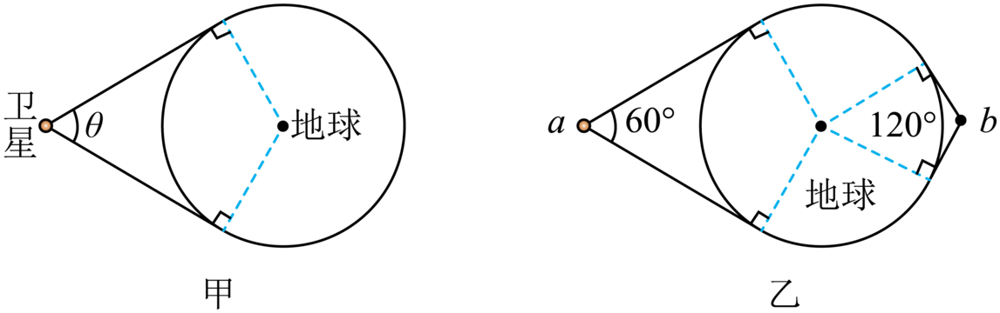

# Physics - 题目 1081

**ID**: 4fa004486d15497e90857af8e33d382b
**年级**: Grade 10
**难度**: Medium-Hard
**题型**: Calculation

## 题目
在地球赤道平面内绕地球运行的卫星（可视为质点），从该卫星作赤道的两条切线，两条切线之间的夹角通常称为地球对该卫星的张角θ，如图甲所示。​​​​​​​‌有a、b两卫星在赤道平面内绕地球做匀速圆周运动，它们的绕行方向相同，地球对卫星a的张角 $θ{{}_{a}}{\rm =60°}$ ，地球对卫星b的张角 $θ{{}_{b}}{\rm =120°}$ ，如图乙所示。已知地球半径为R，地球表面的重力加速度为g。（1）求卫星a的轨道半径及其绕地球运动的周期；（2）求卫星b的轨道半径及其绕地球运动的周期；（3）若a、b通过激光进行通信，两卫星运行过程中，因地球的遮挡，将间歇性地出现不能直接通信的时间段，求每一次因地球遮挡不能直接通信持续的时间。

## 解答

1. （1）据几何关系可得 $r{{}_{a}}\sin 30{}\degree =R$ ，
2. 解得 $r{{}_{a}}=2R$ ，
3. 对卫星a，据万有引力定律可得 $G\frac {Mm{{}_{a}}}{r{{}_{a}^{2}}}=m{{}_{a}}\frac {4{\rm{π}}{^{2}}}{T{{}_{a}^{2}}}r{{}_{a}}$ ，
4. 由黄金代换 $\frac {GMm}{R{^{2}}}=mg$ ，
5. 联立，解得 $T{{}_{{\rm{a}}}}=4{\rm{π}}\sqrt {\frac {2R}{g}}$ 。
6. （2）对卫星b，据几何关系可得 $r{{}_{b}}\sin 60{}\degree =R$ ，
7. 解得 $r{{}_{b}}=\frac {2}{3}\sqrt {3}R$ ，
8. 据万有引力定律可得 $G\frac {Mm{{}_{b}}}{r{{}_{b}^{2}}}=m{{}_{b}}\frac {4{\rm{π}}{^{2}}}{T{{}_{b}^{2}}}r{{}_{b}}$ ，
9. 由黄金代换 $\frac {GMm}{R{^{2}}}=mg$ ，
10. 联立，解得 $T{{}_{b}}=\frac {4{\rm{π}}}{3}\sqrt {\frac {2\sqrt {3}R}{g}}$ 。
11. （3）设卫星a的角速度大小为 $ω{{}_{a}}$ ，卫星b的角速度大小为 $ω{{}_{b}}$ ，从转动的角度，以卫星a为参考系，卫星b相对卫星a转动的角速度大小为 $(ω{{}_{b}}-ω{{}_{a}})$ ，当卫星 $b$ 出现在地球后方的阴影区域时，两颗卫星无法直接通信，据几何关系可得 $(ω{{}_{b}}-ω{{}_{a}})t=θ{{}_{a}}+θ{{}_{b}}$ ，
12. 又 $ω{{}_{a}}=\frac {2{\rm{π}}}{T{{}_{a}}}$ ， $ω{{}_{b}}=\frac {2{\rm{π}}}{T{{}_{b}}}$ ，
13. 解得 $t=\frac {2{\rm{π}}}{\sqrt[4]{27}-1}\sqrt {\frac {2R}{g}}$ 。

## 知识点

**中文**:
  - 非同步卫星问题

**English**:
  - Non-geostationary Satellites

---
