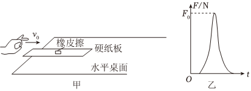

# Physics - 题目 2862

**ID**: 5290c58184e948df9bdc9ae322b1ce3a
**年级**: Grade 10
**难度**: Medium-Hard
**题型**: Calculation

## 题目
某兴趣小组对老师演示惯性的一个实验进行了深入的研究。​​​​​​​‌如图甲所示，长方形硬纸板放在水平桌面上，纸板一端稍稍伸出桌外，伸出部分的长度忽略不计，将一块橡皮置于纸板的正中间，手指水平弹向纸板，纸板水平飞出，橡皮有可能脱离纸板。已知橡皮质量为  ${m}_{1}=10\mathrm{g}$   ，硬纸板的质量为  ${m}_{2}=50\mathrm{g}$   ，长度为  $l=20\mathrm{c}\mathrm{m}$   ，橡皮与纸板间的动摩擦因数为  ${\mu }_{1}=0.2$   ，纸板与桌面间的动摩擦因数为  ${\mu }_{2}=0.3$   ，认为所有接触面处最大静摩擦力等于滑动摩擦力，假设桌面足够长，橡皮擦可视为质点且不会翻滚，重力加速度  $g=10\mathrm{m}/{\mathrm{s}}^{2}$   。求：$(1)$   如果手指与纸板间的作用力随时间变化如图乙所示，则要使橡皮擦相对纸板滑动，  ${F}_{0}$   至少多大；$2)$   手指对纸板的作用时间很短，可认为弹击过程纸板位置没有来得及变化，但是纸板获得一个瞬时初速度  ${v}_{0}$   ，使得橡皮和纸板发生相对滑动，要使橡皮脱离纸板，  ${v}_{0}$   至少多大  $($   结果可带根号表示  $)$   ；$(3)$   如果纸板获得的瞬时初速度为  $1\mathrm{m}/\mathrm{s}$   ，求纸板停止时，纸板发生的位移为多大。

## 解答

1. $(1)$   由牛顿第二定律得：
2. 对橡皮：  ${\mu }_{1}{m}_{1}g={m}_{1}a$
3. 对橡皮与纸板组成的系统：  ${F}_{0}-{\mu }_{2}({m}_{1}+{m}_{2})g=(m+m)a$
4. 代入数据解得：  $a=\frac{2\mathrm{m}}{{s}^{2}}$   ，  ${F}_{0}=0.3\mathrm{N}$
5. $(2)$   纸板做匀减速直线运动，橡皮做初速度为零的匀加速直线运动，当两者共速时橡皮恰好离开纸板，纸板的速度最小
6. 对纸板，由牛顿第二定律得：  ${\mu }_{1}{m}_{1}g+{\mu }_{2}({m}_{1}+{m}_{2})g=m{a}_{1}$
7. 代入数据解得：  ${a}_{1}=\frac{4\mathrm{m}}{{s}^{2}}$
8. 两者共速时：  $v={v}_{0}-{a}_{1}t=at$
9. 橡皮恰好脱离纸板时  $\frac{l}{2}={v}_{0}t-\frac{1}{2}{a}_{1}{t}^{2}-\frac{1}{2}a{t}^{2}$
10. 代入数据解得：  ${v}_{0}=\frac{\frac{\sqrt{30}}{5}m}{s}$
11. $(3)$   纸板的初速度  ${v}_{1}=1\mathrm{m}/\mathrm{s}＜\frac{\sqrt{30}}{5}$   ，则橡皮不会从纸板的左端离开纸板
12. 纸板与橡皮共速时  ${v}_{共}={v}_{1}-{a}_{1}{t}_{1}=a{t}_{1}$
13. 入数据解得：  ${v}_{共}=\frac{\frac{1}{3}m}{s}$   ，  ${t}_{1}=\frac{1}{6}s$
14. 两者共速过程，纸板的位移  ${x}_{1}={v}_{1}{t}_{1}-\frac{1}{2}{a}_{1}{t}_{1}^{2}$
15. 代入数据解得：  ${x}_{1}=\frac{1}{9}m$
16. 由于  ${\mu }_{1}＜{\mu }_{2}$   ，橡皮与纸板共速后，两者相对滑动，
17. 对纸板，由牛顿第二定律得：  ${\mu }_{2}({m}_{1}+{m}_{2})g-{\mu }_{1}{m}_{1}g={m}_{2}{a}_{2}$
18. 代入数据解得：  ${a}_{2}=\frac{\frac{16}{5}m}{{s}^{2}}$
19. 纸板减速到零的位移  ${x}_{2}=\frac{{v}_{共}^{2}}{2{a}_{2}}=\frac{{\left(\frac{1}{3}\right)^{2}}}{2×\frac{16}{5}}m=\frac{5}{288}m$
20. 纸板的位移  $x={x}_{1}+{x}_{2}=\frac{1}{9}m+\frac{5}{288}m=\frac{333}{2592}m$

## 知识点

**中文**:
  - 牛顿运动定律与图像结合问题

**English**:
  - Newton's Laws and Graphs

---
