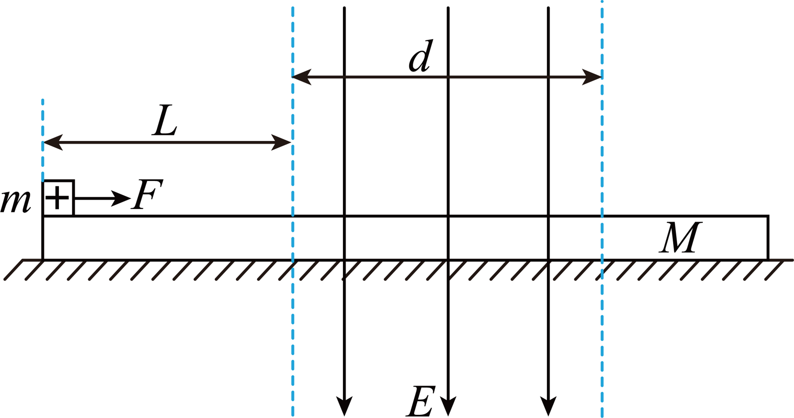

# Physics - 题目 379

**ID**: 5adad734cff640979495770bc367ad00
**年级**: Grade 10
**难度**: Medium-Hard
**题型**: Calculation

## 题目
如图所示，一质量M＝1kg的绝缘长木板静止于水平地面上，在距其最左端L＝1m处存在宽度d＝2m、方向竖直向下的匀强电场区域，电场强度E＝300N/C。​​​​​​​‌一质量m＝1kg、带电量 $q=+\frac {2}{15}$ C的物块（可视为质点）放在长木板的最左端，物块在F＝10N的水平向右恒力作用下从静止开始运动，在物块刚离开电场右边界时撤去外力F，物块最终未从长木板末端滑离。若物块与长木板之间的动摩擦因数为 $μ{{}_{1}}=0.2$ ，长木板与地面之间的动摩擦因数为 $μ{{}_{2}}=0.1$ ，重力加速度g＝10m/s^{2}，若最大静摩擦力等于滑动摩擦力，不计物块电量损失，求：（1）物块刚进入电场区域时的速度大小；（2）长木板从开始运动至与物块共速所用的时间；（3）木板与地面摩擦而产生的热量。

## 解答

1. （1）对物块根据牛顿第二定律可得
2. $F-μ{{}_{1}}mg=ma{{}_{1}}$
3. 代入数据解得加速度大小为
4. $a{{}_{1}}=8{\rm{m}}{\rm{/}}{\rm{s}}{^{2}}$
5. 对长木板根据牛顿第二定律可得
6. $μ{{}_{1}}mg-μ{{}_{2}}\left ({m+M}\right )g=Ma$
7. 解得加速度大小为
8. $a=0$
9. 所以物块进入电场前，木板处于静止状态，对物块根据速度—位移关系可得
10. $v{{}_{0}^{2}}=2a{{}_{1}}L$
11. 代入数据解得
12. $v{{}_{0}}=4{\rm{m}}{\rm{/}}{\rm{s}}$
13. （2）设物块进入电场中时，物块的加速度大小为 $a{{}_{2}}$ ，根据牛顿第二定律可得
14. $F-μ{{}_{1}}\left ({mg+Eq}\right )=ma{{}_{2}}$
15. 代入数据解得
16. $a{{}_{2}}=0$
17. 说明物块进入电场后匀速运动，设物块在电场中运动时间为 $t{{}_{1}}$ ，则有
18. $d=v{{}_{0}}t{{}_{1}}$
19. 代入数据解得
20. $t{{}_{1}}=0.5{\rm{s}}$
21. 物块在电场中运动过程中，设木板的加速度大小为 $a{{}_{3}}$ ，根据牛顿第二定律可得
22. $μ{{}_{1}}(mg+Eq)-μ{{}_{2}}(mg+Mg+Eq)=Ma{{}_{3}}$
23. 代入数据解得
24. $a{{}_{3}}=4{\rm{m}}{\rm{/}}{\rm{s}}{^{2}}$
25. 当物块刚要离开电场时，木板的速度为
26. $v{{}_{1}}=a{{}_{3}}t{{}_{1}}=4\times 0.5{\rm{m}}{\rm{/}}{\rm{s}}=2{\rm{m}}{\rm{/}}{\rm{s}}$
27. 物块离开电场后，设物块的加速度大小为 $a{{}_{4}}$ ，则有
28. $μ{{}_{1}}mg=ma{{}_{1}}$
29. 代入数据解得
30. $a{{}_{1}}=2{\rm{m}}{\rm{/}}{\rm{s}}{^{2}}$
31. 对木板分析可得
32. $μ{{}_{1}}mg=μ{{}_{2}}\left ({m+M}\right )g$
33. 所以木板匀速运动。
34. 物块离开电场后，物块与木板共速的时间为 $t{{}_{2}}$ ，则有
35. $v{{}_{0}}-a{{}_{4}}t{{}_{2}}=v{{}_{1}}$
36. 代入数据解得
37. $t{{}_{2}}=1{\rm{s}}$
38. 则长木板从开始运动至与物块共速所用时间
39. $t=t{{}_{1}}+t{{}_{2}}=0.5{\rm{s}}+1{\rm{s}}=1.5{\rm{s}}$
40. （3）从物块进入电场到离开电场过程中，木板的位移
41. $x{{}_{1}}=\frac {v{{}_{1}}}{2}t{{}_{1}}=\frac {2}{2}\times 0.5{\rm{m}}=0.5{\rm{m}}$
42. 物块离开电场到二者共速，木板的位移
43. $x{{}_{2}}=v{{}_{1}}t{{}_{2}}=2\times 1{\rm{m}}=2{\rm{m}}$
44. 共速后二者一起减速运动的加速度大小为 $a{{}_{5}}$ ，根据牛顿第二定律可得
45. $μ{{}_{2}}\left ({mg+Mg}\right )=\left ({m+M}\right )a{{}_{5}}$
46. 代入数据解得
47. $a{{}_{5}}=1{\rm{m}}{\rm{/}}{\rm{s}}{^{2}}$
48. 根据速度—位移关系可得
49. $x{{}_{3}}=\frac {v{{}_{1}^{2}}}{2a{{}_{5}}}=\frac {2{^{2}}}{2\times 1}{\rm{m}}=2{\rm{m}}$
50. 因木板与地面摩擦而产生的热量
51. $Q=μ{{}_{2}}\left ({mg+Mg+Eq}\right )x{{}_{1}}+μ{{}_{2}}\left ({mg+Mg}\right )\left ({x{{}_{2}}+x{{}_{3}}}\right )=11{\rm{J}}$

## 知识点

**中文**:
  - 能量守恒定律

**English**:
  - Law of Conservation of Energy

---
