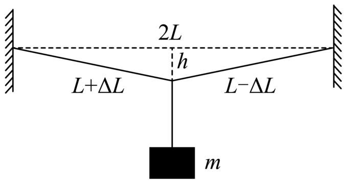

# Physics - 题目 1587

**ID**: 5d9e3b8eba8b4a5ca61ade1aea32866e
**年级**: Grade 10
**难度**: Medium-Hard
**题型**: Calculation

## 题目
建筑、桥梁工程中所用的金属材料（如钢筋钢梁等）在外力作用下会伸长，其伸长量不仅与和拉力的大小有关，还和金属材料的横截面积有关．人们发现对同一种金属，其所受的拉力与其横截面积的比值跟金属材料的伸长量与原长的比值的比是一个常数，这个常数叫做杨氏模量．用E表示，即:E= $\frac {\left ({\frac {F}{S}}\right )}{\left ({\frac {ΔL}{L}}\right )}$ ；​​​​​​​‌某同学为探究其是否正确，根据下面提供的器材:不同粗细不同长度的同种金属丝；不同质量的重物；螺旋测微器； 游标卡尺；米尺；天平；固定装置等．设计的实验如图所示．该同学取一段金属丝水平固定在固定装置上，将一重物挂在金属丝的中点，其中点发生了一个微小下移h（横截面面积的变化可忽略不计）．用螺旋测微器测得金属丝的直径为D；用游标卡尺测得微小下移量为h；用米尺测得金属丝的原长为2L；用天平测出重物的质量m（不超量程）．用游标卡尺测长度时如下图，右图是左图的放大图（放大快对齐的那一部分），读数是．以上测量量的字母表示该金属的杨氏模量的表达式为: E =．

## 解答

1. 试题分析：游标卡尺上主尺读数为：8mm，游标尺上第47个刻度与主尺上刻度对齐，所以读数为：47×0．02=0．94mm，故最后读数为：8+0．94=8．94mm．由图中几何关系，L+△L= $\sqrt {L{^{2}}+h{^{2}}}$ ，△L= $\sqrt {L{^{2}}+h{^{2}}}$ -L
2. 由 $ \frac {F}{mg}=\frac {L+\vartriangle L}{2h}$ ，解得： $F=mg\frac {L+\vartriangle L}{2h}$  ； $S=\frac {πD{^{2}}}{4}$ ，该金属的杨氏模量的表达式为： $E=\frac {\frac {F}{S}}{\frac {\vartriangle L}{L}}=\frac {2mgL\sqrt {L{^{2}}+h{^{2}}}}{πD{^{2}}h(\sqrt {L{^{2}}+h{^{2}}}-L)}$
3. 考点：游标卡尺的读数；探究弹簧的弹力和伸长量之间的关系

## 知识点

**中文**:
  - 实验：探究弹簧弹力和形变量的关系

**English**:
  - Experiment: Investigating Spring Force vs Deformation

---
