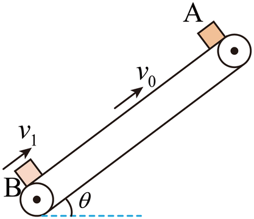

# Physics - 题目 1908

**ID**: 5daec2b6f5fd462a9c89ffd14d7e9684
**年级**: Grade 10
**难度**: Medium-Hard
**题型**: Calculation

## 题目
如图所示，与水平面夹角 $θ=37{}\degree $ 的倾斜传送带以 $v{{}_{0}}=2{\rm{m}}/{\rm{s}}$ 的速度沿顺时针方向转动，小物块A从传送带顶端无初速度释放的同时，小物块B以 $v{{}_{1}}=8{\rm{m}}/{\rm{s}}$ 的速度从底端滑上传送带。​​​​​​​‌已知小物块A、B质量均为 $m=1{\rm{k}}{\rm{g}}$ ，与传送带间的动摩擦因数分别为 $μ{{}_{{\rm{B}}}}=0.5$ ， $μ{{}_{{\rm{A}}}}=0.7$ ，小物块A、B未在传送带上发生碰撞，重力加速度g取 $10{\rm{m}}/{\rm{s}}{^{2}}$ ， ${\rm{s}}{\rm{i}}{\rm{n}}37{}\degree =0.6$ ， ${\rm{c}}{\rm{o}}{\rm{s}}37{}\degree =0.8$ 求：(1)小物块B从底端刚滑上传送带时的加速度大小及方向？小物块A无初速度释放时的加速度大小？(2)小物块B滑上传送带直至离开所经历的时间是多长？(3)传送带从底端到顶端的长度L应满足的条件。

## 解答

1. （1）以物块 ${\rm{B}}$ 为研究对象，根据牛顿第二定律有 $μ{{}_{{\rm{B}}}}mg{\cos}37{}\degree +mg\sin 37{}\degree =ma{{}_{{\rm{B}}{{1}}}}$
2. 解得 $a{{}_{{\rm{B}}1}}=10{\rm{m}}/{\rm{s}}{^{2}}$
3. 方向沿倾斜传送带向下；
4. 以物块 ${\rm{A}}$ 为研究对象，根据牛顿第二定律有 $mg\sin 37{}\degree -μ{{}_{{\rm{A}}}}mg{\cos}37{}\degree =ma{{}_{{\rm{A}}}}$
5. 解得 $a{{}_{{\rm{A}}}}=0.4{\rm{m}}/{\rm{s}}{^{2}}$
6. （2）物块B先减速至和传送带共速，所用时间 $t{{}_{{\rm{B}}{{1}}}}=\frac {v{{}_{1}}-v{{}_{0}}}{a{{}_{{\rm{B}}{{1}}}}}=0.6{\rm{s}}$
7. 沿传送带上升的距离 $x{{}_{{\rm{B}}{{1}}}}=\frac {v{{}_{1}^{2}}-v{{}_{0}^{2}}}{2a{{}_{{\rm{B}}{{1}}}}}=3{\rm{m}}$
8. 共速后，对B研究对象根据牛顿第二定律有 $mg\sin 37{}\degree -μ{{}_{{\rm{B}}}}mg{\cos}37{}\degree =ma{{}_{{\rm{B}}{{2}}}}$
9. 解得 $a{{}_{{\rm{B}}{{2}}}}=2{\rm{m}}/{\rm{s}}{^{2}}$
10. 物块B由与传送带共速减至速度为0，所用时间 $t{{}_{{\rm{B}}{{2}}}}=\frac {v{{}_{0}}}{a{{}_{{\rm{B}}{{2}}}}}=1{\rm{s}}$
11. 又沿传送带上升的距离 $x{{}_{{\rm{B}}{{2}}}}=\frac {v{{}_{0}^{2}}}{2a{{}_{{\rm{B}}{{2}}}}}=1{\rm{m}}$
12. B减速至0后沿传送带下滑，物块B下滑的加速度大小仍为 $a{{}_{{\rm{B}}{{2}}}}$ ，则 $x{{}_{{\rm{B}}}}=x{{}_{{\rm{B}}{{1}}}}+x{{}_{{\rm{B}}{{2}}}}=\frac {1}{2}a{{}_{{\rm{B}}{{2}}}}t{{}_{3}^{2}}$
13. 联立解得 $t{{}_{3}}=2{\rm{s}}$
14. 小物块B滑上传送带直至离开经历的时间 $t{{}_{总}}=t{{}_{1}}+t{{}_{2}}+t{{}_{3}}=3.6{\rm{s}}$
15. （3）从开始到B与A共速，设A运动的时间为 $t$ ，则 $a{{}_{{\rm{A}}}}t=a{{}_{{\rm{B}}{{2}}}}\left ({t-t{{}_{1}}-t{{}_{2}}}\right )$
16. 解得 $t=2{\rm{s}}$
17. B沿传送带下滑至与A共速时沿传送带下滑的距离 $x{{}_{{\rm{B}}3}}=\frac {1}{2}a{{}_{{\rm{B}}2}}{\left({t-t{{}_{1}}-t{{}_{2}}}\right)^{2}}=0.16{\rm{m}}$
18. 则A沿传送带下滑的距离 $x{{}_{{\rm{A}}}}=\frac {1}{2}a{{}_{{\rm{A}}}}t{^{2}}=0.8{\rm{m}}$
19. $L{{}_{0}}=x{{}_{{\rm{B}}}}-x{{}_{{\rm{B}}3}}+x{{}_{{\rm{A}}}}=4.64{\rm{m}}$
20. 因此满足A，B末在传送带上发生碰撞，传送带从底端到顶端的长度应满足 $L>4.64{\rm{m}}$ 。

## 知识点

**中文**:
  - 传送带模型

**English**:
  - Conveyor Belt Model

---
