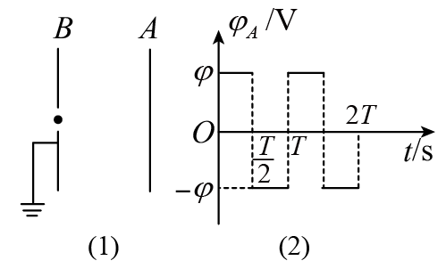

# Physics - 题目 1534

**ID**: 5e54f9dca925485a8931f2ffbb638f41
**年级**: Grade 10
**难度**: Medium-Hard
**题型**: Calculation

## 题目
如图（1）中A和B是真空中的两块面积很大的平行金属板，加上周期为T的交变电压，在两板间产生交变的匀强电场。​​​​​​​‌已知B板电势为零，A板电势φ_{A}随时间t变化的规律如图（2）所示。A板电势最高值为 $φ$ ，最低值为-φ。已知在t=0时刻，一个电荷量为-e的电子（重力不计） ，在电场力的作用下，从B板的小孔中由静止开始向A板运动，当t= T时，电子刚好到达A板。如果该电子是在 $t=\frac {T}{8}$ 时刻才从B板的小孔由静止开始运动，求:（1）从 $\frac {T}{8}$ 到 $\frac {T}{2}$ 时间内，电场力对该电子所做的功;（2）该电子运动多长时间才能第一次到达A板?

## 解答

1. （1）设A、B两板间距为d，电子运动的加速度大小为a，对于t=0时刻进入的电子，前半周期向右匀加速运动，后半周期向右匀减速运动到速度为零。前半周期和后半周期位移相同，均为 $\frac {d}{2}$ ，有
2. d=2× $\frac {1}{2}a(\frac {T}{2}){{}^{2}}$
3. 对于t= $\frac {T}{8}$ 进入的电子，有
4. 在 $\frac {T}{8}$~$\frac {4T}{8}$ = $\frac {3T}{8}$ 内向右匀加速，有
5. x_{1}= $\frac {1}{2}a(\frac {3T}{8}){{}^{2}}$
6. 解得
7. x_{1}= $\frac {9}{32}d$
8. 设从 $\frac {T}{8}$ 到 $\frac {T}{2}$ 的时间内，电场力对该电子所做的功为W，有：
9. W= $\frac {9}{32}$eφ
10. （2）在 $\frac {4T}{8}$~$\frac {7T}{8}$ = $\frac {3T}{8}$ 内向右匀减速到速度为零，有
11. x_{2}=x_{1}= $\frac {9}{32}d$
12. 在 $\frac {7T}{8}$~$\frac {8T}{8}$ = $\frac {T}{8}$ 内反向向左匀加速，有
13. x_{3}= $\frac {1}{2}a(\frac {T}{8}){{}^{2}}$
14. 解得
15. x_{3}= $\frac {1}{32}d$
16. 在 $\frac {8T}{8}$~$\frac {9T}{8}$ = $\frac {T}{8}$ 内反向向左匀减速到速度为零，有
17. x_{4}=x_{3}= $\frac {1}{32}d$
18. 在 $\frac {9T}{8}$~$\frac {12T}{8}$ = $\frac {3T}{8}$ 内继续向右匀加速，有
19. x_{5}=x_{1}= $\frac {9}{32}d$
20. 所以电子运动T+ $\frac {3T}{8}$ 后，距B板距离为：
21. x=x_{1}+x_{2}-x_{3}-x_{4}+x_{5}= $\frac {9}{32}d$ + $\frac {9}{32}d$ - $\frac {1}{32}d$ - $\frac {1}{32}d$ + $\frac {9}{32}d$ = $\frac {25}{32}d$ <d
22. 在t= $\frac {12T}{8}$ 时刻，电子的速度为
23. v=a$(\frac {3T}{8})$
24. 解得
25. v= $\frac {3d}{2T}$
26. 从t= $\frac {12T}{8}$ 时刻开始，设再经过Δt时间，电子刚好到达A板，有
27. x_{6}=vΔt- $\frac {1}{2}$aΔt^{2}
28. d= $\frac {25}{32}d$ +x_{6}
29. 解得
30. Δt=（ $\frac {3}{8}\pm \frac {\sqrt {2}}{8}$ ）T
31. [（ $\frac {3}{8}$ + $\frac {\sqrt {2}}{8}$ ）T不符合题意，舍去]
32. 所以总时间为
33. t_{0}=T+ $\frac {3T}{8}$ +Δt= $\frac {(14-\sqrt {2})T}{8}$ ≈1.57T

## 知识点

**中文**:
  - 带电粒子在交变电场中的运动

**English**:
  - Motion in Alternating Electric Field

---
