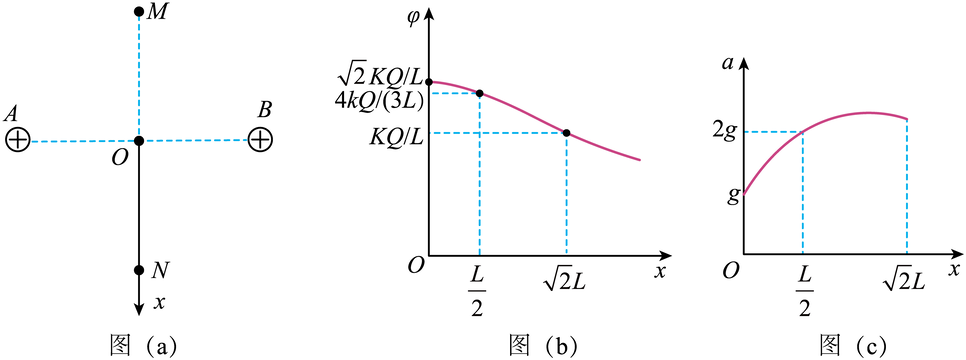

# Physics - 题目 49

**ID**: 61de5723e803476c9f08ae166e3da4cf
**年级**: Grade 10
**难度**: Medium-Hard
**题型**: Calculation

## 题目
如图（a），同一竖直平面内A、B、M、N四点距O点的距离均为 $\sqrt {2}L{\rm ，\mathit{O}}$ 为水平连线AB的中点，M、N在AB连线的中垂线上。​​​​​​​‌A、B两点分别固定有一点电荷，电荷量均为 $Q(Q>0)$ 。以O为原点，竖直向下为正方向建立x轴。若取无穷远处为电势零点，则ON上的电势 $φ$ 随位置x的变化关系如图（b）所示。一电荷量为 $Q(Q>0)$ 的小球以一定初动能从M点竖直下落，一段时间后经过N点，其在ON段运动的加速度大小a随位置x的变化关系如图（c）所示。图中g为重力加速度大小，k为静电力常量。求：（1）M点的电场强度；（2）小球的重力；（3）小球从M点运动到N点过程中，小球的电势能增加量。

## 解答

1. （1）设A到M点的距离为 $R{{}_{M}}{\rm ，\mathit{A}}$ 点的电荷对小球的库仑力大小为 $F{{}_{A}}$ ，由库仑定律有 $F{{}_{A}}=\frac {kQ{^{2}}}{R{{}_{M}^{2}}}$ ，
2. 设小球在M点所受电场力大小为 $F{{}_{M}}$ ，由力的合成有 $F{{}_{M}}=2F{{}_{A}}{\rm{s}}{\rm{i}}{\rm{n}}45{}\degree $ ，
3. 由几何关系可得 $R{{}_{M}}=\sqrt {(\sqrt {2}L){^{2}}+(\sqrt {2}L){^{2}}}=2L$ ，
4. 联立并代入数据得，则M点的电场强度 $E{{}_{M}}=\frac {F{{}_{M}}}{Q}=\frac {\frac {\sqrt {2}kQ{^{2}}}{4L{^{2}}}}{Q}=\frac {\sqrt {2}kQ}{4L{^{2}}}$ ，
5. 方向：竖直向上。
6. （2）设O点下方 $\frac {L}{2}$ 处为C点，A与C的距离为 $R{{}_{{\rm{C}}}}$ ，小球 $S{{}_{1}}$ 在C处所受的库仑力大小为 $F{{}_{{\rm{C}}}}$ ，由库仑定律和力的合成有 $F{{}_{C}}=2\frac {kQ{^{2}}}{R{{}_{C}^{2}}}{\rm{s}}{\rm{i}}{\rm{n}}θ$ ，
7. 式中 ${\rm{s}}{\rm{i}}{\rm{n}}θ=\frac {OC}{R{{}_{{\rm{C}}}}}$ ，
8. 设小球 $S{{}_{1}}$ 的质量为 $m{{}_{1}}$ ，小球 $S{{}_{1}}$ 在C点的加速度大小为a，由牛顿第二定律有 $F{{}_{C}}+m{{}_{1}}g=m{{}_{1}}a$ ，
9. 由图（c）可知，式中 $a=2g$ ，
10. 联立并代入数据得 $m{{}_{1}}=\frac {8kQ{^{2}}}{27gL{^{2}}}$ ，
11. 则小球的重力 $G=m{{}_{1}}g=\frac {8kQ{^{2}}g}{27gL{^{2}}}$ 。
12. （3）根据对称性 $φ{{}_{M}}=φ{{}_{{\rm{N}}}}$ ，
13. 从M点到N点小球的电势能变化量 ${\rm{Δ}}E{{}_{{\rm{p}}}}=Q\left ({φ{{}_{N}}-φ{{}_{M}}}\right )=0$ 。

## 知识点

**中文**:
  - 带电体在库仑力作用下的运动问题
  - 电势能与静电力做功

**English**:
  - Motion under Coulomb Force
  - Electric Potential Energy and Work Done by Electrostatic Force

---
