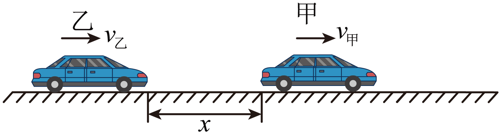

# Physics - 题目 1602

**ID**: 66ceebb0b06a4ce7993161538721dd05
**年级**: Grade 10
**难度**: Medium-Hard
**题型**: Calculation

## 题目
如图，在笔直的公路上前后同向行驶着甲、乙两辆汽车，两车距离s=47m，速度大小分别为v_{甲}=20m/s、v_{乙}=30m/s。​​​​​​​‌甲车司机发现正前方突发事，立即开始刹车做匀减速直线运动。乙车司机发现甲车开始刹车后经过t_{0}=1s，也立即刹车做匀减速直线运动。甲车减速x_{1}=100m后停下，求：（1）甲车刹车的加速度大小a_{1}和乙开始刹车时甲乙的间距x；（2）为保证甲乙两车不发生撞车事，则乙车刹车加速度大小a_{2}的最小值为多少？（3）若乙车刹车时加速度大小a_{3}=5m/s^{2}，在其他条件不变的情况下，为保证甲乙两车不发生撞车事，则甲乙两辆汽车行驶过程距离的最小值为多少？

## 解答

1. （1）甲车匀减速过程有 $v{{}_{甲}^{2}}-0=2a{{}_{1}}x{{}_{1}}$
2. 代入题中数据，解得 $a{{}_{1}}=2{\rm{m}}/{\rm{s}}{^{2}}$
3. 乙开始刹车时甲车行驶的位移 $x{{}_{甲}}=v{{}_{甲}}t{{}_{0}}-\frac {1}{2}a{{}_{1}}t{{}_{0}^{2}}=19{\rm{m}}$
4. 乙车行驶的位移 $x{{}_{乙}}=v{{}_{乙}}t{{}_{0}}=30{\rm{m}}$
5. 则乙开始刹车时甲乙的间距 $x=s-\left ({x{{}_{乙}}-x{{}_{甲}}}\right )=36{\rm{m}}$
6. （2）设甲车刹车到甲乙两车共速时间为t，有 $v{{}_{乙}}-a{{}_{2}}\left ({t-1{\rm{s}}}\right )=v{{}_{甲}}-a{{}_{1}}t$
7. 为保证甲乙两车不发生撞车事，则有 $v{{}_{乙}}t{{}_{0}}+v{{}_{乙}}\left ({t-1{\rm{s}}}\right )-\frac {1}{2}a{{}_{2}}(t-1{\rm{s}}){^{2}}⩽v{{}_{甲}}t-\frac {1}{2}a{{}_{1}}t{^{2}}+{\rm{s}}$
8. 解得 $a{{}_{2}}⩾4{\rm{m}}/{\rm{s}}{^{2}}$
9. 则乙车刹车加速度大小 $a{{}_{2}}$ 的最小值为 $4{\rm{m}}/{\rm{s}}{^{2}}$ 。
10. （3）若乙车刹车时加速度大小最大可达 $a{{}_{3}}=5{\rm{m}}/{\rm{s}}{^{2}}$ ，设甲车刹车到甲乙两车共速用时为t，则有 $v{{}_{乙}}-a{{}_{3}}\left ({t-t{{}_{0}}}\right )=v{{}_{甲}}-a{{}_{1}}t$
11. 解得t=5s
12. 从甲开始减速到甲乙速度相等位移差 $s{{}_{0}}=\left [v{{}_{乙}}t{{}_{0}}+v{{}_{乙}}\left ({t-t{{}_{0}}}\right )-\frac {1}{2}a{{}_{3}}{\left({t-t{{}_{0}}}\right)^{2}}-v{{}_{甲}}t+\frac {1}{2}a{{}_{1}}t{^{2}}\right ]=35{\rm{m}}$
13. 甲乙两辆汽车行驶过程距离的最小值 $Δx=s-s{{}_{0}}=12{\rm{m}}$

## 知识点

**中文**:
  - 刹车问题

**English**:
  - Braking Problems

---
