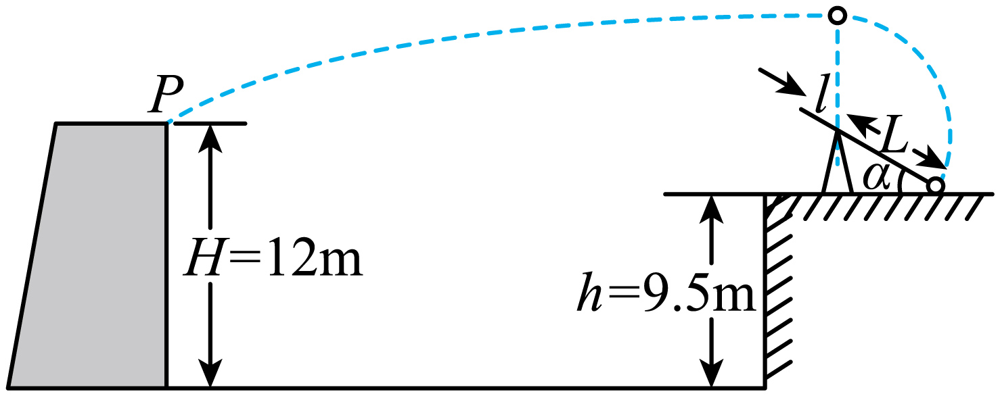

# Physics - 题目 903

**ID**: 6ac0063bffbc4c3ca98cccb9b58da848
**年级**: Grade 10
**难度**: Medium-Hard
**题型**: Calculation

## 题目
“抛石机”是古代战争中常用的一种设备，其装置简化原理如图所示。​​​​​​​‌“抛石机”长臂的长度L=5m，短臂的长度未知，在某次攻城战中，敌人城墙高度H=12m，士兵们为了能将石块投入敌人城中，在城外堆出了高h=9.5m的小土丘，在小土丘上使用“抛石机”对敌人进行攻击，士兵将质量m=5kg的石块装在长臂末端的弹筐中，开始时长臂处于静止状态，其与水平底面夹角 $α=30{}\degree $ ，现对短臂施力，石块抛出前一直做加速圆周运动，当长臂转到竖直位置时立即停止转动，石块被水平抛出且恰好击中城墙顶端的P点，P点与抛出位置间的水平距离x=20m。不计空气阻力，重力加速度g=10m/s^{2}。（1）求石块刚被抛出时的速度大小v；（2）若人作用于短臂末端的最大速度为4m/s，求短臂的长度l最长为多少；（3）求石块转到最高点时对弹筐竖直方向作用力的大小；（4）当长臂转到水平位置时，石块的速度为5m/s，向上的加速度为20m/s^{2}，求弹筐对石块作用力的大小（结果可用根号表示）。

## 解答

1. （1）抛石机支架的高度 $h{{}_{1}}=L\sin α=2.5{\rm m}$ ，
2. 石块刚被抛出点与P点的竖直高度差为 $h{{}_{2}}=h+h{{}_{1}}+L-H=9.5{\rm m}+2.5{\rm m}+5{\rm m}-12{\rm m}=5{\rm m}$ ，
3. 石块被抛出后做平抛运动，则 $h{{}_{2}}=\frac {1}{2}gt{^{2}}$ ， $x=vt$ ，
4. 解得石块刚被抛出时的速度大小 $v=20{{\rm m}}/{{\rm s}}$ 。
5. （2）短臂与长臂的转动角速度相同，由 $v=ωL$ ， $v{{}_{1}}=ωl$ ，
6. 解得短臂的长度l最长为 $l=1{\rm m}$ 。
7. （3）石块转到最高点时由牛顿第二定律得 $mg+F=m\frac {v{^{2}}}{L}$ ，
8. 解得F=350N，
9. 由牛顿第三定律知石块转到最高点时对弹筐竖直方向作用力的大小 $F^{′}=F=350{\rm{N}}$ 。
10. （4）当长臂转到水平位置时，对石块在竖直方向上 $F{{}_{1}}-mg=ma$ ，
11. 解得竖直方向上弹筐对石块作用力的大小 $F{{}_{1}}=150{\rm N}$ ，
12. 当长臂转到水平位置时，对石块在水平方向上 $F{{}_{2}}=m\frac {v{{}_{2}}{^{2}}}{L}=25{\rm N}$ ，
13. 所以当长臂转到水平位置时，弹筐对石块作用力的大小为 $F{{}_{3}}=\sqrt {F{{}_{1}}{^{2}}+F{{}_{2}}{^{2}}}=25\sqrt {37}{\rm N}$ 。

## 知识点

**中文**:
  - 求解平抛运动、类平抛运动问题
  - 竖直面内圆周运动问题

**English**:
  - Solving Horizontal and Quasi-Horizontal Projectile Problems
  - Circular Motion in Vertical Plane

---
