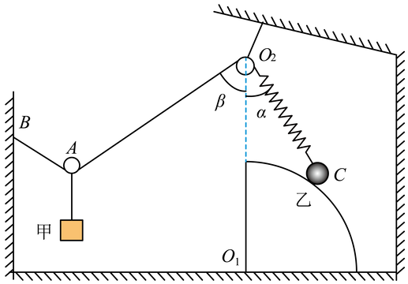

# Physics - 题目 2240

**ID**: 6b3fcf4050dd46fd917e7f1b6f97ad9a
**年级**: Grade 10
**难度**: Medium-Hard
**题型**: Calculation

## 题目
如图所示，粗糙水平面上静止放置一上表面光滑的四分之一圆柱体，光滑轻质小滑轮在圆心 $O{{}_{1}}$ 的正上方 $O{{}_{2}}$ 处用轻杆固定。​​​​​​​‌细线一端跨过小滑轮 $O{{}_{2}}$ 连接一劲度系数 $k=200{\rm{N}}{\rm{/}}{\rm{m}}$ 的轻质弹簧，另一端固定在 $B$ 点，轻质光滑小滑轮A放置在细线上，下面悬挂物块甲，弹簧下端与质量为 $m{{}_{乙}}=1.6{\rm{k}}{\rm{g}}$ 的小球乙连接，小球乙置于圆柱体上， $O{{}_{2}}C$ 与竖直方向成 $α=37{}\degree $ 角， $O{{}_{2}}A$ 与竖直方向成 $β=53{}\degree $ 角，整个装置处于静止状态。已知 $O{{}_{2}}C$ 长度与圆柱体半径相等，不计细线、滑轮质量（ $\sin 37\mathrm{°}=0.6$ ， ${\cos}37\mathrm{°}=0.8$ ，重力加速度 $g$ 取10m/s^{2}），求：(1)轻质弹簧的伸长量和物块甲的质量；(2)地面对四分之一圆柱体摩擦力的大小和杆对滑轮 $O{{}_{2}}$ 作用力的大小。

## 解答

1. （1）对小球乙分析，受拉力、重力、支持力处于平衡状态，根据几何关系和平衡条件可得小球乙受拉力 $F{{}_{{\rm{T}}}}=\frac {m{{}_{乙}}g}{2{\cos}37{}\degree }=10{\rm{N}}$
2. 则根据牛顿第三定律，轻质弹簧受小球乙拉力 $F\mathrm{′}{{}_{{\rm{T}}}}=F{{}_{{\rm{T}}}}$
3. 根据胡克定律 $F\mathrm{′}{{}_{{\rm{T}}}}=k\Delta x$
4. 轻质弹簧的伸长量 $\Delta x=\frac {F\mathrm{′}{{}_{{\rm{T}}}}}{k}=0.05{\rm{m}}$
5. 对物块甲分析，根据竖直方向平衡条件可得 $2F{{}_{{\rm{T}}}}{\cos}53{}\degree =m{{}_{甲}}g$
6. 代入数据解得物块甲质量 $m{{}_{甲}}=1.2{\rm{k}}{\rm{g}}$
7. （2）对小球乙分析，圆柱体对乙的支持力大小 $F{{}_{{\rm{N}}}}=\frac {m{{}_{乙}}g}{2{\cos}37{}\degree }$
8. 方向与竖直方向夹角为37°，则根据牛顿第三定律，乙对圆柱体压力 $F\mathrm{′}{{}_{{\rm{N}}}}=F{{}_{{\rm{N}}}}$
9. 对圆柱体分析，根据水平方向的平衡条件可得 $F{{}_{{\rm{f}}}}=F{{}_{{\rm{N}}}}\sin 37{}\degree $
10. 得 $F{{}_{{\rm{f}}}}=\frac {m{{}_{乙}}g}{2{\cos}37{}\degree }\sin 37{}\degree $
11. 代入数据解得地面对四分之一圆柱体的摩擦力大小 $F{{}_{{\rm{f}}}}=6{\rm{N}}$
12. 对滑轮 $O{{}_{2}}$ 分析，根据平衡条件，两绳对滑轮的作用力合力（两力大小相等且垂直，则合力为 $\sqrt {2}F{{}_{{\rm{T}}}}$ ）与杆对滑轮作用力大小相等，则杆对滑轮 $O{{}_{2}}$ 作用力大小 $F=\sqrt {2}F{{}_{{\rm{T}}}}$
13. 代入数据解得杆对滑轮 $O{{}_{2}}$ 作用力大小 $F=10\sqrt {2}{\rm{N}}$

## 知识点

**中文**:
  - 用正交分解法分析问题

**English**:
  - Problem Analysis using Orthogonal Decomposition

---
