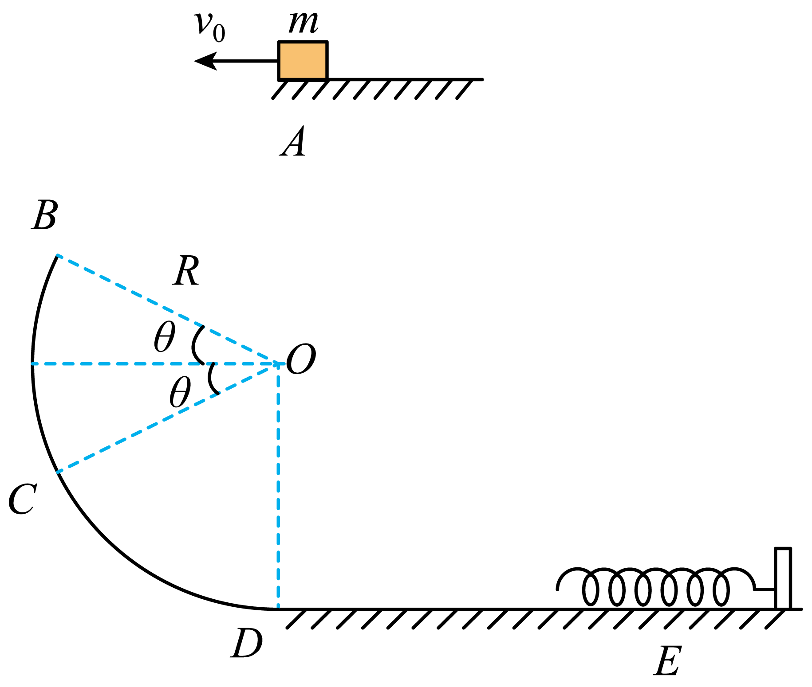

# Physics - 题目 858

**ID**: 6bf55b5849694169951d320344023fc5
**年级**: Grade 10
**难度**: Medium-Hard
**题型**: Calculation

## 题目
如图所示，半径 $R=1{\rm{m}}$ 的光滑圆弧轨道 $BCD$ ，固定在竖直平面内，轨道的上端点B和圆心O的连线与水平方向的夹角 $θ=30{}\degree ，OC$ 与 $OB$ 关于水平方向对称， $D$ 点为圆弧电源的最低点，与粗糙水平面相切（平滑连接），一轻质弹簧的右端固定在竖直挡板上。​​​​​​​‌质量 $m=1{\rm{k}}{\rm{g}}$ 、可视为质点的小物块从空中A点以 $v{{}_{0}}=2{\rm{m}}/{\rm{s}}$ 的速度水平抛出，恰好从 $B$ 点沿轨道切线方向进入轨道，经过圆弧轨道上 $D$ 点后沿水平面向右运动至 $E$ 点时，弹簧被压缩至最短，小物块第二次到达 $D$ 点时刚好停止运动，不计空气阻力，弹簧始终在弹性限度内，重力加速度 $g$ 取 $10{\rm{m}}{\rm{/}}{\rm{s}}{^{{{2}}}}$ 。求：（1）小物块运动到 $B$ 点时的速度大小；（2）小物块经过 $C$ 点时对轨道的压力大小；（3）整个过程中弹簧弹性势能的最大值 $E{{}_{{\rm{p}}{\rm{m}}}}$ 。

## 解答

1. （1）小物块恰好从 $B$ 点沿切线方向进入轨道，由几何关系有 $v{{}_{B}}=\frac {v{{}_{0}}}{{\rm{s}}{\rm{i}}{\rm{n}}θ}$ ，
2. 解得 $v{{}_{B}}=4{\rm{m}}/{\rm{s}}$ 。
3. （2）小物块由 $B$ 点运动到 $C$ 点，由机械能守恒定律得 $2mgR{\rm{s}}{\rm{i}}{\rm{n}}θ=\frac {1}{2}mv{{}_{C}^{2}}-\frac {1}{2}mv{{}_{B}^{2}}$ ，
4. 在 $C$ 点处，由牛顿第二定律有 $F{{}_{{\rm{N}}}}-mg{\rm{s}}{\rm{i}}{\rm{n}}θ=m\frac {v{{}_{C}^{2}}}{R}$ ，
5. 解得 $F{{}_{{\rm{N}}}}=41{\rm{N}}$ ，
6. 根据牛顿第三定律，小物块经过圆弧轨道上 $C$ 点时对轨道的压力 $F{{}_{{\rm{N}}}}{^{\prime }}=F{{}_{{\rm{N}}}}=41{\rm{N}}$ 。
7. （3）小物块由 $B$ 点运动到 $D$ 点，由机械能守恒定律有 $\frac {1}{2}mv{{}_{B}^{2}}+mgR\left ({1+{\rm{s}}{\rm{i}}{\rm{n}}θ}\right )=\frac {1}{2}mv{{}_{D}^{2}}$ ，
8. 小物块从 $D$ 点运动到 $E$ 点，由能量守恒定律有 $\frac {1}{2}mv{{}_{D}^{2}}=W{{}_{{\rm{f}}}}+E{{}_{{\rm{p}}{\rm{m}}}}$ ，
9. 从 $E$ 点运动到 $D$ 点，由能量守恒定律有 $E{{}_{{\rm{p}}{\rm{m}}}}=W{{}_{{\rm{f}}}}$ ，
10. 解得 $E{{}_{{\rm{p}}{\rm{m}}}}=11.5{\rm{J}}$ 。

## 知识点

**中文**:
  - 功能原理、能量守恒与曲线运动的综合

**English**:
  - Energy Conservation in Curvilinear Motion

---
