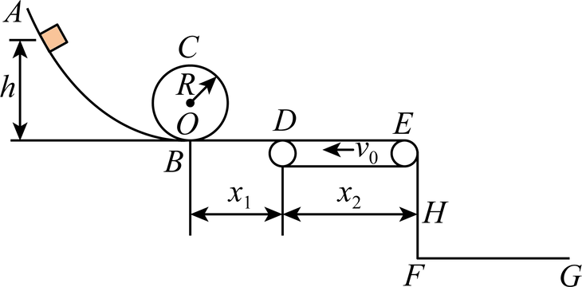

# Physics - 题目 2127

**ID**: 6d76fd7a875f4d78931a53055e644264
**年级**: Grade 10
**难度**: Medium-Hard
**题型**: Calculation

## 题目
商场推出一批新型滑动轨道，简化后模型如下图所示，主要由光滑圆弧面轨道AB、光滑竖直圆轨道BC、水平轨道BD、水平传送带DE和足够长的落地区FG组成，各部分平滑连接，圆轨道最低点B处的入、出口靠近但相互错开，滑块落到FG区域后立即停止运动，现将一质量为m=0.2kg的滑块从轨道AB上某一位置由静止释放，若滑块恰好能通过圆轨道的最高点C，且到C时的速度为 $v=\sqrt {3}{\rm{m}}{\rm{/}}{\rm{s}}$ ，水平面BD的长度 $x{{}_{1}}=2{\rm{m}}$ ，传送带长度 $x{{}_{2}}=3{\rm{m}}$ ，距落地区的竖直高度 $H=0.45{\rm{m}}$ ，滑块与水平轨道BD和传送带间的动摩擦因数均为μ=0.2，传送带以恒定速度 $v{{}_{0}}=5{\rm{m}}{\rm{/}}{\rm{s}}$ 沿逆时针方向转动，取 $g=10{\rm{m}}{\rm{/}}{\rm{s}}{^{{{2}}}}$ 。​​​​​​​‌（1）求圆轨道半径R，及滑块恰好过圆轨道最高点C时，滑块释放点的高度ℎ_{1}；（2）要使滑块恰能运动到E点，求滑块释放点的高度ℎ_{2}；（3）当滑块释放的高度ℎ=1.2m时，求滑块落到FG区域后停止运动时，距B点的水平距离x，以及滑块落到FG前瞬间的速度大小。

## 解答

1. （1）当滑块恰好过圆轨道最高点C时，由重力提供向心力，由牛顿第二定律得 $mg=m\frac {v{^{2}}}{R}$ ，解得 $R=0.3{\rm{m}}$ ，滑块恰好过圆轨道最高点C时，根据动能定理 $mg(h{{}_{1}}-2R)=\frac {1}{2}mv{^{2}}$ ，解得 $h{{}_{1}}=0.75{\rm{m}}$
2. （2）要使滑块恰能运动到E点，则滑块到E点的速度 $v{{}_{E}}=0$ ，从A到E过程中，根据动能定理有 $mgh{{}_{2}}-{\rm μm}g(x{{}_{1}}+x{{}_{2}})=0$ ，解得 $h{{}_{2}}=1{\rm{m}}$ ，显然 $h{{}_{2}}>h{{}_{1}}$ ，所以要使滑块恰能运动到E点，则滑块释放点的高度 $h{{}_{2}}=1m$ 。
3. （3）当滑块释放点的高度h=1.2m时，滑块从E点飞出，根据动能定理有 $mgh-{\rm μm}g(x{{}_{1}}+x{{}_{2}})=\frac {1}{2}mv{{}_{E}^{2}}$ ，解得 $v{{}_{E}}=2{\rm{m}}{\rm{/}}{\rm{s}}$ ，滑块从E点飞出做平抛运动，平抛运动的时间为 $t=\sqrt {\frac {2H}{g}}$ ，解得 $t=0.3{\rm{s}}$ ，所以滑块落到FG区域后停止运动时，距B点的水平距离 $x=x{{}_{1}}+x{{}_{2}}+v{{}_{E}}t$ ，解得 $x=5.6{\rm{m}}$ ，根据动能定理 $mg(h+H)-{\rm μm}g(x{{}_{1}}+x{{}_{2}})=\frac {1}{2}mv{{}_{末}^{2}}$ ，解得 $v{{}_{末}}=\sqrt {13}{\rm{m}}{\rm{/}}{\rm{s}}$

## 知识点

**中文**:
  - 应用动能定理求解多阶段、多过程问题

**English**:
  - Multi-stage/Multi-process Problems

---
