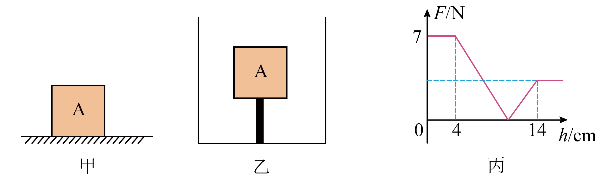

# Physics - 题目 279

**ID**: 6e24942c6d834d26a3bbc339a5a9e31b
**年级**: Grade 10
**难度**: Medium-Hard
**题型**: Calculation

## 题目
如图甲所示，一不吸水的正方体物块 ${\rm{A}}$ 静止在水平桌面上，现将物块 ${\rm{A}}$ 与一轻质细杆（质量、体积均不计）连接后，将细杆的另一端固定在质量为1kg、底面积为 $200{\rm{c}}{\rm{m}}{^{2}}$ 的容器底部，如图乙所示。​​​​​​​‌容器放在水平桌面上，现向容器内缓慢地加水，物块对杆的力大小 $F$ 与容器内水的深度 $h$ 的关系如图丙所示。 $ρ{{}_{水}}=1.0\times 10{^{3}}{\rm{k}}{\rm{g}}/{\rm{m}}{^{3}}$ ， $g$ 取 $10{\rm{N}}/{\rm{k}}{\rm{g}}$ ，求：（1）物块 ${\rm{A}}$ 静止在水平桌面上时对水平桌面的压强；（2）物块 ${\rm{A}}$ 浸没时受到水的浮力大小；（3）物块 ${\rm{A}}$ 对杆的力 $F$ 的大小为2N时，水对物块 ${\rm{A}}$ 下表面的压强。

## 解答

1. （1）由题图丙可知，水的深度为4cm时物块 ${\rm{A}}$ 开始浸入水中，水的深度为14cm时物块 ${\rm{A}}$ 完全浸没，所以物块 ${\rm{A}}$ 的边长为 $14{\rm{c}}{\rm{m}}-4{\rm{c}}{\rm{m}}=10{\rm{c}}{\rm{m}}=0.1{\rm{m}}$
2. 未加水时，物块 ${\rm{A}}$ 对杆的力的大小为7N，则物块 ${\rm{A}}$ 受到的重力大小 $G=7{\rm{N}}$
3. 物块 ${\rm{A}}$ 静止在水平桌面上时对水平桌面的压强 $p{{}_{1}}=\frac {F}{S}=\frac {G}{S}=\frac {7{\rm{N}}}{(0.1{\rm{m}}){^{2}}}=7\times 10{^{2}}{\rm{P}}{\rm{a}}$
4. （2）物块 ${\rm{A}}$ 浸没时排开水的体积 $V{{}_{排}}=V{{}_{A}}=(0.1{\rm{m}}){^{3}}=1\times 10{^{-3}}{\rm{m}}{^{3}}$
5. 水的浮力大小 $F{{}_{浮}}=ρ{{}_{水}}gV{{}_{排}}=1.0\times 10{^{3}}{\rm{k}}{\rm{g}}/{\rm{m}}{^{3}}\times 10{\rm{N}}/{\rm{k}}{\rm{g}}\times 10{^{-3}}{\rm{m}}{^{3}}=10{\rm{N}}$
6. （3）第一种情况，当物块 ${\rm{A}}$ 受到的重力大于受到的浮力时，物块 ${\rm{A}}$ 受到的浮力大小 $F{{}_{1}}=G-F=7{\rm{N}}-2{\rm{N}}=5{\rm{N}}$
7. 物块 ${\rm{A}}$ 浸入水中的体积 $V{{}_{1}}=\frac {F{{}_{1}}}{ρ{{}_{水}}g}=\frac {5{\rm{N}}}{1.0\times 10{^{3}}{\rm{k}}{\rm{g}}/{\rm{m}}{^{3}}\times 10{\rm{N}}/{\rm{k}}{\rm{g}}}=5\times 10{^{-4}}{\rm{m}}{^{3}}$
8. 物块 ${\rm{A}}$ 浸入水中的深度 $h{{}_{1}}=\frac {V{{}_{1}}}{S{{}_{A}}}=\frac {5\times 10{^{-4}}{\rm{m}}{^{3}}}{(0.1{\rm{m}}){^{2}}}=0.05{\rm{m}}$
9. 物块 ${\rm{A}}$ 下表面受到水的压强 $p{{}_{2}}=ρ{{}_{水}}gh{{}_{1}}=1.0\times 10{^{3}}{\rm{k}}{\rm{g}}/{\rm{m}}{^{3}}\times 10{\rm{N}}/{\rm{k}}{\rm{g}}\times 0.05{\rm{m}}=5\times 10{^{2}}{\rm{P}}{\rm{a}}$
10. 第二种情况，当物块 ${\rm{A}}$ 受到的重力小于受到的浮力时，物块 ${\rm{A}}$ 受到的浮力大小 $F{{}_{2}}=G+F=7{\rm{N}}+2{\rm{N}}=9{\rm{N}}$
11. 物块 ${\rm{A}}$ 浸入水中的体积 $V{{}_{2}}=\frac {F{{}_{2}}}{ρ{{}_{水}}g}=\frac {9{\rm{N}}}{1.0\times 10{^{3}}{\rm{k}}{\rm{g}}/{\rm{m}}{^{3}}\times 10{\rm{N}}/{\rm{k}}{\rm{g}}}=9\times 10{^{-4}}{\rm{m}}{^{3}}$
12. 物块 ${\rm{A}}$ 浸入水中的深度 $h{{}_{2}}=\frac {V{{}_{2}}}{S{{}_{A}}}=\frac {9\times 10{^{-4}}{\rm{m}}{^{3}}}{(0.1{\rm{m}}){^{2}}}=0.09{\rm{m}}$
13. 物块 ${\rm{A}}$ 下表面受到水的压强 $p{{}_{3}}=ρ{{}_{水}}gh{{}_{2}}=1.0\times 10{^{3}}{\rm{k}}{\rm{g}}/{\rm{m}}{^{3}}\times 10{\rm{N}}/{\rm{k}}{\rm{g}}\times 0.09{\rm{m}}=9\times 10{^{2}}{\rm{P}}{\rm{a}}$

## 知识点

**中文**:
  - 力学

**English**:
  - Mechanics

---
