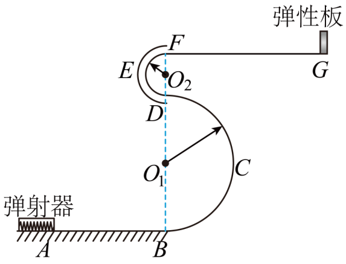

# Physics - 题目 505

**ID**: 6ef6d5228cdd42a68e61a71753207993
**年级**: Grade 10
**难度**: Medium-Hard
**题型**: Calculation

## 题目
为助力全国文明城区建设，九龙坡区师生积极参与社区建设，组织了“科技创作进社区”等一系列活动，如图所示为某小区业主自行研制的一弹射游戏装置，该装置由安装在水平台面上的固定弹射器、水平直轨道AB、圆心为O_{1}的竖直半圆轨道BCD、圆心为O_{2}的竖直半圆管道DEF，水平直轨道FG及弹性板等组成，轨道各部分平滑连接。​​​​​​​‌已知滑块（可视为质点）质量m=0.01kg，轨道BCD的半径R=0.8m，管道DEF的半径r=0.1m，滑块与轨道FG间的动摩擦因数μ=0.5，其余各部分轨道均光滑，轨道FG的长度L=2m，弹射器中弹簧的弹性势能最大值E_{Pm}=0.5J，滑块与弹簧作用后，弹簧的弹性势能完全转化为滑块的动能，滑块与弹性板作用后以等大速率弹回，g=10m/s^{2}。求：（1）若弹簧的弹性势能E_{P0}=0.4J，求滑块运动到B点时对轨道的压力的大小；（2）若滑块被弹簧弹开后恰能沿轨道BCD到达D点，请判断之后能否继续沿轨道DEF到达F点；（3）若滑块在运动过程中不脱离轨道且最终静止在轨道FG中点的右侧区域内，求弹簧的弹性势能E_{p}的范围。

## 解答

1. （1）到B点时，由机械能守恒定律 $E{{}_{{\rm{p}}{{}_{0}}}}=\frac {1}{2}mv{^{2}}$
2. 由向心力公式 $N-mg=m\frac {v{^{2}}}{R}$
3. 由牛顿第三定律 $N{^{\prime }}=N=1.1{\rm{N}}$
4. （2）运动中滑块恰能到达D点，则通到D点的速度为 $mg=\frac {mv{{}_{D}^{2}}}{R}$
5. $v{{}_{D}}=\sqrt {gR}=2\sqrt {2}{\rm{m}}/{\rm{s}}{\rm \mathit{DF}}$ 过程由机械能守恒得 $-2mgr=\frac {1}{2}mv{{}_{F}^{2}}-\frac {1}{2}mv{{}_{D}^{2}}$
6. 解得在F点有 $v{{}_{F}}=2{\rm{m}}/{\rm{s}}>0$
7. 则能到达F点。
8. （3）保证不脱离轨道，滑块在F点的速度至少为 $v{{}_{{\rm{m}}{\rm{i}}{\rm{n}}}}=v{{}_{F}}=2{\rm{m}}/{\rm{s}}$
9. 若以此速度在FG上滑行直至静止运动距离 $x{{}_{{\rm \min }}}=\frac {v{{}_{{\rm \min }}^{2}}}{2μg}=0.4{\rm{m}}$
10. 滑块没有越过FG的中点。滑块以最大弹性势能弹出时，在FG上滑行的最大路程为x_{max}，则 $E{{}_{{\rm{p}}{{}_{{\rm \max }}}}}={\rm μm}gx{{}_{{\rm \max }}}+mg(2R+2r)$
11. 解得x_{max}=6.4m
12. 由题意知，滑块不脱离轨道且最终静止在轨道FG中点的右侧区域，运动的路程应满足1m<x<3m或5m<x≤6.4m
13. 当x=1m时，可得E_{p1}=0.23J，当x=3m时，可得E_{p1}=0.33J；
14. 当x=5m时，可得E_{p1}=0.43J，当x=6.4m时，可得E_{p1}=0.5J；
15. 因此弹性势能E_{p}的范围0.23J<E_{p}<0.33J或0.43J<E_{p}≤0.50J

## 知识点

**中文**:
  - 单一物体机械能守恒定律的应用

**English**:
  - Applications for Single Body

---
