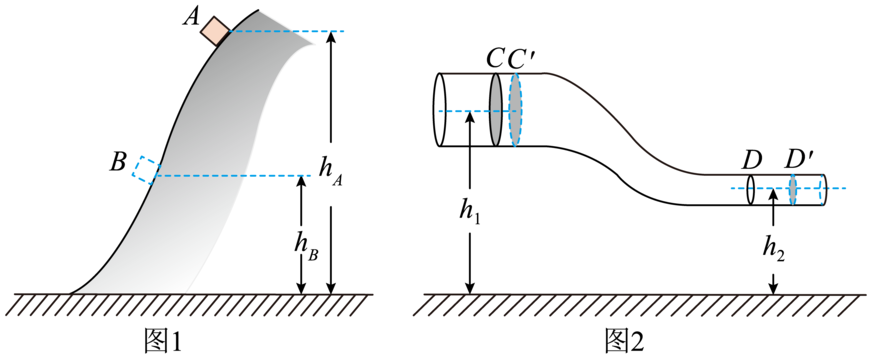

# Physics - 题目 2259

**ID**: 7395b2a13d7447dbb40c5225353dbd98
**年级**: Grade 10
**难度**: Medium-Hard
**题型**: Calculation

## 题目
追寻守恒量是物理学的重要研究内容，在高中阶段我们探索守恒量时，除了实验手段，也常借助已有理论来进行分析。​​​​​​​‌已知重力加速度为g。（1）如图1所示，A和B两位置分别距离地面高度为h_{A}和h_{B}，质量为m的物体（可视为质点）在A和B两位置的速度大小分别为v_{A}和v_{B}。a．以地面为参考平面，分别写出物体在A和B两位置的机械能E_{A}和E_{B}；b．利用动能定理和重力做功的特点，证明沿光滑曲面下滑的物块在A位置的机械能与在B位置的机械能相等。（2）供暖系统、自来水系统都是通过管道运送液体的。管内液体稳定流动时具有这样的特点：①管内各处液体体积无法压缩且密度均相同；②管内各处液体流速不随时间改变。如图2所示，选取横截面C和横截面D之间的液体为研究对象，当C处液体流动很小一段距离，到达C´时，D处液体正好流动到D´处。已知液体密度为ρ，C处的压强为p_{1}、流速为u_{1}、高度为h_{1}，D处的压强为p_{2}、流速为u_{2}、高度为h_{2}，C处管道半径为R，C与C´间距离为d，且R、d均远远小于h_{2}。不计管道对液体的阻力，不考虑液体的黏滞性。在C、D间的液体流动至Cʹ、Dʹ的过程中a．求横截面C左侧液体对研究对象所做的功W_{1}；b．求重力对研究对象所做的功W_{G}；c．研究表明，可运用动能定理对C、D间的液体进行分析。请依据动能定理探索压强p、流速u、高度h是否也存在着某种守恒的关系。若存在，请写出关系式；若不存在，请说明理由。

## 解答

1. （1）a．以地面为参考平面，物体在A位置的机械能 $E{{}_{{\rm{A}}}}=\frac {1}{2}mv{{}_{{\rm{A}}}^{2}}+mgh{{}_{{\rm{A}}}}$  ，物体在B位置的机械能 $E{{}_{{\rm{B}}}}=\frac {1}{2}mv{{}_{{\rm{B}}}^{2}}+mgh{{}_{{\rm{B}}}}$
2. b．物体从A位置运动到B位置，重力做功 $W{{}_{{\rm{G}}}}=mgh{{}_{{\rm{A}}}}-mgh{{}_{{\rm{B}}}}$  ，根据动能定理，合外力做功 $W{{}_{合}}=\frac {1}{2}mv{{}_{B}^{2}}-\frac {1}{2}mv{{}_{A}^{2}}$ ，从A位置运动到B位置，由于曲面光滑，仅有重力做功，即 $W{{}_{合}}=W{{}_{G}}$ ，因此 $mgh{{}_{{\rm{A}}}}-mgh{{}_{{\rm{B}}}}=\frac {1}{2}mv{{}_{B}^{2}}-\frac {1}{2}mv{{}_{A}^{2}}$  ，可得 $\frac {1}{2}mv{{}_{{\rm{A}}}^{2}}+mgh{{}_{{\rm{A}}}}=\frac {1}{2}mv{{}_{{\rm{B}}}^{2}}+mgh{{}_{{\rm{B}}}}$ ，即物体在A位置的机械能与在B位置的机械能相等。
3. （2）a．横截面C左侧液体对研究对象所做的功 $W{{}_{1}}=Fs=p{{}_{1}}πR{^{2}}d$
4. b．C、D间液体流动至C´、D´间，可等效为C´、D间液体位置不变，C、C´间液体流动至D、D´间。C、C´间液体质量 $Δm=ρπR{^{2}}d$ ，重力对研究对象所做的功 $W{{}_{G}}=\vartriangle mg\cdot \vartriangle h=ρπR{^{2}}dg\left ({h{{}_{1}}-h{{}_{2}}}\right )$
5. c．在相同的时间内，流过C处截面水的体积与流过D处截面水的体积∆V相同。由C、C´间液体体积 $ΔV=πR{^{2}}d$ ，可知  $W{{}_{1}}=p{{}_{1}}ΔV$ ，设D处管道面积为S_{2}，D、D´间距离为x，则D、D´间液体体积 $S{{}_{2}}x=πR{^{2}}d$ ，横截面D右侧液体对研究对象所做的功 $W{{}_{2}}=-p{{}_{2}}S{{}_{2}}x=-p{{}_{2}}πR{^{2}}d=-p{{}_{2}}\vartriangle V$   ，由动能定理，合外力做功 $ΣW=\frac {1}{2}Δmu{{}_{2}^{2}}-\frac {1}{2}Δmu{{}_{1}^{2}}$ ，即 $ρΔVg(h{{}_{1}}-h{{}_{2}})+p{{}_{1}}ΔV-p{{}_{2}}ΔV=\frac {1}{2}ρΔVu{{}_{2}^{2}}-\frac {1}{2}ρΔVu{{}_{1}^{2}}$  ，整理得 $ρgh{{}_{1}}-ρgh{{}_{2}}+p{{}_{1}}-p{{}_{2}}=\frac {1}{2}ρu{{}_{2}^{2}}-\frac {1}{2}ρu{{}_{1}^{2}}$  ，所以压强 $p$ 、流速 $u$ 、高度 $h$ 是满足守恒的关系 $p{{}_{1}}+ρgh{{}_{1}}+\frac {1}{2}ρu{{}_{1}^{2}}=p{{}_{2}}+ρgh{{}_{2}}+\frac {1}{2}ρu{{}_{2}^{2}}$ ，即 $p+ρgh+\frac {1}{2}ρu{^{2}}$ 为守恒量。

## 知识点

**中文**:
  - 功能原理、能量守恒与曲线运动的综合

**English**:
  - Energy Conservation in Curvilinear Motion

---
