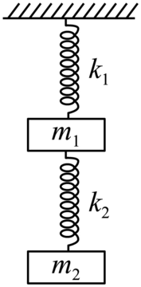

# Physics - 题目 2576

**ID**: 75129cad4031486d8d788fb9448db66c
**年级**: Grade 10
**难度**: Medium-Hard
**题型**: Calculation

## 题目
如图所示,原长分别为L_{1}和L_{2},劲度系数分别为k_{1}和k_{2}的轻质弹簧竖直悬挂在天花板上,两弹簧之间有一质量为m_{1}的物体,最下端挂着质量为m_{2}的另一物体,整个装置处于静止状态.​​​​​​​‌求:（1）这时两弹簧的总长;（2）若有一个质量为M的平板把下面的物体竖直缓慢地向上托起,直到两弹簧的总长度等于两弹簧的原长之和,求这时平板受到下面物体m_{2}的压力.

## 解答

1. （1）设上面弹簧受到的弹力为F_{1}，伸长量为△x_{1}，下面弹簧受到的弹力为F_{2}，伸长量为△x_{2}，由物体的平衡及胡克定律有： ${\rm \mathit{F}_{1}=（\mathit{m}_{1}+\mathit{m}_{2}）\mathit{g}\mathit{，}}\vartriangle x{{}_{1}}=\frac {F{{}_{1}}}{k{{}_{1}}}=\frac {(m{{}_{1}}+m{{}_{2}})g}{k{{}_{1}}}{\rm ，\mathit{F}_{2}=\mathit{m}_{2}g}$ ， $\vartriangle x{{}_{2}}=\frac {F{{}_{2}}}{k{{}_{2}}}=\frac {m{{}_{2}}g}{k{{}_{2}}}$ ，所以总长为： $L=L{{}_{1}}+L{{}_{2}}+\vartriangle x{{}_{1}}+\vartriangle x{{}_{2}}=L{{}_{1}}+L{{}_{2}}+\frac {(m{{}_{1}}+m{{}_{2}})g}{k{{}_{1}}}+\frac {m{{}_{2}}g}{k{{}_{2}}}$ ．
2. （2）要使两个弹簧的总长度等于两弹簧原长之和，必须是上面弹簧伸长△x，下面弹簧缩短△x．对m_{2}：N=k_{2}△x+m_{2}g，对m_{1}：m_{1}g=k_{1}△x+k_{2}△x，解得： $N=m{{}_{2}}g+\frac {k{{}_{2}}}{k{{}_{1}}+k{{}_{2}}}m{{}_{1}}g$ ，所以平板对物体m_{2}的支持力为： $N=m{{}_{2}}g+\frac {k{{}_{2}}}{k{{}_{1}}+k{{}_{2}}}m{{}_{1}}g$

## 知识点

**中文**:
  - 弹力的大小与胡克定律

**English**:
  - Magnitude of Elastic Force and Hooke's Law

---
