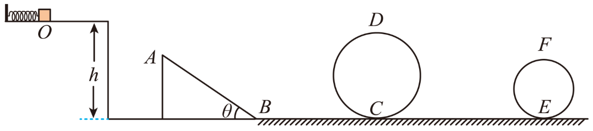

# Physics - 题目 320

**ID**: 7a399828664747c4a45560267aeb2b46
**年级**: Grade 10
**难度**: Medium-Hard
**题型**: Calculation

## 题目
如图所示，在距地面上方h的光滑水平台面上，质量为 $m=2{\rm{k}}{\rm{g}}$ 的物块左侧压缩一个轻质弹簧，弹簧与物块未拴接。​​​​​​​‌物块与左侧竖直墙壁用细线拴接，使物块静止在O点，水平台面右侧有一倾角为 $θ=37{}\degree $ 的光滑斜面，半径分别为 $R{{}_{1}}=0.5{\rm{m}}$ 和 $R{{}_{2}}=0.2{\rm{m}}$ 的两个光滑圆形轨道固定在粗糙的水平地面上，且两圆轨道分别与水平面相切于C、 $E$ 两点，两圆最高点分别为D、F，现剪断细线，弹簧恢复原长后与物块脱离，脱离时物块的速度 $v{{}_{0}}=8{\rm{m}}{\rm{/}}{\rm{s}}$ ，物块离开水平台面后恰好无碰撞地从A点落入光滑斜面上，运动至B点后（在B点无能量损失）沿粗糙的水平面从C点进入光滑竖直圆轨道且通过最高点D，已知物块与水平面间的动摩擦因数 $μ=0.1{\rm ，\mathit{AB}}$ 长度 $L{{}_{1}}=1{\rm{m}}{\rm ，\mathit{BC}}$ 距离 $L{{}_{2}}=1{\rm{m}}$ ， $g=1{{0}}{\rm{m}}{\rm{/}}{\rm{s}}{^{{{2}}}}$ ，已知：sin37°=0.6，cos37°=0.8。（1）求水平台面的高度h；（2）求物块经过D点时对圆轨道的压力；（3）为了让物块能从E点进入圆轨道且中途不脱离轨道，则C、 $E$ 间的距离应满足什么条件？

## 解答

1. （1）剪断细线，物块离开水平台面后恰好无碰撞地从A点落入光滑斜面上，
2. 则有 ${\tan}37{}\degree =\frac {v{{}_{Ay}}}{v{{}_{0}}}$ ，
3. 解得 $v{{}_{Ay}}=6{\rm{m}}{\rm{/}}{\rm{s}}$ ，
4. 则台面到A点的高度为 $h{{}_{1}}=\frac {v{{}_{Ay}^{2}}}{2g}=1.8{\rm{m}}$ ，
5. 水平台面的高度为 $h=h{{}_{1}}+L{{}_{1}}\sin 37{}\degree =2.4{\rm{m}}$ 。
6. （2）物块从离开水平台面到经过D点过程，根据动能定理可得 $mg(h-2R{{}_{1}})-{\rm μm}gL{{}_{2}}=\frac {1}{2}mv{{}_{D}^{2}}-\frac {1}{2}mv{{}_{0}^{2}}$ ，
7. 解得 $v{{}_{D}}=3\sqrt {10}{\rm{m}}{\rm{/}}{\rm{s}}$ ，
8. 物块经过D点时，根据牛顿第二定律可得 $mg+F{{}_{{\rm{N}}}}=m\frac {v{{}_{D}^{2}}}{R{{}_{1}}}$ ，
9. 解得 $F{{}_{{\rm{N}}}}=340{\rm{N}}$ ，
10. 根据牛顿第三定律可知，物块经过D点时对圆轨道的压力大小为340N，方向竖直向上。
11. （3）设物体刚好能到达E点，从D到E的过程，根据动能定理可得 $mg\cdot 2R{{}_{1}}-{\rm μm}gs{{}_{1}}=0-\frac {1}{2}mv{{}_{D}^{2}}$ ，
12. 解得 $s{{}_{1}}=55{\rm{m}}$ ，
13. 设物体经过E点后刚好到达圆心等高处，根据动能定理可得 $mg\cdot 2R{{}_{1}}-{\rm μm}gs{{}_{2}}-mgR{{}_{2}}=0-\frac {1}{2}mv{{}_{D}^{2}}$ ，
14. 解得 $s{{}_{2}}=53{\rm{m}}$ ，
15. 设物体经过E点后刚好经过最高点F，则有 $mg=m\frac {v{{}_{F}^{2}}}{R{{}_{2}}}$ ，
16. 根据动能定理可得 $mg\cdot 2R{{}_{1}}-{\rm μm}gs{{}_{3}}-mg\cdot 2R{{}_{2}}=\frac {1}{2}mv{{}_{F}^{2}}-\frac {1}{2}mv{{}_{D}^{2}}$ ，
17. 联立解得 $s{{}_{3}}=50{\rm{m}}$ ，
18. 为了让物块能从E点进入圆轨道且不脱离轨道，则C、E间的距离应满足 $0⩽x{{}_{CE}}<50{\rm{m}}$ 或 $53{\rm{m}}⩽x{{}_{CE}}<55{\rm{m}}$ 。

## 知识点

**中文**:
  - 应用动能定理求解多阶段、多过程问题

**English**:
  - Multi-stage/Multi-process Problems

---
