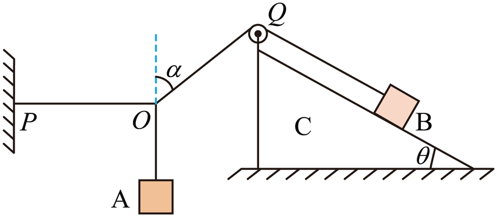

# Physics - 题目 2342

**ID**: 7a436467bd7242238153150fabde4ed3
**年级**: Grade 10
**难度**: Medium-Hard
**题型**: Calculation

## 题目
如图所示，倾角 $θ=30{}\degree $ 、质量 $m{{}_{{\rm{C}}}}=0.4{\rm{k}}{\rm{g}}$ 的斜面体C静置于水平桌面上，顶端固定有一轻质光滑定滑轮。​​​​​​​‌物块A悬于轻绳 $OP$ 、 $OQ$ 的结点 $O$ 处， $OP$ 段绳水平， $P$ 固定在墙上。 $OQ$ 段绳与竖直方向的夹角 $α=53{}\degree $ ，并绕过定滑轮与斜面体上质量 $m{{}_{{\rm{B}}}}=2{\rm{k}}{\rm{g}}$ 的物块B相连。B与C间的动摩擦因数 $μ{{}_{1}}=\frac {\sqrt {3}}{6}$ ， ${\rm{C}}$ 与地面间的动摩擦因数 $μ{{}_{2}}=\frac {1}{3}$ 。整个装置始终处于静止状态。已知最大静摩擦力等于滑动摩擦力， ${\rm{s}}{\rm{i}}{\rm{n}}53{}\degree =0.8$ ， ${\rm{c}}{\rm{o}}{\rm{s}}53{}\degree =0.6$ ， $g$ 取 $10{\rm{m}}/{\rm{s}}{^{2}}$ 。求：（1）A的质量取多大，可使B、C间的摩擦力恰好为零；（2）当A的质量 $m{{}_{{\rm{A}}}}=0.6{\rm{k}}{\rm{g}}$ 时，C受到地面的摩擦力的大小；（3）A的质量的取值范围。

## 解答

1. （1）设绳OQ的拉力为 $T$ ，对物块B分析有 $T=m{{}_{{\rm{B}}}}g\sin θ$
2. 解得 $T=10{\rm{N}}$
3. 对节点O分析，有 $T{\cos}α=m{{}_{{\rm{A}}}}g$
4. 解得 $m{{}_{{\rm{A}}}}=0.6{\rm{k}}{\rm{g}}$
5. （2）将ABC看作整体，受到绳OP的拉力，ABC整体的重力，地面对其的支持力，地面对C的摩擦力。
6. 装置处于静止状态，水平方向有 $T{{}_{OP}}=f{{}_{C}}$
7. 对节点O分析，有 $T{{}_{OP}}=m{{}_{{\rm{A}}}}g{\tan}α$
8. 解得 $f{{}_{C}}=8{\rm{N}}$
9. （3）假设C不滑动，当A的质量最大时，B受到的静摩擦力沿斜面向下且最大，对B分析，沿斜面方向有 $T{{}_{1}}=m{{}_{{\rm{B}}}}g\sin θ+μ{{}_{1}}m{{}_{{\rm{B}}}}g{\cos}θ$
10. 对结点O分析，竖直方向有 $T{{}_{1}}{\cos}α=m{{}_{{\rm{A}}{\rm \max }}}g$
11. 解得 $m{{}_{{\rm{A}}{\rm{m}}{\rm{a}}{\rm{x}}}}=0.9{\rm{k}}{\rm{g}}$
12. 当A的质量最小时，B受到的摩擦力沿斜面向上且达到最大，有 $T{{}_{2}}+μ{{}_{1}}m{{}_{{\rm{B}}}}g{\cos}θ=m{{}_{{\rm{B}}}}g\sin θ$
13. $T{{}_{2}}{\cos}α=m{{}_{{\rm{A}}{\rm \min }}}g$
14. 解得 $m{{}_{{\rm{A}}{\rm{m}}{\rm{i}}{\rm{n}}}}=0.3{\rm{k}}{\rm{g}}$
15. 将ABC看作整体，当C相对于地面刚要滑动时，设A的质量为 $m{{}_{{\rm{A}}{\rm{m}}{\rm{a}}{\rm{x}}}^{^{′}}}$ ，地面对C的最大摩擦力为 $f{{}_{{\rm{C}}}}=μ{{}_{2}}N=μ{{}_{2}}(m{{}_{{{}_{{\rm{A}}{\rm{m}}{\rm{a}}{\rm{x}}}}}^{^{′}}}+m{{}_{{\rm{C}}}}+m{{}_{{\rm{B}}}})g$
16. 要保持整个系统静止，则有 $T{{}_{OP}}⩽f{{}_{{\rm{C}}}}$
17. 对O有 $T{{}_{OP}}=m{{}_{{\rm{A}}{\rm{m}}{\rm{a}}{\rm{x}}}^{^{′}}}g{\tan}α$
18. 解得 $m{{}_{{\rm{A}}{\rm{m}}{\rm{a}}{\rm{x}}}^{^{′}}}=0.8{\rm{k}}{\rm{g}}$
19. 综上可知，保持整个系统始终静止，物块A的质量大小取值范围为 $0.3{\rm{k}}{\rm{g}}⩽m{{}_{{\rm{A}}}}⩽0.8{\rm{k}}{\rm{g}}$

## 知识点

**中文**:
  - 在共点力平衡中整体法与隔离法的应用

**English**:
  - Whole and Isolation Methods in Equilibrium

---
