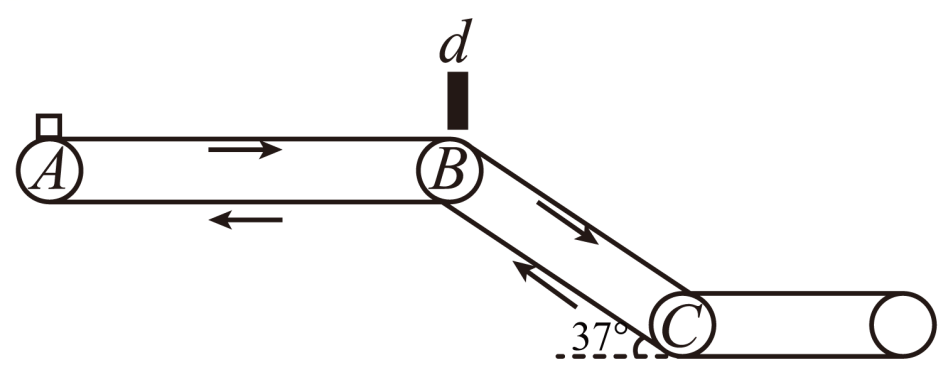

# Physics - 题目 2759

**ID**: 7aa35f455968403494edb9d1a9109601
**年级**: Grade 10
**难度**: Medium-Hard
**题型**: Calculation

## 题目
如图所示的装置是某工厂用于产品分拣的传送带示意图，产品（可以忽略其形状和大小）无初速地放上水平传送带AB的最左端，当产品运动到水平传送带最右端时被挡板d挡住，分拣员在此鉴定产品质量，不合格的被取走，合格品被无初速地放在斜向传送带BC的顶端，滑至底端的传送带后再进行包装等工序．已知传送带AB、BC与产品间的动摩擦因数μ=0.​​​​​​​‌25，均以v=4m/s的速度按图示方向匀速转动，水平传送带AB长L_{1}=12m，斜向传送带BC长L_{2}=1.88m，倾角α=37°（sin37°=0.6，cos37°=0.8，g=10m/s^{2}），求：（1）产品刚放上水平传送带AB时，产品加速度的大小和方向；（2）产品在水平传送带AB上运动的时间；（3）产品在斜向传送带BC上运动的时间．

## 解答

1. (1)产品刚放上水平传送带AB时，水平方向受到向右的滑动摩擦力，
2. 由牛顿第二定律得：μmg=ma
3. 得加速度大小为 ：
4. a=2.5m/s^{2}，方向水平向右
5. (2)产品加速到速度传送带相同所用时间为： $t{{}_{1}}=\frac {v}{a}=1.6{\rm{s}}$
6. 匀加速的位移：
7. $S{{}_{1}}=\frac {1}{2}at{{}_{1}}{^{2}}=3.2{\rm{m}}$
8. 则匀速运动的时间：
9. $t{{}_{2}}=\frac {Δx}{a}=\frac {12-3.2}{v}=2.2{\rm{s}}$
10. 得产品在水平传送带AB上运动的时间为：
11. t=t_{1}+t_{2}=3.8s
12. (3)第一段物体向下做匀加速直线运动，则有：mgsinθ+μmgcosθ=ma_{1}
13. 则得加速度为：
14. a_{1}=8m/s^{2}
15. 匀加速运动的时间：
16. $t{{}_{1}}=\frac {v{{}_{0}}}{a{{}_{1}}}=0.5{\rm{s}}$
17. 位移为：
18. $S{{}_{1}}=\frac {1}{2}a{{}_{1}}t{{}_{1}^{2}}=1{\rm{m}}$
19. 第二阶段，由于mgsin37°＞μmgcos37°，故物体继续向下做匀加速直线运动．
20. 则得：mgsinθ-μmgcosθ=ma_{2}
21. 加速度为
22. a_{2}＝4m/s^{2}
23. 第二段运动时间： $0.84=v{{}_{0}}t{{}_{2}}+\frac {1}{2}a{{}_{2}}t{{}_{2}^{2}}$
24. 解得：
25. t_{2}=0.2s
26. 可得产品在斜向传送带BC上运动的时间为：
27. t=t_{1}+t_{2}=0.7s

## 知识点

**中文**:
  - 传送带模型
  - 运动过程分析、多过程问题

**English**:
  - Conveyor Belt Model
  - Analysis of Motion Process and Multi-process Problems

---
