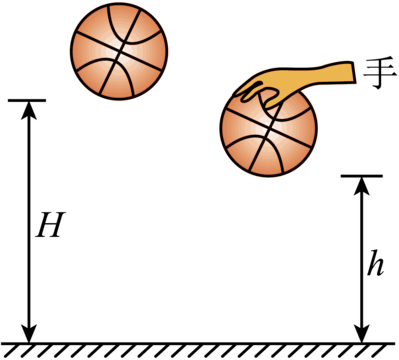

# Physics - 题目 1038

**ID**: 7b79c7aa98954259bb7211bbcc6fbde7
**年级**: Grade 10
**难度**: Medium-Hard
**题型**: Calculation

## 题目
如图所示，质量为 $m$ 的篮球从离地 $H$ 高度处由静止下落，与地面发生第一次碰撞后反弹至离地 $h$ 的最高处。​​​​​​​‌设篮球在运动过程中所受空气阻力的大小是篮球所受重力的 $λ$ 倍（ $λ$ 为常数且 $0<λ<\frac {H-h}{H+h}$ ），且篮球每次与地面碰撞的碰后速度大小与碰前速度大小的比值 $k$ 均相同，整个过程中篮球没有旋转，重力加速度大小为 $g$ 。(1)求篮球下落过程的加速度大小 $a{{}_{下}}$ 和篮球上升过程的加速度大小 $a{{}_{上}}$ ；(2)求比值 $k$ ；(3)篮球从 $H$ 高度处由静止下落后，每次反弹至最高点时，运动员拍击一次篮球（拍击时间极短，在这极短时间内篮球产生的位移可忽略不计），若篮球每一次被拍击后的瞬间都获得一个竖直向下、大小相等的速度 $v$ ，求 $N$ 次拍击后篮球能反弹的高度 $h{{}_{N}}$ 。

## 解答

1. （1）篮球下降过程中有
2. $mg-λmg=ma{{}_{下}}$
3. 解得
4. $a{{}_{下}}=g-λg$
5. 篮球上升过程中有
6. $mg+λmg=ma{{}_{上}}$
7. 解得
8. $a{{}_{上}}=g+λg$
9. （2）篮球下降过程中有
10. $v{{}_{下}}=\sqrt {2a{{}_{下}}H}$
11. 篮球上升过程中有
12. $v{{}_{上}}=\sqrt {2a{{}_{上}}{\rm{h}}}$
13. $k=\frac {v{{}_{上}}}{v{{}_{下}}}$
14. 解得
15. $k=\sqrt {\frac {h(1+λ)}{H(1-λ)}}$
16. （3）由（1）问可知篮球上升和下降过程中的加速度分别为
17. $a{{}_{下}}=\left ({1-λ}\right )g$ （方向向下）
18. $a{{}_{上}}=\left ({1+λ}\right )g$ （方向向下）
19. 由题知运动员拍击一次篮球（拍击时间极短），瞬间给其一个竖直向下的速度v。
20. 拍击第1次下降过程有
21. $v{{}_{1}^{2}}-v{^{2}}=2\left ({1-λ}\right )gh$
22. 上升过程有
23. ${\left({kv{{}_{1}}}\right)^{2}}=2\left ({1+λ}\right )gh{{}_{1}}$
24. 代入k后，下降过程有
25. $v{{}_{1}^{2}}-v{^{2}}=2\left ({1-λ}\right )gh$
26. 上升过程有
27. $hv{{}_{1}^{2}}=2\left ({1-λ}\right )gHh{{}_{1}}$
28. 联立有
29. $h{{}_{1}}=\frac {h}{H}(h+\frac {v{^{2}}}{2g(1-λ)})=(\frac {h}{H}){^{1}}\cdot h+(\frac {h}{H}){^{1}}\cdot \frac {v{^{2}}}{2g(1-λ)}$
30. 拍击第2次，同理代入k后，下降过程有
31. $v{{}_{2}^{2}}-v{^{2}}=2\left ({1-λ}\right )gh{{}_{1}}$
32. 上升过程有
33. $hv{{}_{2}^{2}}=2\left ({1-λ}\right )gHh{{}_{2}}$
34. 联立有
35. $h{{}_{2}}=\frac {h}{H}(h{{}_{1}}+\frac {v{^{2}}}{2g(1-λ)})$
36. 再将h_{1}代入h_{2}有
37. $h{{}_{2}}=(\frac {h}{H}){^{2}}\cdot h+(\frac {h}{H}){^{2}}\cdot \frac {v{^{2}}}{2g(1-λ)}+(\frac {h}{H}){^{1}}\cdot \frac {v{^{2}}}{2g(1-λ)}$
38. 拍击第3次，同理代入k后，下降过程有
39. $v{{}_{3}^{2}}-v{^{2}}=2\left ({1-λ}\right )gh{{}_{2}}$
40. 上升过程有
41. $hv{{}_{3}^{2}}=2\left ({1-λ}\right )gHh{{}_{3}}$
42. 联立有
43. $h{{}_{3}}=\frac {h}{H}(h{{}_{2}}+\frac {v{^{2}}}{(1-λ)2g})$
44. 再将h_{2}代入h_{3}有
45. $h{{}_{3}}=(\frac {h}{H}){^{3}}\cdot h+(\frac {h}{H}){^{3}}\cdot \frac {v{^{2}}}{2g(1-λ)}+(\frac {h}{H}){^{2}}\cdot \frac {v{^{2}}}{2g(1-λ)}+(\frac {h}{H}){^{1}}\cdot \frac {v{^{2}}}{2g(1-λ)}$
46. 直到拍击第N次，同理代入k后，下降过程有
47. $v{{}_{N}^{2}}-v{^{2}}=2\left ({1-λ}\right )gh{{}_{N-}}{{}_{1}}$
48. 上升过程有
49. $hv{{}_{N}^{2}}=2\left ({1-λ}\right )gHh{{}_{N}}$
50. 联立有
51. $h{{}_{N}}=\frac {h}{H}(h{{}_{N-1}}+\frac {v{^{2}}}{2g(1-λ)})$
52. 将hN-1代入hN有
53. $h{{}_{N}}=(\frac {h}{H}){^{N}}\cdot h+(\frac {h}{H}){^{N}}\cdot \frac {v{^{2}}}{2g(1-λ)}+(\frac {h}{H}){^{N-1}}\cdot \frac {v{^{2}}}{2g(1-λ)}+…+(\frac {h}{H}){^{1}}\cdot \frac {v{^{2}}}{2g(1-λ)}$
54. 整理得
55. $h{{}_{{\rm{N}}}}=(\frac {h}{H}){^{N}}\cdot h+[\frac {(\frac {h}{H}){^{N+1}}-\frac {h}{H}}{\frac {h}{H}-1}]\frac {v{^{2}}}{2g(1-λ)}$

## 知识点

**中文**:
  - 竖直上抛运动及其应用
  - 自由落体运动规律的应用

**English**:
  - Vertical Throw Motion and Applications
  - Applications of Free Fall Laws

---
