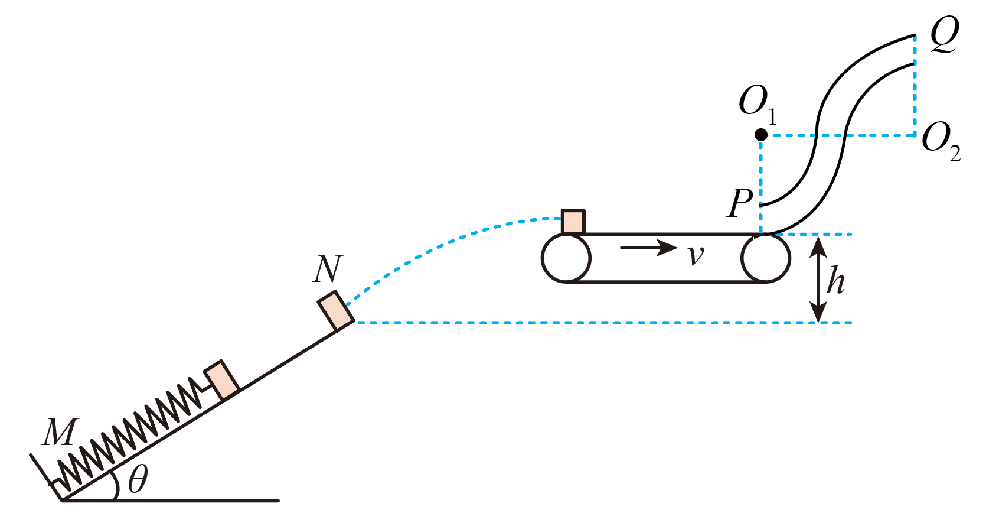

# Physics - 题目 587

**ID**: 7c04756af29e4e35bd37c9f9c263adcf
**年级**: Grade 10
**难度**: Medium-Hard
**题型**: Calculation

## 题目
如图所示，一轻弹簧的一端固定在倾角为 $θ=45{}\degree $ 的光滑斜面底端 $M$ 处，另一端放置一可视为质点的滑块，滑块的质量 $m=2{\rm{k}}{\rm{g}}$ ，滑块与弹簧不连接。​​​​​​​‌在外力作用下将滑块沿斜面向下缓慢推到某一位置时，再撤去外力，滑块从静止开始沿斜面运动到顶端 $N$ 点后离开斜面，恰好水平飞上顺时针匀速运行的水平传送带。已知滑块离开斜面时弹簧已恢复原长，滑块沿斜面向上运动的距离 $l{{}_{0}}=1{\rm{m}}$ ，传送带上表面距 $N$ 点的竖直高度 $h=0.1{\rm{m}}$ ，滑块与传送带间的动摩擦因数 $μ=0.2$ ，传送带的长度为 $l=2{\rm{m}}$ ，重力加速度 $g=10{\rm{m}}{\rm{/}}{\rm{s}}{^{2}}$ 。求：（1）滑块飞上传送带时的速度大小，及弹簧初始时储存的弹性势能；（2）若传送带的速度为 $v{{}_{1}}=4{\rm{m}}{\rm{/}}{\rm{s}}$ ，求滑块第一次滑到传送带右端时，传送带多消耗的电能；（3）传送带右端竖直固定两个半径为 $R=0.1{\rm{m}}$ 的光滑半圆弧轨道，且轨道下端恰好与传送带相切，若使滑块不能离开传送带和圆弧构成的轨道，传送带的速度大小应满足什么条件。

## 解答

1. （1）设飞上传送带后速度为 $v{{}_{0}}$ ，滑块从N飞上传送带过程，逆向思维法，可知在N点时竖直方向速度 $v{{}_{y}^{2}}=2gh$
2. 因为 $v{{}_{y}}=v{{}_{0}}{\rm{t}}{\rm{a}}{\rm{n}}θ$
3. 能量守恒有 $E{{}_{{\rm{p}}}}=mg\left ({l{{}_{0}}\sin θ+h}\right )+\frac {1}{2}mv{{}_{0}^{2}}$
4. 联立解得 $v{{}_{0}}=\sqrt {2}{\rm{m}}{\rm{/}}{\rm{s}}$  $E{{}_{{\rm{p}}}}=\left ({4+10\sqrt {2}}\right ){\rm{J}}$
5. （2）滑块飞上传送带后 ${\rm μm}g=ma$
6. 假设全程加速 $v{{}_{P}^{2}}-v{{}_{0}^{2}}=2al$
7. 解得 $v{{}_{P}}=\sqrt {10}{\rm{m}}/{\rm{s}}<4{\rm{m}}/{\rm{s}}$
8. 可知假设成立，则传送带多消耗的电能 $E{{}_{多}}={\rm μm}g\left ({v{{}_{1}}t-l}\right )+\frac {1}{2}mv{{}_{P}^{2}}-\frac {1}{2}mv{{}_{0}^{2}}$
9. 因为 $v{{}_{P}}-v{{}_{0}}=at$
10. 联立解得 $E{{}_{多}}=8\left ({\sqrt {10}-\sqrt {2}}\right ){\rm{J}}$
11. （3）若滑块恰好能到达圆弧最高点时，在最高点速度为零，从最低点到最高点，由动能定理有 $-2mgR=-\frac {1}{2}mv{{}_{2}^{2}}$
12. 代入数据，解得 $v{{}_{2}}=2{\rm{m}}/{\rm{s}}$
13. 滑块以 $v{{}_{2}}=2{\rm{m}}/{\rm{s}}$ 的速度向左返回传送带时向左的最远位移 $x=\frac {v{{}_{2}^{2}}}{2a}$
14. 联立解得 $x={{1}}{\rm{m}}{\rm{<}}l$
15. 可知滑块不会离开传送带，传送带速度应满足 $0<v<2{\rm{m}}/{\rm{s}}$ 。

## 知识点

**中文**:
  - 传送带模型中的能量守恒问题
  - 应用动能定理求解多阶段、多过程问题

**English**:
  - Energy Conservation in Conveyor Belt Models
  - Multi-stage/Multi-process Problems

---
