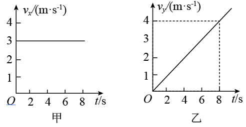

# Physics - 题目 1222

**ID**: 7c4f837667254640b94368f503289164
**年级**: Grade 10
**难度**: Medium-Hard
**题型**: Calculation

## 题目
质量 $m=2{\rm{k}}{\rm{g}}$ 的物体在光滑水平面上运动，其在相互垂直的x方向和y方向的分速度 $v{{}_{x}}$ 和 $v{{}_{y}}$ 随时间变化的图像如图甲、乙所示，求：（1）物体所受的合力大小；（2）物体的初速度大小；（3）0~4s内物体的位移大小；（4） $t{{}_{2}}=8{\rm{s}}$ 时物体的速度大小；（5）物体运动的轨迹表达式。​​​​​​​‌

## 解答

1. （1）物体在x方向的加速度大小
2. $a{{}_{x}}=0$
3. 在y方向的加速度大小
4. $a{{}_{y}}=\frac {Δv{{}_{y}}}{Δt}=0.5{\rm{m}}/{\rm{s}}{^{2}}$
5. 故合加速度为
6. $a=a{{}_{y}}=0.5{\rm{m}}/{\rm{s}}{^{2}}$
7. 根据牛顿第二定律得
8. $F{{}_{合}}=ma=1{\rm{N}}$
9. （2）由题图可知 $v{{}_{x0}}=3{\rm{m}}/{\rm{s}}$ ， $v{{}_{y0}}=0$ ，所以物体的初速度大小为
10. $v{{}_{0}}=v{{}_{x0}}=3{\rm{m}}/{\rm{s}}$
11. （3）0~4s内物体在x、y方向上位移分别为
12. $x{{}_{1}}=v{{}_{x0}}t{{}_{1}}=12{\rm{m}}$ ， $y{{}_{1}}=\frac {1}{2}a{{}_{y}}t{{}_{1}^{2}}=4{\rm{m}}$
13. 所以0~4s内物体的位移
14. $s{{}_{1}}=\sqrt {x{{}_{1}^{2}}+y{{}_{1}^{2}}}=4\sqrt {10}{\rm{m}}$
15. （4） $t{{}_{2}}=8{\rm{s}}$ 时，物体在x、y方向上位移速度分别为
16. $v{{}_{x2}}=v{{}_{x0}}=3{\rm{m}}/{\rm{s}}$ ， $v{{}_{y2}}=a{{}_{y}}t{{}_{2}}=4{\rm{m}}/{\rm{s}}$
17. 所以此时物体的速度大小为
18. $v{{}_{2}}=\sqrt {v{{}_{x2}^{2}}+v{{}_{y2}^{2}}}=5{\rm{m}}/{\rm{s}}$
19. （5）由 $x=v{{}_{x}}t$ ， $y=\frac {1}{2}a{{}_{y}}t{^{2}}$ ， $v{{}_{x}}=3{\rm{m}}/{\rm{s}}$ ， $a{{}_{y}}=0.5{\rm{m}}/{\rm{s}}{^{2}}$ ，联立可得
20. $y=\frac {x{^{2}}}{36}({\rm{m}})$

## 知识点

**中文**:
  - 合运动的性质与轨迹的判断
  - 运动的合成与分解

**English**:
  - Determining Nature and Trajectory of Resultant Motion
  - Composition and Resolution of Motion

---
