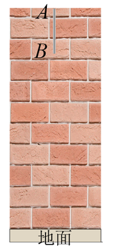
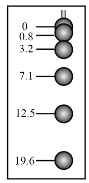

# Physics - 题目 2155

**ID**: 81c32b7f4a0145339f25be7d17638b89
**年级**: Grade 10
**难度**: Medium-Hard
**题型**: Calculation

## 题目
（1）有一种照相机，其光圈（进光孔径）随被拍摄物体的亮度自动调节，而快门（曝光时间）固定不变。​​​​​​​‌此相机拍摄的石子从砖墙前的某一高度处自由落下的照片，如图所示。由于石子的运动，它在照片上留下了一条模糊的径迹AB，已知石子从地面以上4.1m的高度下落，每块砖的平均厚度为6.0cm，求：①石子开始下落点离B点的高度；②石子经过B时的瞬时速度大小；③这张照片的曝光时间约为多少？（结果均保留2位有效数字）（2）频闪摄影也是研究变速运动常用的实验手段。在暗室中，照相机的快门处于常开状态，频闪仪每隔0.04s发出一次短暂的强烈闪光，照亮运动的物体，于是胶片上记录了物体在几个闪光时刻的位置，如图所示为小球自由下落的频闪照片示意图，照片中的数字是小球落下的距离，单位是厘米。①判断小球运动是否为匀变速运动，并写出理由；②如果要通过这幅照片测量自由落体运动的加速度，可以采用哪几种方法？要求至少写出2种测量方法并求出相应的g值。（结果保留3位有效数字）

## 解答

1. （1）①由图可知，B点到地面的距离为 $h{{}_{1}}=8d+0.5d=8.5\times 6.0\times 10{^{-2}}{\rm{m}}=0.51{\rm{m}}$
2. 所以石子开始下落点离B点的高度为 $h{{}_{2}}=h-h{{}_{1}}=4.1-0.51{\rm{m}}\approx 3.6{\rm{m}}$
3. ②根据速度位移关系可得 $v{{}_{B}^{2}}=2gh{{}_{2}}$
4. 解得石子经过B时的瞬时速度大小为 $v{{}_{B}}=8.4{\rm{m}}{\rm{/}}{\rm{s}}$
5. ③石子开始下落点离A点的高度为 $h{{}_{3}}=h{{}_{2}}-2d=3.47{\rm{m}}$
6. 根据速度位移关系可得 $v{{}_{A}^{2}}=2gh{{}_{3}}$
7. 解得石子经过A时的瞬时速度大小为 $v{{}_{A}}=8.2{\rm{m}}{\rm{/}}{\rm{s}}$
8. 根据平均速度关系可得 $2d=\frac {v{{}_{A}}+v{{}_{B}}}{2}T$
9. 解得 $T=0.014{\rm{s}}$
10. （2）①小球下落过程中在连续相等时间间隔内的位移差为 $Δx{{}_{1}}=(x{{}_{2}}-x{{}_{1}})-x{{}_{1}}=(3.2-0.8)-0.8{\rm{c}}{\rm{m}}=1.{{6}}{\rm{c}}{\rm{m}}$ ， $Δx{{}_{2}}=(x{{}_{3}}-x{{}_{2}})-(x{{}_{2}}-x{{}_{1}})=(7.1-3.2)-(3.2-0.8){\rm{c}}{\rm{m}}=1.{{5}}{\rm{c}}{\rm{m}}$ ， $Δx{{}_{3}}=(x{{}_{4}}-x{{}_{3}})-(x{{}_{3}}-x{{}_{2}})=(12.5-7.1)-(7.1-3.2){\rm{c}}{\rm{m}}=1.{{5}}{\rm{c}}{\rm{m}}$ ， $Δx{{}_{4}}=(x{{}_{5}}-x{{}_{4}})-(x{{}_{4}}-x{{}_{3}})=(19.6-12.5)-(12.5-7.1){\rm{c}}{\rm{m}}=1.{{7}}{\rm{c}}{\rm{m}}$
11. 由此可知，在误差允许的范围内位移差相等，小球下落过程中加速度不变，所以小球运动为匀变速运动；
12. ②方法1：根据自由落体运动规律可得 $x{{}_{5}}=\frac {1}{2}g(5T){^{2}}$
13. 代入数据解得 $g=9.80{\rm{m}}{\rm{/}}{\rm{s}}{^{{{2}}}}$
14. 方法2：根据逐差法可得 $g=\frac {(x{{}_{5}}-x{{}_{3}})-(x{{}_{3}}-x{{}_{1}})}{(2T){^{2}}}=\frac {[(19.6-7.1)-(7.1-0.8)]\times 10{^{-2}}}{(2\times 0.04){^{2}}}{\rm{m}}{\rm{/}}{\rm{s}}{^{2}}=9.69{\rm{m}}{\rm{/}}{\rm{s}}{^{2}}$

## 知识点

**中文**:
  - 自由落体相关实验
  - 自由落体运动规律的应用

**English**:
  - Experiments Related to Free Fall
  - Applications of Free Fall Laws

---
