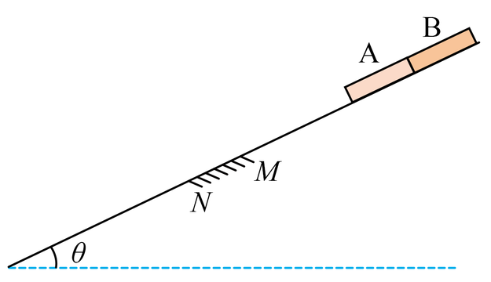

# Physics - 题目 2650

**ID**: 8292ef97917c4b6391759717dda8724b
**年级**: Grade 10
**难度**: Medium-Hard
**题型**: Calculation

## 题目
如图所示，足够长的斜面倾角为θ，MN段粗糙，其余部分光滑，完全相同的均匀木板A、B紧靠着放在斜面上。​​​​​​​‌已知A、B的质量均为m，长度均为l，与MN间的动摩擦因数μ=2tanθ，MN长为l，A的下端到M点的距离为2l，重力加速度为g。现将A、B同时由静止释放，求：（1）A的下端滑至M点时，A、B的速度大小v；（2）A刚好全部滑入MN时，A、B间的弹力大小F；（3）B刚好全部滑出MN时，重力对B做功的功率P。

## 解答

1. （1）A、B由相对静止一起下滑，从A的下端滑至M点的过程，对A、B整体，根据动能定理得 $2mg\sin θ\times 2l=\frac {1}{2}\times 2mv{^{2}}-0$ ，解得 $v=2\sqrt {gl\sin θ}$ 。
2. （2）A刚好全部滑入MN时，对A、B整体，根据牛顿第二定律得 $2mg\sin θ-{\rm μm}g{\cos}θ=2ma$ ，解得 $a=0$ ，此时对木板B，根据牛顿第二定律得 $mg\sin θ-F=ma$ ，解得 $F=mg\sin θ$ 。
3. （3）由于A、B在MN段受到的滑动摩擦力与它们处于MN段中的长度成正比，所以当A的上半部与B的下半部分处于MN段（即A、B的接触位置在MN的中点）时，A、B受到的滑动摩擦力相等，此后A受到的滑动摩擦力变小，B受到的滑动摩擦力变大，A、B分离，设A、B恰好分离时的速度大小为v_{1}。A的下端滑至M点到其全部滑入MN的过程，克服滑动摩擦力做功为 $W{{}_{1}}=\frac {1}{2}{\rm μm}g{\cos}θ\times l{\rm ，A}$ 全部滑入MN到A、B的接触位置在MN的中点的过程，克服滑动摩擦力做功为 $W{{}_{2}}={\rm μm}g{\cos}θ\times \frac {1}{2}l{\rm ，A}$ 的下端滑至M点到A、B的接触位置在MN的中点的过程，对A、B整体，根据动能定理得 $2mg\sin θ\times \left ({l+\frac {1}{2}l}\right )-W{{}_{1}}-W{{}_{2}}=\frac {1}{2}\times 2mv{{}_{1}^{2}}-\frac {1}{2}\times 2mv{^{2}}$ ，解得 $v{{}_{1}}=\sqrt {5gl\sin θ}{\rm B}$ 分离后到B刚好全部滑出MN的过程，B克服滑动摩擦力做功 $W{{}_{3}}=\frac {1}{2}\times \left ({\frac {1}{2}{\rm μm}g{\cos}θ+{\rm μm}g{\cos}θ}\right )\times \frac {1}{2}l+\frac {1}{2}{\rm μm}g{\cos}θ\times l=\frac {7}{4}mgl\sin θ$ ，设B刚好全部滑出MN时的速度大小为v_{2}，对B由A、B分离后到刚好全部滑出MN的过程，根据动能定理得 $mg\sin θ\times \left ({\frac {1}{2}l+l}\right )-W{{}_{3}}=\frac {1}{2}mv{{}_{2}^{2}}-\frac {1}{2}mv{{}_{1}^{2}}$ ，解得 $v{{}_{2}}=\frac {3}{2}\sqrt {2gl\sin θ}$
4. 可得B刚好全部滑出MN时，重力对B做功的功率为 $P=mg\sin θ\times v{{}_{2}}=\frac {3}{2}\sqrt {2gl\sin θ}mg\sin θ$ 。

## 知识点

**中文**:
  - 板块模型中的能量守恒问题

**English**:
  - Energy Conservation in Plate Models

---
