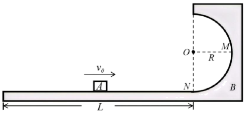

# Physics - 题目 734

**ID**: 847bcff1c3cc464481e821df7146a6df
**年级**: Grade 10
**难度**: Medium-Hard
**题型**: Calculation

## 题目
如图所示，有一右侧带半圆弧槽的木板B固定在水平地面上，圆弧槽内部光滑，半径 $R=0.4{\rm{m}}{\rm ，\mathit{N}}$ 为圆弧轨道最低点且与木板水平段右侧相连。​​​​​​​‌滑块A经过N点前后速度大小不变，M与半圆弧槽圆心O等高，木板水平段长 $L=2{\rm{m}}$ ，滑块A可视为质点，开始时静止放置在木板水平段的正中央。已知滑块A与水平段木板的动摩擦因数 $μ=0.5$ ，滑块A的质量 $m=1{\rm{k}}{\rm{g}}$ ，某一时刻给滑块A以水平向右的初速度 $v{{}_{0}}=\sqrt {42}{\rm{m}}{\rm{/}}{\rm{s}}$ ，重力加速度 $g=10{\rm{m}}{\rm{/}}{\rm{s}}{^{{{2}}}}$ ，求：（1）滑块A向右通过N点时的速度大小；（2）滑块A通过M点时对半圆弧槽的压力大小；（3）滑块A返回木板水平段（不考虑反弹及后续过程）的位置距出发点的水平距离d。

## 解答

1. （1）滑块A在木板水平段由动能定理 $-{\rm μm}g\frac {L}{2}=\frac {1}{2}mv{{}_{1}^{2}}-\frac {1}{2}mv{{}_{0}^{2}}$ ，
2. 解得 $v{{}_{1}}=4\sqrt {2}{\rm{m}}{\rm{/}}{\rm{s}}$ 。
3. （2）滑块A从N到M，由动能定理 $-mgR=\frac {1}{2}mv{{}_{M}^{2}}-\frac {1}{2}mv{{}_{N}^{2}}$ ，
4. 在M点由向心力 $N=m\frac {v{{}_{M}^{2}}}{R}$ ，
5. 联立解得 $N=60{\rm{N}}$ ，
6. 由牛顿第三定律，滑块A在M点对半圆弧槽的压力大小为60N。
7. （3）假设滑块A能到达半圆弧槽的最高点P，对NP段由机械能守恒 $-2mgR=\frac {1}{2}mv{{}_{P}^{2}}-\frac {1}{2}mv{{}_{N}^{2}}$ ，
8. 解得 $v{{}_{P}}=4{\rm{m}}{\rm{/}}{\rm{s}}>\sqrt {gR}$ ，
9. 滑块A能到达半圆弧槽的最高点P并从P点水平抛出后落回到水平面；滑块A从P点抛出后在竖直方向 $h=\frac {1}{2}gt{^{2}}$ ，
10. 解得 $t=0.4{\rm{s}}$ ，
11. 在水平方向 $x=v{{}_{0}}t=1.6{\rm{m}}$ ，
12. 故滑块A返回水平段瞬间的位置在初位置左边 $d=1.6-1=0.6{\rm{m}}$ 处。

## 知识点

**中文**:
  - 单一物体机械能守恒定律的应用
  - 竖直面内圆周运动问题
  - 应用动能定理求解多阶段、多过程问题

**English**:
  - Applications for Single Body
  - Circular Motion in Vertical Plane
  - Multi-stage/Multi-process Problems

---
