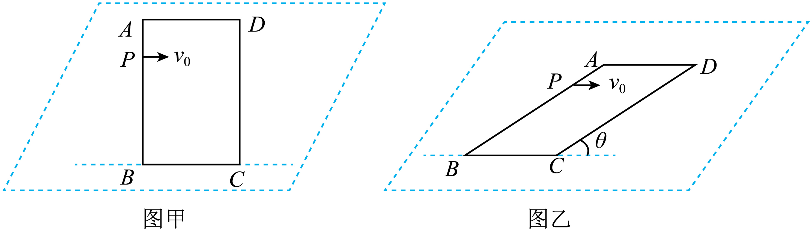

# Physics - 题目 691

**ID**: 85bdb73ce0644421b54ce32ba6ed4ce3
**年级**: Grade 10
**难度**: Medium-Hard
**题型**: Calculation

## 题目
如图甲所示，水平面上竖直固定一矩形光滑薄板 ${\rm ABCD，}AB$ 边长为 $4{\rm{m}}$ ， $BC$ 边长为 $2{\rm{m}}$ 。​​​​​​​‌AB边上有一点 $P$ ， $PB$ 长为 $3.2{\rm{m}}$ 。一可视为质点的小球由 $P$ 点以速度 $v{{}_{0}}=4{\rm{m}}/{\rm{s}}$ 沿平行于 $AD$ 的方向第一次水平抛出，最后落在水平面上的 $M$ 点。如图乙所示，将薄板以 $BC$ 边为轴旋转，与水平面夹角为 $θ=37{}\degree $ 时再次固定，将小球第二次从 $P$ 点以速度 $v{{}_{0}}=4{\rm{m}}/{\rm{s}}$ 沿平行于 $AD$ 的方向水平抛出，经过 $DC$ 边上的 $Q$ 点后，落在水平面上。重力加速度的大小取 $10{\rm{m}}/{\rm{s}}{^{2}}$ ，求：（1）小球第一次抛出后， $M$ 点到 $C$ 点的距离；（2）小球第二次抛出后，到达 $Q$ 点时的速度大小；（3）小球第二次抛出后，小球在 $Q$ 点的速度方向和竖直方向夹角的正切值（结果可用根式表示）。

## 解答

1. （1）小球第一次抛出后，在竖直面内做平抛运动，则有 $h{{}_{PB}}=\frac {1}{2}gt{^{2}}$ ， $x=v{{}_{0}}t$
2. 由题可知 $d{{}_{1}}=x-x{{}_{BC}}$
3. 联立解得 $d{{}_{1}}=1.2{\rm{m}}$
4. （2）小球第二次抛出后，在斜面上做类平抛运动，根据牛顿第二定律可得 $F{{}_{合}}=mg\sin θ=ma$
5. 由平抛运动的规律可得 $x{{}_{BC}}=v{{}_{0}}t\prime $ ， $v{{}_{x}}=v{{}_{0}}$ ， $v{{}_{y}}=at^{′}$
6. 根据运动的合成可得 $v{{}_{Q}}=\sqrt {v{{}_{x}}{^{2}}+v{{}_{y}}{^{2}}}$
7. 联立解得 $v{{}_{Q}}=5{\rm{m}}/{\rm{s}}$
8. （3）当小球到达 $Q$ 点时，速度可按照如图所示的方式分解
9. 
10. 则有 $v{{}_{y1}}=v{{}_{y}}{\cos}θ$ ， $v{{}_{y2}}=v{{}_{y}}\sin θ$ ， $v{{}_{Q1}}=\sqrt {v{{}_{y1}}{^{2}}+v{{}_{0}^{2}}}$
11. 由几何知识可得 ${\tan}α=\frac {v{{}_{Q1}}}{v{{}_{y2}}}$
12. 联立解得 ${\tan}α=\frac {4\sqrt {34}}{9}$

## 知识点

**中文**:
  - 求解平抛运动、类平抛运动问题

**English**:
  - Solving Horizontal and Quasi-Horizontal Projectile Problems

---
