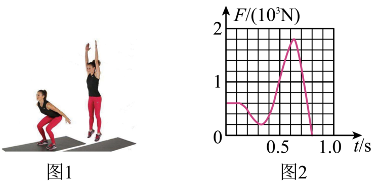
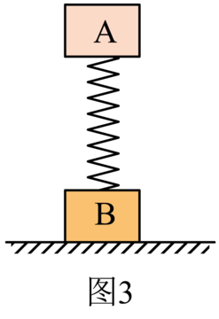

# Physics - 题目 2062

**ID**: 87bb7312f3ed47d9a5a6ab7875dc7315
**年级**: Grade 10
**难度**: Medium-Hard
**题型**: Calculation

## 题目
体育课上，直立起跳是一项常见的热身运动，运动员先蹲下，然后瞬间向上直立跳起，如图1所示。​​​​​​​‌（1）一位同学站在力传感器上做直立起跳，力传感器采集到的F-t图线如图2所示。根据图像求这位同学的质量，并用十字线“+”在图像上标出该同学超重的开始点和结束点。取重力加速度g= 10 m/s^{2}（2）为了进一步研究直立起跳过程，这位同学构建了如图3所示的简化模型。考虑到起跳过程中，身体各部分肌肉（包括上肢、腹部、腿部等肌肉）的作用，他把人体的上、下半身看作质量均为m的两部分A和B，这两部分用一个劲度系数为k的轻弹簧相连。起跳过程相当于压缩的弹簧被释放后使系统弹起的过程。已知弹簧的弹性势能 $E{{}_{{\rm{p}}}}$ 与其形变量 $Δx$ 的关系为 $E{{}_{{\rm{p}}}}=\frac {1}{2}kΔx{^{2}}$ 。要想人的双脚能够离地，即B能离地，起跳前弹簧的压缩量至少是多少？已知重力加速度为g。（3）“爆发力”是体育运动中对运动员身体水平评估的一项重要指标，人们通常用肌肉收缩产生的力与速度的乘积来衡量肌肉收缩的爆发能力，其最大值称之为“爆发力”。某同学想在家通过直立起跳评估自己的“爆发力”，为了简化问题研究，他把人离地前重心的运动看做匀加速直线运动，认为起跳时人对地面的平均蹬踏力大小等于肌肉的收缩力。他计划用体重计和米尺测量“爆发力”，具体做法是用体重计测量人的质量m；用米尺测量人蹲下时头顶到地面的高度h_{1}，人直立站起时头顶到地面的高度h_{2}；人由下蹲用尽全力直立起跳，其头顶距离地面的最大高度h_{3}。请利用这些物理量直接写出计算“爆发力”的公式（不要求计算过程）。

## 解答

1. （1）由图可知 $F=600{\rm{N}}$ 时人处于静止状态，有 $F=mg=600{\rm{N}}$ ，得 $m=60{\rm{k}}{\rm{g}}$
2. （2）设起跳前弹簧的最小压缩量为 $Δx{{}_{0}}$ ，当B将恰好离开地面时，B受到的弹簧弹力方向向上，大小 $F=mg$ ，且A的速度为0，有 $F=kΔx=mg$ ，此时弹簧处于拉伸状态，形变量 $Δx=\frac {mg}{k}$ ，起跳过程系统机械能守恒，有 $\frac {1}{2}kΔx{{}_{0}}{^{2}}-\frac {1}{2}kΔx{^{2}}=mg(Δx{{}_{0}}+Δx)$ ，解得 $Δx{{}_{0}}=3Δx=\frac {3mg}{k}$
3. （3）设人离地时的速度大小为v,人离地前重心做匀加速直线运动，有 $F-mg=ma$ ， $2aΔh{{}_{1}}=v{^{2}}$
4. 
5. 其中 ${\rm{Δ}}h{{}_{1}}=\frac {1}{2}\left ({h{{}_{2}}-h{{}_{1}}}\right )$ ，人离地后重心做竖直上抛运动，有 $2gΔh{{}_{2}}=v{^{2}}$ ，其中 $\mathrm{Δ}h{{}_{2}}=h{{}_{3}}\mathrm{-}h{{}_{2}}$ ，人的“爆发力” $P=Fv$ ，解得  $P=mg\left ({\frac {2h{{}_{3}}-h{{}_{1}}-h{{}_{2}}}{h{{}_{2}}-h{{}_{1}}}}\right )\sqrt {2g\left ({h{{}_{3}}-h{{}_{2}}}\right )}$

## 知识点

**中文**:
  - 弹簧问题中机械能守恒定律的应用

**English**:
  - Spring Problems

---
